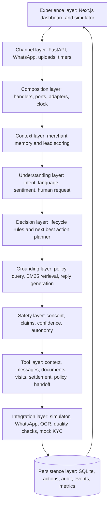

# Paytm Saathi

> **The autonomous AI teammate for merchant onboarding, activation, and
> support.**

Paytm Saathi helps field sales executives and support teams move synthetic
demo merchants through outreach, document collection, visit scheduling, device
activation, and service. It combines an agent loop with deterministic
lifecycle rules, typed tools, human approval, escalation, audit logging, and a
live operational dashboard.

This root README is the central project guide. For every Mermaid diagram,
see [Architecture diagrams](docs/ARCHITECTURE.md). For installation,
environment setup, startup, demo controls, and troubleshooting, see
[Setup and startup](docs/SETUP-AND-STARTUP.md).

> **Demo boundary:** this repository uses synthetic merchants, documents,
> messages, payments, and mock integrations. It is not connected to real
> Paytm systems.

## Product solution

Saathi is designed to own the operational journey from a lead to activation,
without replacing the human roles that require trust or judgement:

| Workflow stage | Saathi capability | Human control |
|---|---|---|
| Lead triage | Scores merchants and proposes the next action | FSE reviews priorities |
| Outreach | Simulator/WhatsApp messaging, language-aware replies, follow-ups | Human can take over |
| Documents | Upload checks, blur/readability/PAN/name pre-check, targeted re-request | Mock KYC remains separate from pre-check |
| Visits | Finds nearby verified leads and schedules clustered visits | FSE performs the visit |
| Activation | Sends nudges, tracks device events and transaction progress | Escalates idle or risky cases |
| Service | Grounds fee, settlement, and device answers in policy documents | Support handles complex disputes |

The agent never writes to SQLite directly. It proposes a structured action;
guardrails decide whether it is blocked, escalated, queued for approval, or
executed through a typed tool.

## Implemented features

### Agent and decisioning

- Context builder for merchant memory, lifecycle, documents, visits,
  transactions, tickets, messages, and previous actions.
- NLU for intent, language, and sentiment with model and fallback paths.
- Lifecycle-aware next-best-action planner.
- Weighted lead scoring using footfall, category, engagement,
  responsiveness, and proximity.
- BM25 policy retrieval over fee, settlement, KYC, device, and escalation
  documents.
- Structured handoff summaries with reason, history, objection, and next step.
- Timers for follow-up, document reminders, activation checks, and settlement
  re-checks.

### Safety and human-in-the-loop

- L1: suggestion only; L2: human approval; L3: bounded autonomous execution.
- Consent/opt-out, quiet-hour, rate-limit, retry, confidence, and
  unsupported-claim checks.
- Escalation for negative sentiment, human requests, sensitive topics, risky
  commitments, low confidence, and retry exhaustion.
- Approval queue supports approve, reject, and edit operations.
- Append-only audit records and override tracking.

### Channels and document processing

- Phone simulator channel that runs through the same agent path as external
  messages.
- WhatsApp webhook verification, HMAC signature validation, payload parsing,
  event deduplication, media handling, template/text routing, retries, and
  status reporting.
- Document upload MIME and size validation.
- Synthetic document quality checks for blur, readability, OCR/PAN extraction,
  and profile-name matching.
- Mock KYC submission after a document pre-check passes. This is not official
  KYC verification.

### Platform and operations

- FastAPI REST API with Swagger and generated OpenAPI.
- SQLite persistence with SQLAlchemy and separate agent/integration adapters.
- Async scheduler and controllable simulated clock.
- Server-Sent Events with polling fallback.
- Morning briefing, merchants, chat, documents, actions, handoffs, autonomy,
  scoreboard, simulation, audit, policies, batch, and demo-control APIs.
- Seed/reset controls, hero scenarios, device events, and deterministic
  Monte Carlo simulation.

## Frontend pages

The current Next.js application provides these product surfaces:

| Page/view | What it shows |
|---|---|
| Home | Product entry point and demo navigation |
| Dashboard | Briefing, feed, counts, and daily operating view |
| Merchants | Merchant/lead list with lifecycle and scoring |
| Merchant detail | Merchant 360 context, messages, actions, and scenario controls |
| Approvals | Pending actions and approve/reject/edit controls |
| Handoffs | Escalation queue and resolution workflow |
| Scoreboard | Funnel, outcome, and override metrics |
| Phone simulator | Merchant message interaction and agent responses |
| Demo controls | Reset, clock advancement, scenario and device simulation |

## Current layered architecture

The composition root is `server/main.py`. The frontend calls FastAPI; the
server wires the agent and integrations through ports; adapters connect those
areas to SQLite; events flow back to the browser through SSE or polling.

<!-- mermaid-checked: no \n, no em-dash/en-dash, no {} in labels, subgraphs are id["label"], arrows are -->|"label"|, all subgraphs closed by end, ids unique -->


The detailed agent loop, available tools, and RAG policy sources are shown in
[docs/ARCHITECTURE.md](docs/ARCHITECTURE.md).

## Agentic architecture and impact

Saathi uses the model only where language or prioritization is ambiguous.
Rules remain authoritative for lifecycle legality, score calculation,
consent, rate limits, quiet hours, policy thresholds, document quality, and
autonomy. This gives the application useful autonomy without making the model
an unrestricted database actor.

| Agentic capability | Measurable operational effect |
|---|---|
| Contextual next-best action | FSEs work from a ranked action queue rather than a raw lead list |
| Persistent follow-up timers | Fewer leads and document requests stall due to missed reminders |
| Grounded policy retrieval | Fewer unsupported fee, settlement, and device claims |
| Targeted document re-request | Merchants correct the specific quality problem instead of resubmitting everything |
| Activation monitoring | Idle installed devices are detected and nudged earlier |
| Warm handoffs | Support starts with context and a recommended next step |
| Autonomy ladder | Managers can increase automation gradually and safely |
| Audit and override loop | Decisions are reviewable and autonomy can be tuned from evidence |

## Success metrics

The live/demo scoreboard and simulation expose the following definitions:

| Metric | Definition |
|---|---|
| Contacted within one hour | Leads contacted in the first hour divided by all leads |
| Lead-to-onboarded conversion | Leads reaching installed divided by all leads |
| Activated within seven days | Installed devices reaching the activation threshold within seven days |
| Tier-1 resolution without human | Tier-1 tickets closed by the agent divided by all tier-1 tickets |
| FSE admin time | Share of FSE time spent on non-visit work |
| Cost per activated merchant | FSE and agent cost divided by activated merchants |
| Override rate | Human overrides divided by reviewed or overridden actions |
| Handoff resolution | Resolved handoffs divided by created handoffs |

`server.simulation` compares manual and Saathi-assisted workflows on synthetic
populations and reports confidence intervals. Its numbers are assumptions and
projections, not production Paytm results.

## Business impact

- **Merchant growth:** faster outreach and fewer stalled onboarding journeys.
- **FSE productivity:** less manual chasing and status lookup; more time for
  visits, negotiation, and relationship building.
- **Support efficiency:** common questions are answered with context, while
  complex cases arrive as prepared handoffs.
- **Risk control:** no autonomous discounts, refunds, loan decisions, or
  unsupported commitments.
- **Operational learning:** outcomes, overrides, and simulation results reveal
  where automation should be promoted or restricted.

## Technology stack

| Area | Current technology |
|---|---|
| Frontend | Next.js 16.4.3, React 19.3, TypeScript, Tailwind CSS 4 |
| API | Python, FastAPI, Uvicorn, Pydantic |
| Persistence | SQLite and SQLAlchemy 2 |
| Agent | Python ports, lifecycle state machine, structured planner and tools |
| LLM | Configurable OpenAI-compatible client; Gemini configuration supported by the simulator |
| Retrieval | BM25 policy search over Markdown documents |
| Documents | OpenCV headless, Pillow, pytesseract/Tesseract-compatible OCR, synthetic samples |
| Events | In-process event bus, Server-Sent Events, polling fallback |
| Scheduling | Async background scheduler with a demo clock |
| Testing | pytest, unit tests, API contract tests, integration tests, e2e scenarios |
| Tooling | Makefile, OpenAPI export, ownership/import-boundary checker |

## Repository map and boundaries

| Area | Location | Responsibility |
|---|---|---|
| Agent | `agent/` | Context, NLU, planner, guardrails, tools, policy, scoring |
| Integrations | `integrations/` | Simulator, WhatsApp, documents, OCR, mock KYC |
| Platform | `server/`, `e2e/`, `scripts/`, `docs/`, root files | Database, API, events, scheduler, simulation, wiring |
| Frontend | `frontend/` | Next.js product views and browser presentation |

`agent/` does not import server or integration internals. `integrations/`
uses the boundary types in `agent/ports.py`. `server/main.py` is the
composition root and owns dependency injection.

## Setup, startup, and dependencies

Follow [docs/SETUP-AND-STARTUP.md](docs/SETUP-AND-STARTUP.md) for the full
Windows workflow. The essential commands are:

```powershell
python --version
python -m venv .venv
.\.venv\Scripts\Activate.ps1
python -m pip install --upgrade pip
python -m pip install -e .
python -m pip install -r integrations\requirements.txt
Copy-Item .env.example .env
Copy-Item server\.env.example server\.env
Copy-Item agent\.env.example agent\.env
python -m server.db.seed
python -m uvicorn server.main:app --host 0.0.0.0 --port 8000 --reload
```

In another terminal:

```powershell
cd frontend
npm install
npm run dev
```

If `python` is not recognized, install Python 3.11+ with **Add python.exe to
PATH** enabled, restart the terminal, and repeat the commands. The `py`
launcher form works only when that optional launcher is installed.

## API and verification

The generated contract is in [`docs/openapi.json`](docs/openapi.json). Run:

```powershell
python -m pytest server/tests -v
python -m pytest agent/tests -v
python -m pytest integrations/tests -v
python -m pytest e2e -v
python scripts/check_ownership.py
python -m server.simulation.report
```

Useful URLs:

- API health: <http://localhost:8000/api/health>
- Swagger UI: <http://localhost:8000/docs>
- Frontend: <http://localhost:3000>

## Make targets

| Command | Purpose |
|---|---|
| `make setup` | Install the editable Python package and copy environment files |
| `make seed` | Build the seeded database and reset snapshot |
| `make dev` | Start FastAPI on port 8000 |
| `make test` | Run server unit tests |
| `make e2e` | Run end-to-end acceptance tests |
| `make sim` | Run the simulation report |
| `make check` | Verify ownership and import boundaries |
