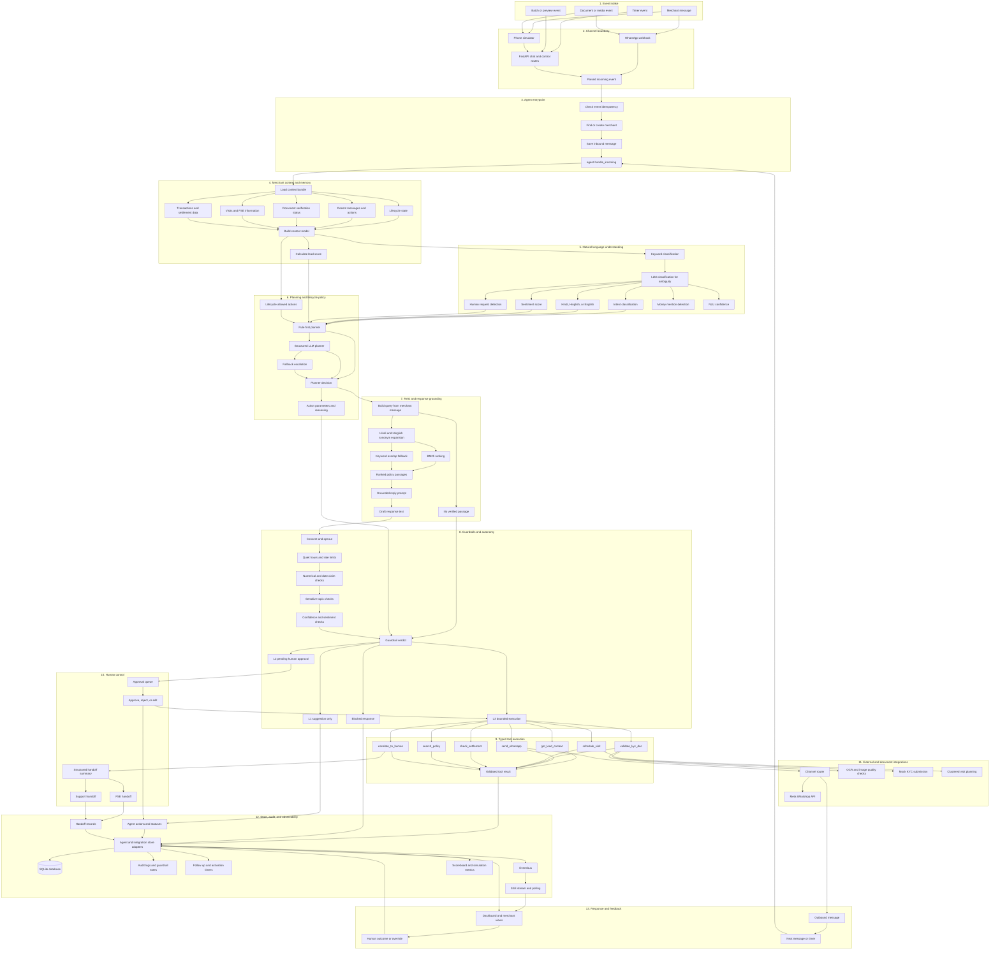

# Paytm Saathi agent architecture

This document is the detailed agentic architecture for the implemented Paytm
Saathi platform. It focuses on the agent loop rather than API endpoints:
understanding, context, planning, retrieval, guardrails, autonomy, tools,
handoffs, persistence, and channel responses.

## Complete top-to-bottom agent architecture

<!-- mermaid-checked: no \n, no em-dash/en-dash, no {} in labels, subgraphs are id["label"], arrows are -->|"label"|, all subgraphs closed by end, ids unique -->

## Intent inventory

| Intent | Description | Main route |
|---|---|---|
| `greeting` | Greeting or opening message | `ANSWER_QUERY` |
| `interest` | Product interest or more information | `ANSWER_QUERY` |
| `ask_fees` | Fees, rental, MDR, pricing, or charges | `ANSWER_QUERY` |
| `ask_documents` | Required documents or KYC requirements | `ANSWER_QUERY` |
| `send_document` | Merchant says a document was sent | Document validation |
| `agree_visit` | Merchant agrees to a visit | `SCHEDULE_VISIT` |
| `settlement_query` | Settlement status or missing payment | `EXPLAIN_SETTLEMENT` or escalation |
| `device_issue` | Soundbox, QR, battery, or network issue | Answer or escalation |
| `complaint` | Complaint, fraud, refund, chargeback, or legal concern | FSE or support escalation |
| `ask_discount` | Discount, waiver, or reduced fee request | `OFFER_DISCOUNT` |
| `ask_human` | Manager, FSE, or human request | Human escalation |
| `opt_out` | Stop or unsubscribe request | `WAIT` and pause outbound |
| `not_interested` | Declines the offer | `WAIT` or close suggestion |
| `other` | Unsupported or unmatched question | `ESCALATE` |

## Planner actions and autonomy

| Action | Purpose | Control |
|---|---|---|
| `SEND_INTRO` | Start outreach to a new lead | L3 when allowed |
| `ANSWER_QUERY` | Send a grounded policy answer | L3 when allowed |
| `REQUEST_DOCS` | Request PAN or address proof | L3 when allowed |
| `REREQUEST_DOC` | Request a corrected document | L3 when allowed |
| `SCHEDULE_VISIT` | Create an FSE visit slot | L3 when allowed |
| `SEND_ACTIVATION_NUDGE` | Nudge an inactive installed device | L3 when allowed |
| `EXPLAIN_SETTLEMENT` | Check and explain settlement data | L3 when data exists |
| `WAIT` | Pause or schedule a future follow-up | L3 when allowed |
| `ESCALATE` | Create a human handoff | Handoff action |
| `CLOSE_LEAD` | Suggest lead closure | L1 |
| `OFFER_DISCOUNT` | Propose discount without changing price | L2 |

## Typed tools

| Tool | Responsibility | Main output |
|---|---|---|
| `get_lead_context` | Load current merchant context | Context bundle |
| `send_whatsapp` | Send simulator or WhatsApp message | Send result |
| `validate_kyc_doc` | Run document quality and mock KYC checks | Validation result |
| `schedule_visit` | Plan clustered FSE visit | Visit and slot |
| `check_settlement` | Look up settlement record | Settlement result |
| `search_policy` | Retrieve ranked policy passages | Sources and scores |
| `escalate_to_human` | Create a human handoff | Handoff ID and summary |

## RAG policy documents

| File | Retrieved policy areas |
|---|---|
| [`fees.md`](../agent/policy/docs/fees.md) | Soundbox rental, UPI charges, card MDR, refunds, deposits, fee support |
| [`settlement.md`](../agent/policy/docs/settlement.md) | Settlement timing, holidays, delays, minimum amount, failed settlement, TDS |
| [`kyc_requirements.md`](../agent/policy/docs/kyc_requirements.md) | PAN, address proof, image quality, file limits, pre-check boundaries |
| [`device_faq.md`](../agent/policy/docs/device_faq.md) | Setup, payment announcements, connectivity, QR, battery, charging, maintenance |
| [`escalation_policy.md`](../agent/policy/docs/escalation_policy.md) | Hard blocks, escalation triggers, handoff targets, response expectations |

Retrieval splits Markdown sections into passages, expands Hindi and Hinglish
terms, ranks with BM25 when installed, and falls back to keyword overlap. If
no passage meets the configured threshold, the current implementation routes
the query to support escalation instead of presenting an unverified answer.

## Layer responsibility table

| Layer | Responsibility | Implementation |
|---|---|---|
| Intake | Receive messages, media, timers, and batch events | Simulator, WhatsApp, FastAPI |
| Entry | Enforce idempotency and invoke the agent loop | `agent/core/entrypoint.py` |
| Context | Build merchant memory and lead score | `context_builder.py`, `scoring.py` |
| NLU | Classify intent and language signals | `nlu.py` |
| Planning | Select a lifecycle-legal next action | `lifecycle.py`, `planner.py` |
| RAG | Retrieve policy and generate grounded replies | `policy/retrieval.py`, reply prompt |
| Safety | Check consent, claims, confidence, and risk | `guardrails.py` |
| Autonomy | Resolve L1, L2, or L3 execution | `autonomy.py` |
| Tools | Perform bounded operations | `agent/tools/impl.py` |
| Human control | Approval and structured handoffs | Approval routes and handoff tool |
| Persistence | Save state, actions, audit, timers, and events | Store adapters and SQLite |
| Response | Send messages and refresh operator views | Channel router, SSE, polling |
