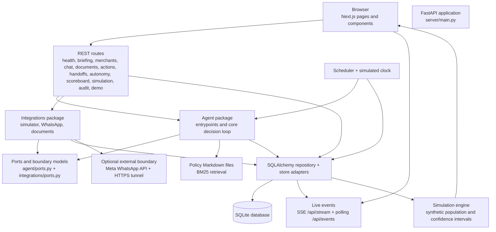
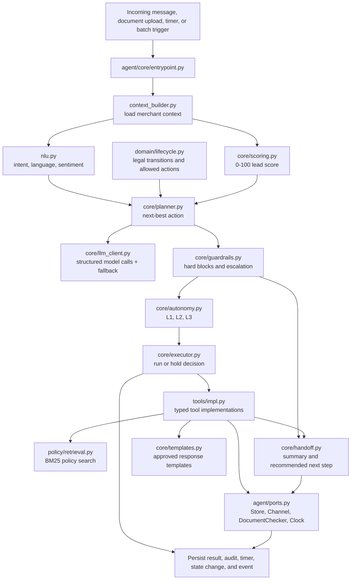
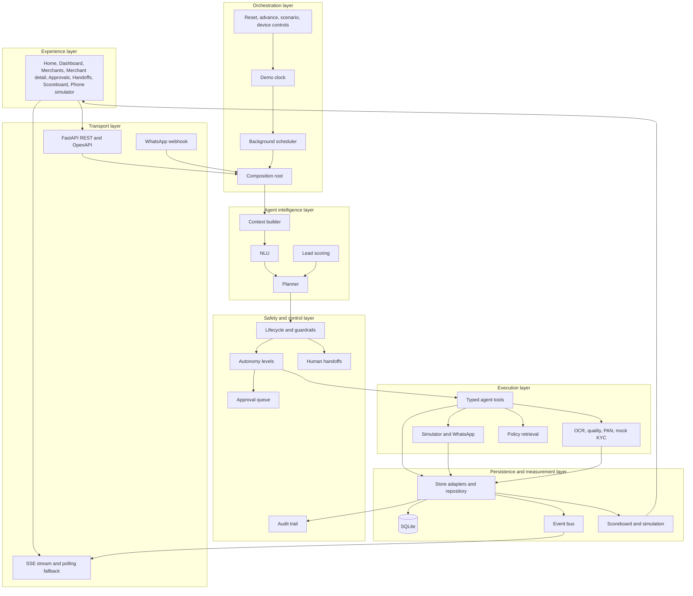
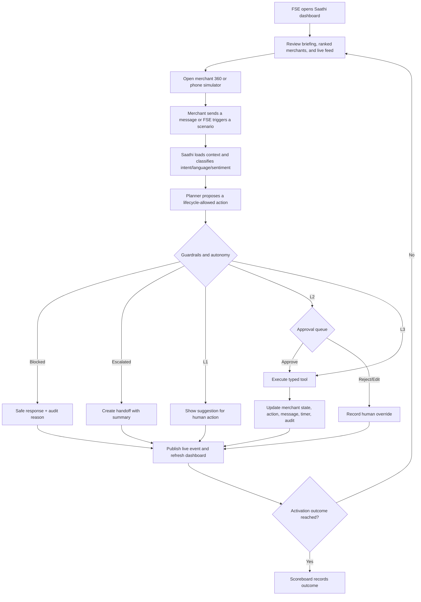
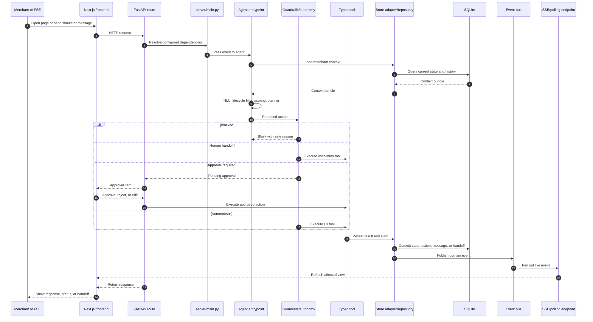
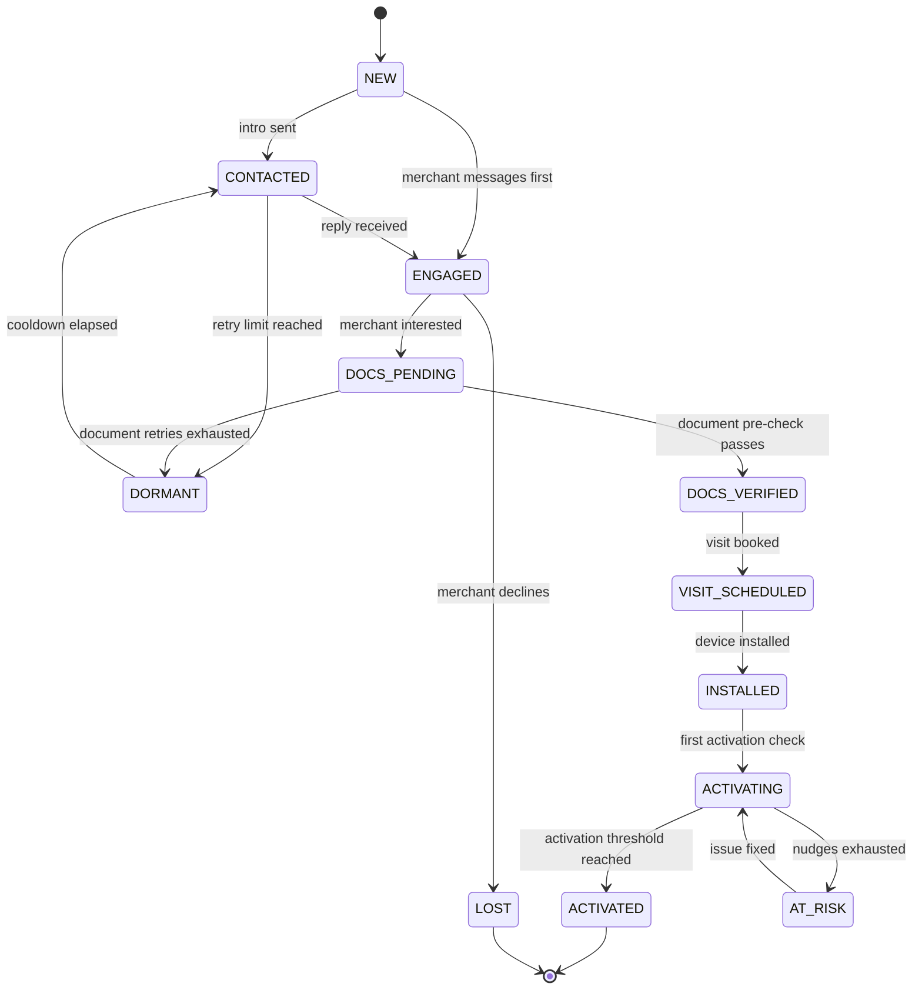

# Paytm Saathi architecture diagrams

This document is the Mermaid source for the implemented application. Diagrams
describe the current repository structure and runtime behavior; they are not
future-state specifications.

## 1. Full application architecture

## 2. Agent-specific detailed architecture

## 3. All project layers

## 4. End-to-end user flow

## 5. Runtime application flow

## 6. Lifecycle and activation flow

