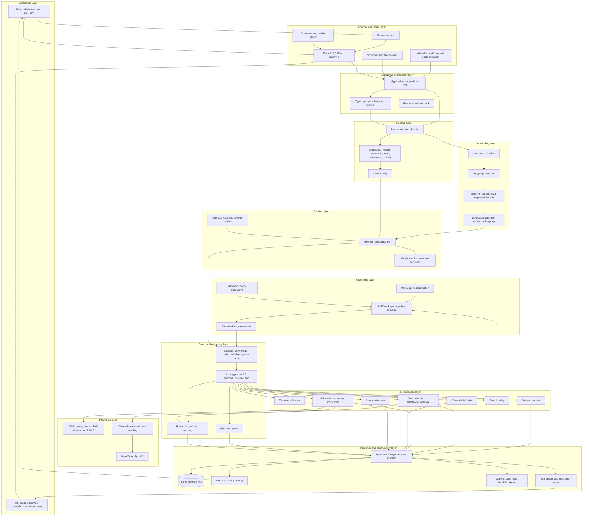
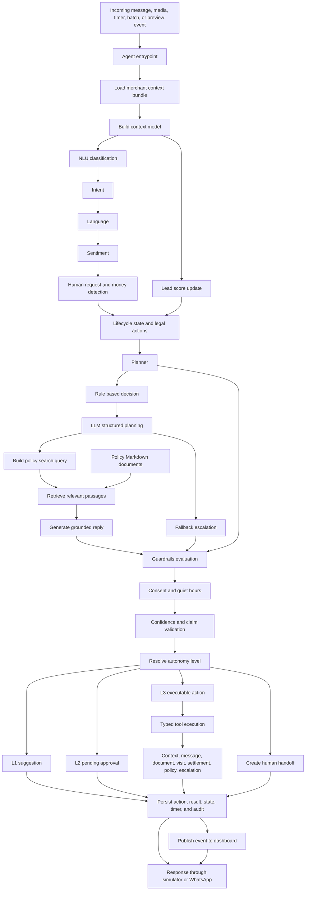

# Paytm Saathi architecture diagrams

These diagrams describe the implemented platform and its agentic decision
loop. They show the layers and responsibilities from an incoming event to a
response, action, handoff, or persisted result.

## Full platform architecture

<!-- mermaid-checked: no \n, no em-dash/en-dash, no {} in labels, subgraphs are id["label"], arrows are -->|"label"|, all subgraphs closed by end, ids unique -->

## Agent decision loop

<!-- mermaid-checked: no \n, no em-dash/en-dash, no {} in labels, subgraphs are id["label"], arrows are -->|"label"|, all subgraphs closed by end, ids unique -->

### Intents classified by NLU

The NLU layer classifies each incoming text message into one of these
implemented intents. It also emits language, sentiment, human-request,
money-mention, and confidence signals.

| Intent | Meaning | Typical planner result |
|---|---|---|
| `greeting` | Greeting or opening message | `ANSWER_QUERY` |
| `interest` | Product interest or request for more information | `ANSWER_QUERY` |
| `ask_fees` | Fees, rental, MDR, pricing, or charges | `ANSWER_QUERY` |
| `ask_documents` | Required documents or KYC requirements | `ANSWER_QUERY` |
| `send_document` | Merchant indicates that a document was sent | Document validation flow |
| `agree_visit` | Merchant agrees to or confirms a visit | `SCHEDULE_VISIT` |
| `settlement_query` | Settlement status, missing payment, or settlement timing | `EXPLAIN_SETTLEMENT` or support handoff |
| `device_issue` | Soundbox, QR, battery, network, or device problem | Planner or support handoff |
| `complaint` | Complaint, fraud, refund, chargeback, or legal concern | FSE or support handoff |
| `ask_discount` | Discount, waiver, reduced fee, or free request | `OFFER_DISCOUNT` with approval |
| `ask_human` | Explicit request for manager, FSE, or human | FSE handoff |
| `opt_out` | Stop, unsubscribe, or do-not-contact request | `WAIT` and outbound pause |
| `not_interested` | Declines the offer or says no | `WAIT` or lifecycle close |
| `other` | No supported intent match | `ESCALATE` for unsupported question |

### Planner actions and autonomy

The planner can select these structured actions. Lifecycle rules filter the
actions that are legal for the merchant's current state before execution.

| Planner action | What it does | Default control |
|---|---|---|
| `SEND_INTRO` | Starts outreach to a new lead | L3 when permitted |
| `ANSWER_QUERY` | Sends a policy-grounded response | L3 when permitted |
| `REQUEST_DOCS` | Requests PAN or address proof | L3 when permitted |
| `REREQUEST_DOC` | Requests a corrected document with specific issues | L3 when permitted |
| `SCHEDULE_VISIT` | Creates a clustered FSE visit slot | L3 when permitted |
| `SEND_ACTIVATION_NUDGE` | Nudges an installed but inactive merchant | L3 when permitted |
| `EXPLAIN_SETTLEMENT` | Looks up and explains settlement status | L3 when data exists |
| `WAIT` | Pauses messaging or waits for a future event | L3 when permitted |
| `ESCALATE` | Creates a human handoff with context | L3 handoff creation |
| `CLOSE_LEAD` | Marks a lead as closed after human-controlled review | L1 suggestion |
| `OFFER_DISCOUNT` | Proposes a discount request without changing price | L2 approval |

### Typed tools available to the agent

The model does not call tools directly. The executor invokes these typed,
wrapped functions after planning, guardrail evaluation, and autonomy checks.

| Tool | Inputs or lookup | Result |
|---|---|---|
| `get_lead_context` | Merchant ID | Current context bundle for the merchant |
| `send_whatsapp` | Merchant ID, text, language, optional template | Outbound simulator or WhatsApp send result |
| `validate_kyc_doc` | Document, merchant, file path, document type | Quality/PAN/name pre-check and mock KYC result |
| `schedule_visit` | Merchant ID and optional preferred slot | FSE, slot, cluster size, and lifecycle update |
| `check_settlement` | Merchant ID | Current settlement record or not-found result |
| `search_policy` | Query and language | Ranked policy passages with source and score |
| `escalate_to_human` | Merchant, action, target, reason, decision | Handoff ID and structured handoff summary |

## Layer responsibilities

| Layer | Responsibility | Current implementation |
|---|---|---|
| Experience | Operator and simulator views | Next.js frontend |
| Channel and intake | Receive messages, uploads, and scheduled events | FastAPI, WhatsApp webhook, simulator |
| Composition | Wire ports, adapters, clock, and handlers | `server/main.py` |
| Context | Build merchant memory and lead score | `context_builder.py`, `scoring.py` |
| Understanding | Convert language into structured signals | `nlu.py` |
| Decision | Select lifecycle-allowed next action | `lifecycle.py`, `planner.py` |
| Grounding | Retrieve verified policy passages and draft replies | `policy/retrieval.py`, reply prompt |
| Safety and autonomy | Block, escalate, request approval, or permit execution | `guardrails.py`, `autonomy.py` |
| Tools | Perform bounded business operations | `agent/tools/impl.py` |
| Integration | Connect channels and document services | `integrations/` |
| Persistence | Store state, actions, events, and measurements | SQLAlchemy adapters and SQLite |

## RAG knowledge sources

RAG uses the following actual Markdown documents under `agent/policy/docs/`.
The retriever loads each `##` and `###` section as a passage, expands Hindi
and Hinglish terms, ranks passages with BM25 when available, and falls back to
keyword overlap. The selected passages are passed to the reply-generation
prompt with their source labels.

| Document | Policy topics retrieved |
|---|---|
| [`fees.md`](../agent/policy/docs/fees.md) | Soundbox rental, UPI charges, card MDR, settlement timing, refunds, deposit, fee support |
| [`settlement.md`](../agent/policy/docs/settlement.md) | Settlement schedule, status checks, holiday delays, delay reasons, minimum amount, failed settlement, TDS |
| [`kyc_requirements.md`](../agent/policy/docs/kyc_requirements.md) | PAN, address proof, quality requirements, file limits, pre-check boundaries, rejection reasons |
| [`device_faq.md`](../agent/policy/docs/device_faq.md) | Soundbox setup, payment announcements, connectivity, QR, battery, charging, maintenance |
| [`escalation_policy.md`](../agent/policy/docs/escalation_policy.md) | Hard blocks, escalation triggers, handoff targets, handoff contents, response expectations |

For `ANSWER_QUERY`, the entrypoint calls policy retrieval using the merchant's
original question. If no passage passes the configured retrieval threshold,
the current implementation does not claim a verified answer and changes the
decision to a support escalation.
