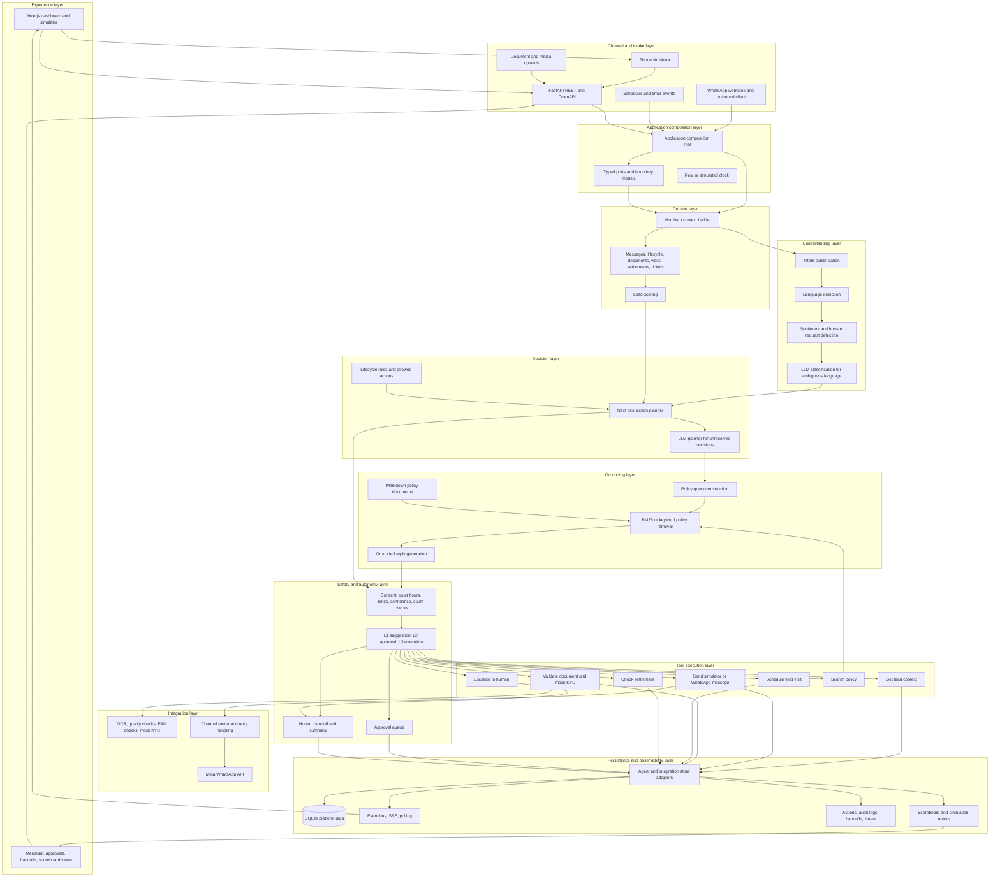
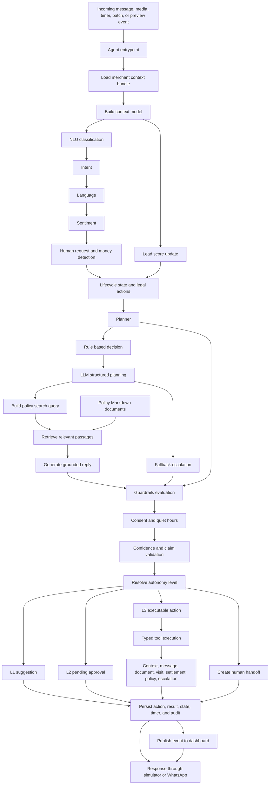

# Paytm Saathi architecture diagrams

These diagrams describe the implemented platform and its agentic decision
loop. They show the layers and responsibilities from an incoming event to a
response, action, handoff, or persisted result.

## Full platform architecture

<!-- mermaid-checked: no \n, no em-dash/en-dash, no {} in labels, subgraphs are id["label"], arrows are -->|"label"|, all subgraphs closed by end, ids unique -->

## Agent decision loop

<!-- mermaid-checked: no \n, no em-dash/en-dash, no {} in labels, subgraphs are id["label"], arrows are -->|"label"|, all subgraphs closed by end, ids unique -->

## Layer responsibilities

| Layer | Responsibility | Current implementation |
|---|---|---|
| Experience | Operator and simulator views | Next.js frontend |
| Channel and intake | Receive messages, uploads, and scheduled events | FastAPI, WhatsApp webhook, simulator |
| Composition | Wire ports, adapters, clock, and handlers | `server/main.py` |
| Context | Build merchant memory and lead score | `context_builder.py`, `scoring.py` |
| Understanding | Convert language into structured signals | `nlu.py` |
| Decision | Select lifecycle-allowed next action | `lifecycle.py`, `planner.py` |
| Grounding | Retrieve verified policy passages and draft replies | `policy/retrieval.py`, reply prompt |
| Safety and autonomy | Block, escalate, request approval, or permit execution | `guardrails.py`, `autonomy.py` |
| Tools | Perform bounded business operations | `agent/tools/impl.py` |
| Integration | Connect channels and document services | `integrations/` |
| Persistence | Store state, actions, events, and measurements | SQLAlchemy adapters and SQLite |

## RAG knowledge sources

RAG uses Markdown policy documents under `agent/policy/docs/`. The retrieval
layer loads sections by heading, expands Hindi and Hinglish terms, ranks
passages with BM25 when available, and falls back to keyword overlap. Retrieved
passages are supplied to the reply prompt; an answer is not treated as
verified when no relevant policy passage is found.
