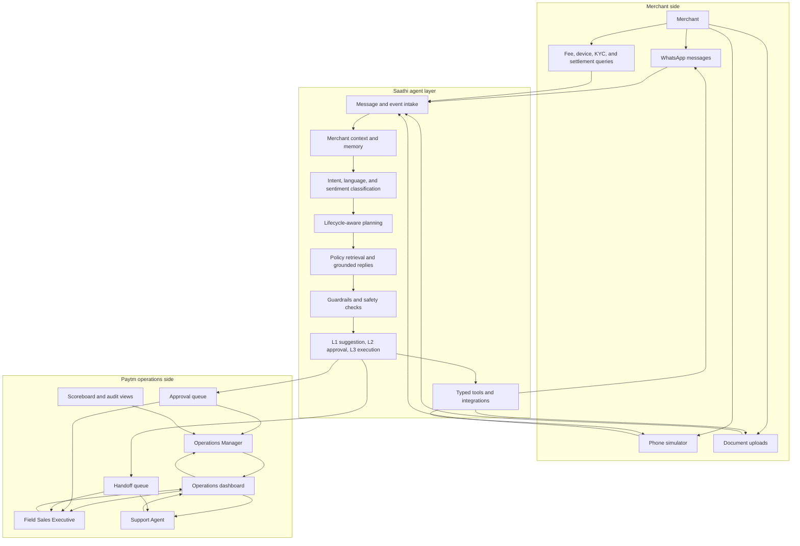

# Paytm Saathi platform users

Paytm Saathi is a two-sided platform. Merchants communicate with the Saathi
agent, while internal Paytm operations users review, approve, execute, or
resolve the resulting work.

## User and role architecture

<!-- mermaid-checked: no \n, no em-dash/en-dash, no {} in labels, subgraphs are id["label"], arrows are -->|"label"|, all subgraphs closed by end, ids unique -->

## User roles and responsibilities

| User or role | Side | Main responsibilities |
|---|---|---|
| Merchant | External user | Onboarding, documents, visits, device activation, support queries |
| Field Sales Executive | Internal user | Visit merchants, install devices, resolve assigned handoffs, review priorities |
| Support Agent | Internal user | Handle settlement, refund, fraud, chargeback, legal, and complex support cases |
| Operations Manager | Internal user | Approve discounts, review overrides, monitor metrics, govern autonomy |
| Saathi agent | Agent layer | Understand messages, retrieve policies, plan actions, apply guardrails, and execute bounded tools |

## Important implementation boundary

The current repository models merchants, FSE assignment, actions, approvals,
and handoffs. It does not yet implement authenticated accounts or role-based
access control for FSEs, support agents, or operations managers. The diagram
shows the intended platform user roles and the currently implemented
operational interaction surfaces.
