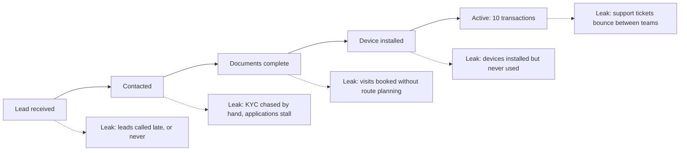
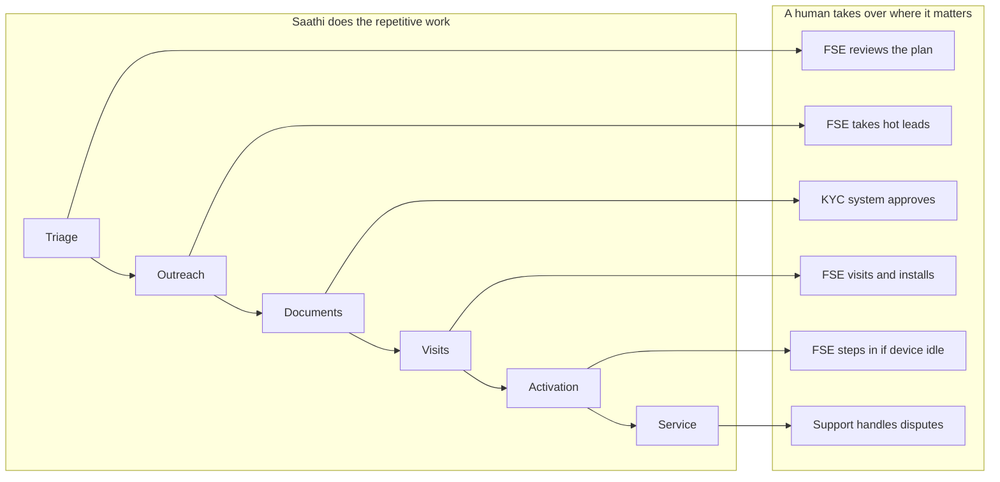
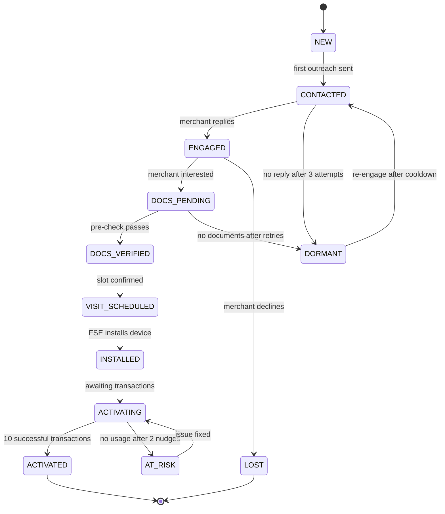
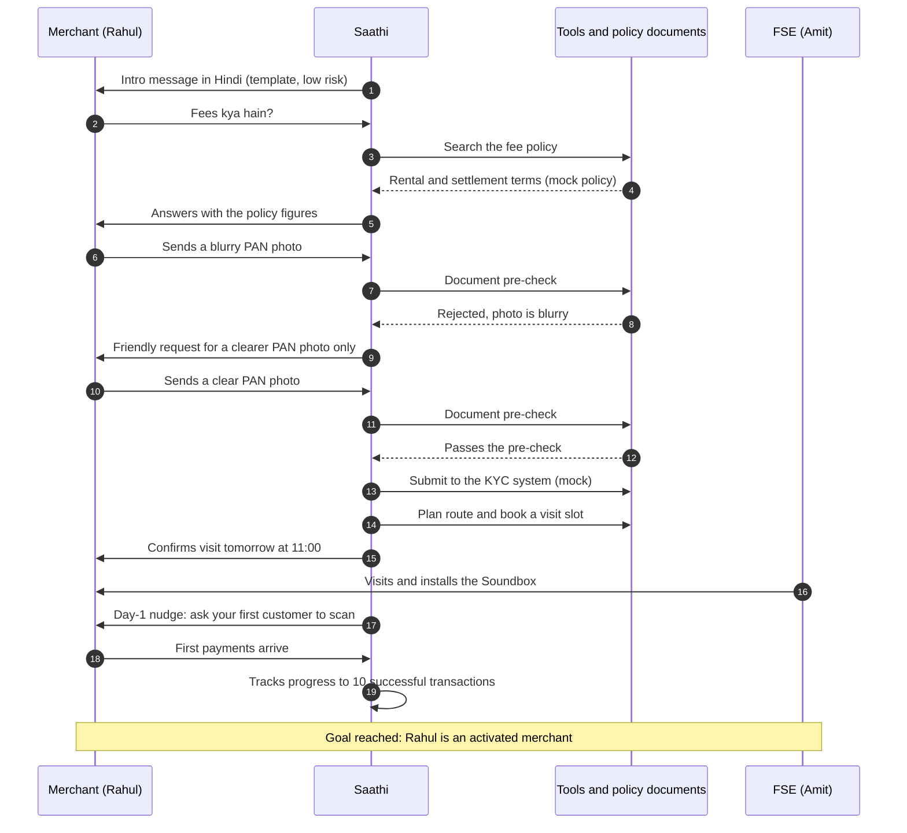
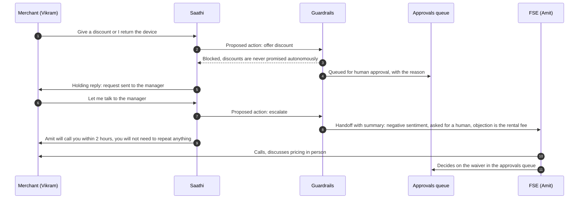
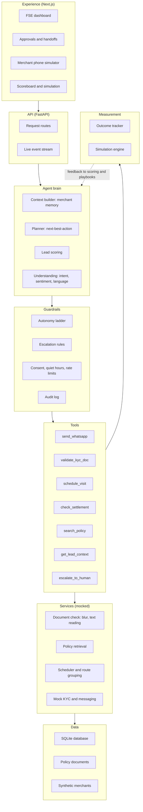
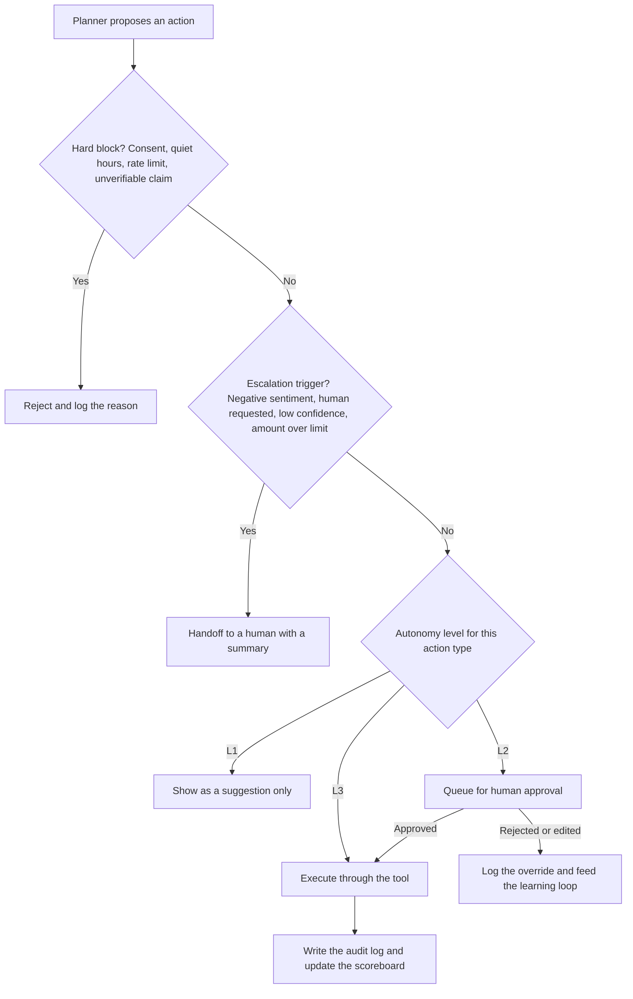
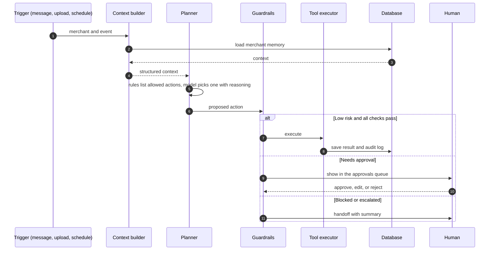
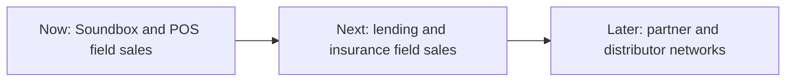

# Paytm Saathi: Project Overview

A plain-language description of the whole project, written in the same order as the pitch deck. It is meant for people and AI assistants who need full context before helping with the idea, the pitch, the demo, or the build. It contains no code.

| | |
|---|---|
| Hackathon | Paytm Build for India AI Hackathon, Delhi-NCR Edition (Paytm with devSemble) |
| Track | Track 3: Autonomous AI Teammates (sales and customer service) |
| Product | Paytm Saathi ("saathi" means companion) |
| Planned stack | Next.js frontend, Python FastAPI backend, SQLite |
| Data | All merchants, messages, fees, and results are synthetic demo data |
| Pitch deck sections required by the hackathon | Title, Problem Statement, Proposed Solution, Technology Stack, USP, Impact and Benefits, Business Model |

## What exists so far

| Item | What it is |
|---|---|
| Project specification | A long technical document with the full build plan, data model, API contract, and future features |
| Interactive demo | A clickable frontend on demo data: landing page, dashboard, merchants, merchant phone simulator, approvals with autonomy settings, handoffs, scoreboard |
| Pitch deck | 10 slides following the order of this document |
| This document | The shared context for everything above |

Nothing here is connected to real Paytm systems. There is no real WhatsApp, calling, KYC, or payment integration.

---

## 1. Paytm Saathi

**Subtitle:** The AI teammate that takes every merchant from lead to first 10 transactions.

Saathi is an AI teammate for Paytm's field sales and support teams. It works next to field sales executives (FSEs) and support agents. It owns one outcome for every merchant: reach their first 10 successful transactions, and stay happy.

It is a teammate with a quota, not a chatbot. A chatbot waits for questions. Saathi decides who to contact, when, and in which language. It acts through tools, tracks whether the outcome happened, and calls a human the moment a human is needed.

What Saathi is:
- An agent that runs the repetitive pipeline work: contacting leads, chasing documents, booking visits, nudging first use, checking settlements.
- A system with visible safety: every action has an autonomy level, a logged reason, and clear escalation rules.

What Saathi is not:
- It is not a replacement for field sales. Visits, negotiation, and trust stay with people.
- It is not a KYC authority. It runs a document pre-check only. The official KYC system decides.
- It does not approve loans, discounts, or refunds on its own.

---

## 2. Problem Statement: a huge base to activate

Paytm already has a very large base of merchants who use its devices (Soundbox and card machines). Every one of them has to be onboarded, activated, and supported.

Real figures, from Paytm's Q1 FY27 results (quarter ended June 2026), as reported by Asianet Newsable and Upstox:

| Figure | Value |
|---|---|
| Device merchants | 1.57 crore (15.7 million) |
| Net devices added over the last year | 27 lakh (2.7 million) |
| Merchant GMV in the quarter | ₹7.1 lakh crore, up 31 percent year on year |

Paytm also credits AI-led lifecycle management of device merchants as one driver of its merchant loan distribution business. Saathi applies the same idea earlier in the journey: onboarding and activation.

Why this matters: at this scale, even small leaks in the funnel mean a very large number of merchants who never get activated. The leak is a people-time problem, not a lack of leads.

---

## 3. Problem Statement: where merchants drop out

A merchant has to pass through five stages: lead received, contacted, documents complete, device installed, and active (10 transactions). Merchants drop out at every step, for reasons that are repetitive and rule-based.

| Leak | What happens today | Why it happens |
|---|---|---|
| Late or missed contact | Leads are called late, or never | One field executive cannot call 100 leads on time |
| Stalled KYC | Documents are chased by hand and applications stall | Follow-ups depend on memory and spare time |
| Poor visit planning | Visits are booked without grouping nearby shops | Route planning is manual |
| Dead devices | A Soundbox is installed and nobody notices zero transactions | No one is watching usage after install |
| Support ping-pong | Settlement issues bounce between teams, merchants repeat themselves | No single owner and no shared context |

The core insight: each leak is a repetitive, rule-heavy job. Humans do it badly at scale. An agent does it well. Humans are best at the in-person visit, the negotiation, and building trust.

---

## 4. Proposed Solution: six stages, human handoffs

Saathi owns the pipeline in six stages. At each stage it does the repetitive work and hands over to a human where a human is better.

| Stage | What Saathi does | What the human does |
|---|---|---|
| Triage | Scores leads by conversion likelihood and builds the day's ranked list | Reviews the plan instead of a raw list |
| Outreach | Contacts the merchant in Hindi, Hinglish, or English, pitches in context, answers fee and settlement questions from approved policy documents | Takes over hot leads |
| Documents | Collects documents, flags blurry or mismatched photos, re-requests only what is missing | The official KYC system gives final approval |
| Visits | Groups nearby leads into one route, proposes slots, confirms with the merchant | Visits and installs the device |
| Activation | Nudges the first scan, detects devices with no transactions, does basic troubleshooting | Steps in if the device stays idle |
| Service | Looks up settlement and ticket status through tools and explains it plainly | Support handles complex disputes |

Four things make this a teammate:
- It has a goal and a scoreboard: conversions, activations, tickets resolved without a human.
- It decides: who to contact, when, in what language, and whether to retry, escalate, or drop a lead.
- It acts: it calls real tools for messaging, document checks, scheduling, and settlement lookups.
- It is accountable: every action is logged with its reasoning, and humans can override.

Every handoff carries a full summary, so the merchant never repeats themselves.

### Merchant lifecycle

Every merchant sits in one state, and the state decides which actions Saathi is allowed to consider.

---

## 5. Proposed Solution: one merchant's journey

This section shows the solution at work on single merchants, end to end.

### Use case 1: Rahul's kirana store, from first message to first 10 transactions

Rahul owns a kirana store in Delhi and prefers Hindi. He is a high-scoring lead because the shop is busy.

What each side contributed:

| Moment | Saathi | Human |
|---|---|---|
| First contact and fee question | Answered from the policy document, not from model memory | None |
| Blurry document | Rejected it politely and asked only for the PAN photo | None |
| Verification | Ran a pre-check and passed the result on | The official KYC system gives the final decision |
| Visit | Grouped Rahul with 3 nearby leads into one route and confirmed the slot | Amit visits, installs, and builds trust |
| Activation | Sent the first-scan nudge and tracked usage | None unless the device stays idle |

### Use case 2: Vikram's mobile repair shop, the safety case

Vikram is unhappy about the rental fee. He demands a discount and threatens to return the device.

What this shows: Saathi refuses the risky action, explains why, keeps the merchant informed, and passes the case with a summary. This visible refusal is the main trust moment in the demo.

### The other demo scenarios

| Merchant | Scenario | What it shows |
|---|---|---|
| Meena (salon) | Blurry PAN photo, then a clear one | Targeted document re-request and pre-check |
| Sunil (chai stall) | Device installed, no transactions for 24 hours | Activation nudge, then escalation after two failed nudges |
| Farida (sweet shop) | "Mera settlement nahi aaya" | Tool-grounded answer: delayed because of a bank holiday, reminder set |
| Pooja (pharmacy) | New lead, first contact in English | Template first contact |

---

## 6. Technology Stack: architecture and guardrails

### Layered architecture

| Layer | Job | Must not |
|---|---|---|
| Experience | Show state and collect human decisions | Contain business rules |
| API | Validate requests and stream updates | Call the language model directly |
| Agent brain | Build context and decide the next best action | Change data itself |
| Guardrails | Decide whether an action may run and at what level | Be bypassed by any code path |
| Tools | The only code allowed to change state for the agent | Accept unchecked input |
| Services | Wrap mocked outside systems | Touch real data or real APIs |
| Data | Store everything | Hold business logic |
| Measurement | Compute outcomes and run the simulation | Change live state |

### Technology choices

| Area | Choice |
|---|---|
| Frontend | Next.js with TypeScript and Tailwind |
| Backend | Python with FastAPI and Pydantic |
| Database | SQLite |
| Language model | Any model with tool calling, behind a thin adapter so the provider can change |
| Document pre-check | OpenCV (blur check) and Tesseract (text reading) with format rules |
| Policy answers | BM25 retrieval over policy documents, upgradeable to embeddings |
| Charts | Recharts |
| Frontend development | Built mock-first against an API contract so frontend and backend can be built separately |

### What the language model does, and what it does not

Not everything uses the model. Rules are used wherever they are enough, which makes the system predictable.

| Job | Done by |
|---|---|
| Lead scoring | Weighted rules (footfall, category value, engagement, responsiveness, nearby leads) |
| Which actions are allowed in a lifecycle state | A fixed lookup |
| Understanding a merchant message | The model, returning structured output |
| Choosing among the allowed actions, with reasoning | The model, returning structured output |
| Writing merchant-facing text | Templates for first contact and reminders, the model for free-form replies grounded in tool output |
| Fees, timelines, and statuses | Tools and policy documents only |
| Document quality check | Image and text rules, no model |
| Guardrail decisions | Plain rules |

### The tools

| Tool | Purpose |
|---|---|
| get_lead_context | Load the merchant's profile, state, documents, transactions, tickets, and recent messages |
| send_whatsapp | Send a message in the merchant's language |
| validate_kyc_doc | Check document quality, extract the PAN, compare the name with the profile |
| schedule_visit | Book an FSE slot and group nearby leads into a route |
| check_settlement | Look up settlement status, amount, expected date, and delay reason |
| search_policy | Find approved policy passages to answer a question |
| escalate_to_human | Create a handoff with a generated summary |

### The action menu

The planner can only choose from a fixed list: send intro, answer query, request documents, re-request a document, schedule visit, send activation nudge, explain settlement, wait, escalate, close lead, and offer discount (which exists only to show the guardrail refusing it). Limits keep it safe and debuggable: at most 3 contact attempts, 2 activation nudges, and 2 document re-requests per merchant.

### Data model in brief

The main records are merchants, messages, documents, visits, devices, transactions, settlements, tickets, agent actions, handoffs, field sales executives, and an append-only audit log. A merchant belongs to one FSE. An agent action may create a handoff. Autonomy levels are stored per action type so managers can change them.

### Frontend and backend separation

The frontend and backend are separate apps that agree on one API contract. The frontend can run on fixtures before the backend exists. The backend exposes routes for the briefing, merchants, actions and approvals, chat, document upload, handoffs, autonomy settings, scoreboard, simulation, audit, demo controls, and a live event stream.

---

## 7. Technology Stack: how every action is checked

Every action Saathi proposes passes through the same checks before anything runs.

### One agent step, in order

### Hard blocks

| Rule | Detail |
|---|---|
| Consent | No outbound message to a merchant who opted out or has not given consent |
| Rate limit | At most 3 outbound messages per merchant per day |
| Unverifiable claims | Any fee, timeline, or status must come from a tool or a policy passage in the same step |
| Forbidden actions | Loan offers, refunds, and discounts never run autonomously in the prototype |

### Escalation triggers

| Trigger | Example |
|---|---|
| Negative sentiment | Abusive language or clear anger |
| Human requested | The merchant asks for a manager or a person |
| Low confidence | The planner is unsure or no policy passage matches |
| Amount above limit | Any money commitment over the configured limit |
| Retry exhaustion | Two failed nudges, two failed document re-requests, three unanswered contacts on a high-value lead |
| Sensitive topics | Fraud, chargebacks, legal matters |

### What a handoff contains

The merchant and shop, the lifecycle state and lead score, what happened so far, the merchant's sentiment and objection, document status, and a recommended next step. A person should be able to act in under a minute without asking the merchant anything.

---

## 8. USP: autonomy ladder, suggest, approve or act

Saathi's differentiator is safe autonomy: it does real work, and a manager can see and control how far it is allowed to go.

| Level | Meaning | Default examples |
|---|---|---|
| L1 | Suggest only. A person acts | Closing a lead, anything not yet trusted |
| L2 | Saathi drafts and acts after human approval | Discounts and offers, higher-value commitments |
| L3 | Saathi acts alone within the rules | First-contact templates, document chasing, activation nudges, policy-grounded answers, settlement explanations from tool data, visit booking |

Managers can promote or demote any action type. Each change is logged. In the demo, setting an action to L2 makes the next matching action wait in the approvals queue.

Other points that set Saathi apart:

| Point | Why it matters |
|---|---|
| Grounded answers | Fees, timelines, and statuses come from policy documents and tools, never from model memory |
| Full audit trail | Every action is logged with its reasoning, and overrides are recorded |
| Visible refusals | Saathi declines to promise discounts and explains why, which builds trust |
| Sales and service in one loop | The merchant experiences one relationship from lead to settlement |
| Warm handoffs | Humans receive a summary, merchants never repeat themselves |
| Outcome framing | Everything is measured against first 10 successful transactions, not messages sent |

A learning loop is included in simple form: human rejections and edits are stored with reasons and shown as override rates per action type.

---

## 9. Impact and Benefits: simulated results

These results come from a simulation on synthetic data. They are projections from stated assumptions, not Paytm results, and should always be labeled that way.

### Simulated comparison

300 synthetic leads over 30 days. The same lead pool and the same underlying conversion propensity are used in both arms, so only workflow behavior differs.

| Metric | Manual | Saathi-assisted | Change |
|---|---|---|---|
| Leads contacted within 1 hour | 25% | 95% | 70 points |
| Lead-to-onboarded conversion | 20% | 26% | +30% relative |
| Devices activated within 7 days | 38% | 47% | +24% relative |
| Tier-1 tickets resolved without a human | 0% | 50% | 50 points |
| FSE time spent on admin | 50% | 25% | -50% relative |

### Assumptions behind the numbers

| Assumption | Manual | Saathi |
|---|---|---|
| Median days to first contact | 2.0 | 0.1 |
| Maximum follow-up attempts | 2 | 4 |
| Document completion after a re-request | 40% | 60% |
| Activation nudge actually sent | 15% | 90% |
| FSE share of time on admin | 50% | 25% |

These values are placeholders chosen for the prototype. They must be replaced or confirmed when the real simulation is run, and the assumptions must be shown next to every chart.

### What is real and what is simulated

| Shown in the demo | Source |
|---|---|
| Agent actions, tool calls, database changes | Real code on synthetic data |
| Guardrail decisions and escalations | Real code |
| Lift chart and comparison metrics | Simulated, with stated assumptions |
| Settlement, KYC, messaging | Mocked integrations |

### Benefits in words

- Merchants are contacted faster and receive consistent follow-up.
- Applications stall less because document chasing is targeted and persistent.
- Idle devices are noticed early.
- Support teams receive cases with context instead of starting from zero.
- FSEs spend their time on visits, negotiation, and trust.

---

## 10. Business Model: lower cost per activated merchant

Saathi is an internal growth and productivity engine for Paytm, not a product merchants buy.

| Lever | How it creates value |
|---|---|
| More activated merchants per FSE | Faster contact, fewer stalled applications, activation nudges |
| Lower cost per activated merchant | Admin work costs almost nothing at the margin, so FSE time goes to visits |
| Fewer tickets and handoffs | Tool-grounded answers for simple cases, warm handoffs for the rest |

Cost per activated merchant is the cost of FSE time plus the cost of running the agent, divided by the number of merchants activated. Saathi aims to lower the top of that fraction and raise the bottom.

### Rollout path

The same agent platform serves more pipelines over time. Each new pipeline adds tools, allowed actions, guardrail rules, and screens, without changing the core loop.

---

## Appendix A: Scope

| Tier | What is included |
|---|---|
| Prototype (MVP) | Lead scoring and briefing, planner with a fixed action menu, seven tools, guardrails with autonomy levels, dashboard with action feed and approvals, merchant phone simulator, document pre-check, settlement lookup and handoff, simulation and scoreboard |
| Stretch | Voice in Hinglish, learning-loop view, route map, pitch and timing insights |
| Second build | Expansion agent (working-capital loan or upgrade flag with consent), churn-saver, dispute assistant, failed-payment recovery, manager analytics copilot, FSE mobile app, more languages, device troubleshooting playbooks, evaluation harness |
| Future platform | Real WhatsApp, calling, CRM and KYC integrations, learned lead scoring, multi-agent split (triage, resolver, compliance checker), QA supervisor agent, scam first responder, observability, security and privacy hardening |

Rule for growth: every new capability is added as one tool or service, one allowed-action entry, one guardrail rule, one autonomy default, one screen element, and tests, never by changing the core loop.

## Appendix B: Build plan in three phases

| Phase | Focus | Done when |
|---|---|---|
| Phase 1: Backend and agent core | Database and seed data, tools, planner, guardrails, audit log, API | All demo scenarios pass from the command line with real database changes |
| Phase 2: Frontend and user flows | Every screen and user flow built on mock data | All flows click through without errors |
| Phase 3: Integration, simulation, polish | Real backend behind the real UI, simulation, live updates, demo rehearsal, backup recording | Live end-to-end demo works from a clean reset |

Phases 1 and 2 can run in parallel after a short kickoff because both follow the same API contract.

## Appendix C: The three-minute demo

| Time | What is shown | Point |
|---|---|---|
| 0:00 to 0:20 | Dashboard morning briefing | Saathi works overnight and gives the FSE a ranked plan |
| 0:20 to 0:55 | Rahul asks about fees and books a visit | Grounded answer and a real database change |
| 0:55 to 1:20 | Meena sends a blurry then a clear PAN photo | Targeted re-request, pre-check only |
| 1:20 to 1:45 | Sunil's idle device | Nudge, then escalation |
| 1:45 to 2:05 | Farida's settlement | Answer from tool data |
| 2:05 to 2:30 | Vikram's discount demand | Refusal, approval queue, handoff |
| 2:30 to 3:00 | Scoreboard and simulation | Outcomes with honest assumptions |

## Appendix D: Risks and how they are handled

| Risk | Handling |
|---|---|
| Scope creep across six stages | Build only the prototype tier. The demo scenarios are the acceptance test |
| Live model or network failure | Timeouts, fallbacks, cached replies, and a backup recording |
| Wrong or invented fee in a reply | Hard block on unverifiable claims, structured output checks, fall back to escalation |
| Simulated numbers challenged | Show assumptions, fair comparison, and label everything "simulated" |
| "Is this real KYC?" | No. It is a pre-check. The official system decides |
| Similar ideas from other teams | Lead with safe autonomy, sales plus service in one loop, and the first-10-transactions outcome |

## Appendix E: Rules for AI assistants working on this project

1. Treat all merchant, fee, and result data as synthetic. Never present simulated numbers as real Paytm results.
2. Real figures are limited to Paytm's reported Q1 FY27 numbers in section 2, and should be cited if reused.
3. Never describe the document pre-check as KYC verification.
4. Never suggest that Saathi approves loans, discounts, or refunds on its own.
5. The language model proposes actions. Only guardrails and tools change state.
6. Keep the deck order and section names: Title, Problem Statement, Proposed Solution, Technology Stack, USP, Impact and Benefits, Business Model.
7. Keep language professional, specific, and honest about what is built versus mocked.

## Appendix F: Glossary

| Term | Meaning |
|---|---|
| FSE | Field sales executive, the person who visits shops |
| Soundbox | Paytm's speaker device that announces received payments |
| POS | Card payment machine |
| Activation | A merchant reaching 10 successful transactions |
| KYC | Identity verification, decided by the official system |
| Pre-check | A quality and format check on documents, not a verification |
| Next-best-action | Choosing one action from a fixed list based on the merchant's state |
| Autonomy ladder | L1 suggest, L2 act after approval, L3 act alone |
| Guardrails | Rules that block, escalate, or limit agent actions |
| Handoff | Passing a case to a human with a summary |
| Audit log | A permanent record of each action and its reasoning |
| Grounded answer | An answer taken from a policy document or tool, not from model memory |
| Simulation | A model run on synthetic data to compare manual and Saathi-assisted workflows |
