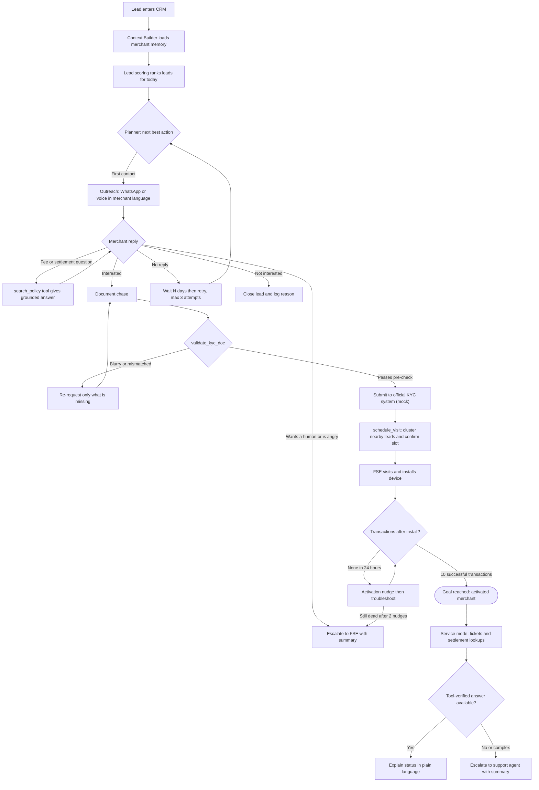
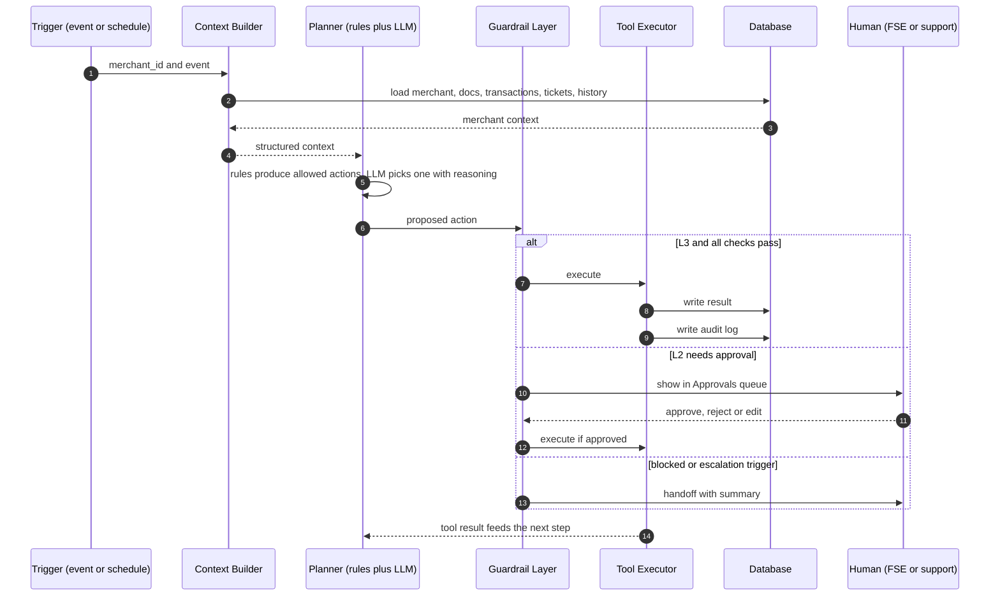
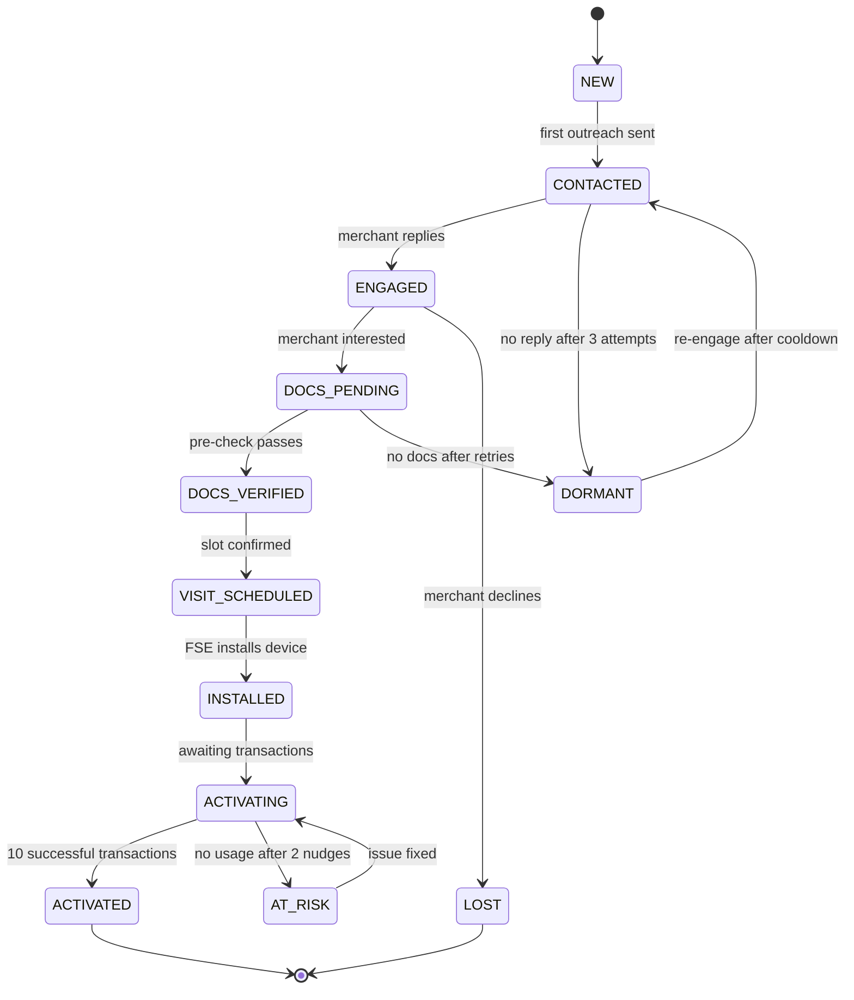
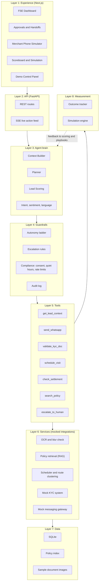
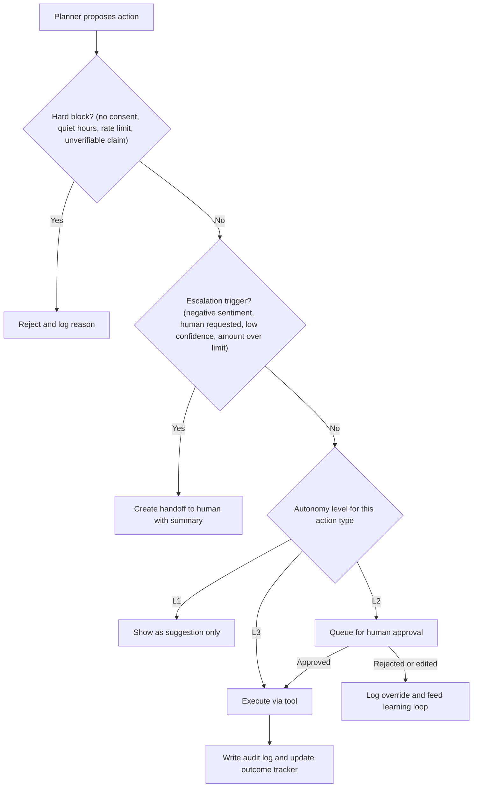
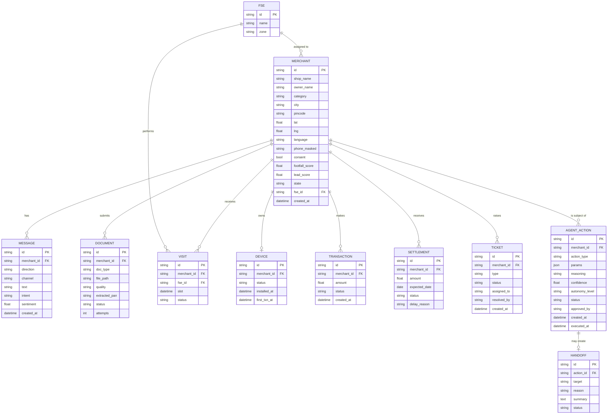
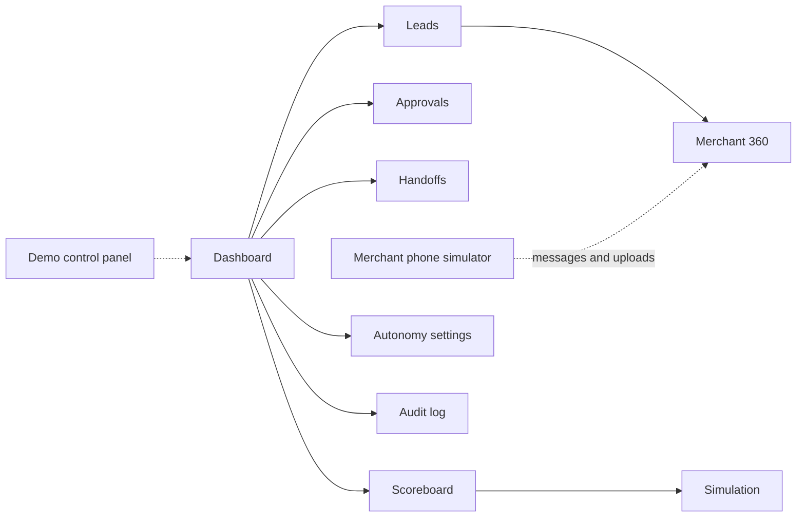
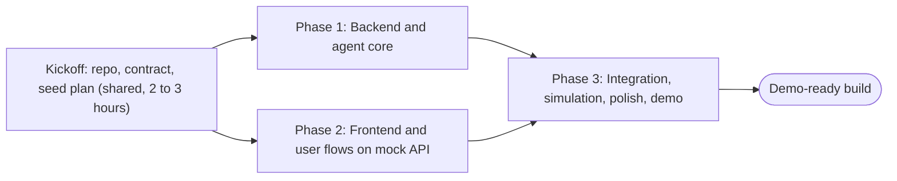

# Paytm Saathi: Project Specification and Build Guide

An AI teammate that owns the merchant pipeline, from lead to first transaction.

| | |
|---|---|
| Hackathon | Paytm Build for India AI Hackathon, Delhi-NCR Edition (organized by Paytm with devSemble) |
| Track | Track 3: Autonomous AI Teammates (sales + customer service) |
| Product name | Paytm Saathi ("saathi" = companion) |
| Stack | Next.js (frontend) + Python FastAPI (backend) + SQLite |
| Status | Pre-build. This document is the single source of truth. |

## How to use this document (read first, especially if you are an AI coding agent)

1. This file describes the full project: problem, solution, architecture, data model, API contract, frontend spec, backend spec, build phases, and future work.
2. Build only what is marked **MVP**. Items marked **Stretch** come after the MVP works end to end. Items marked **Future** must not be built, only mentioned in the pitch.
3. All data is synthetic. Never integrate real Paytm systems, real phone numbers, real KYC documents, or real payments.
4. The LLM never writes to the database directly. It only proposes actions. Actions run through the Guardrail Layer and then through typed tools (see section 9).
5. Frontend and backend are separate apps developed against the API contract in section 12. The frontend can run on mock data before the backend exists.
6. Follow the repository layout in section 11 and the conventions in section 21.

## Table of contents

1. Overview
2. Problem statement
3. Solution
4. Goals, non-goals, success criteria
5. Users and personas
6. End-to-end flow
7. Demo hero merchants
8. Layered architecture
9. Agent design (planner, tools, autonomy, guardrails)
10. Data model
11. Tech stack and repository structure
12. API contract
13. Frontend specification
14. Backend specification
15. Simulation and metrics
16. Business model and impact
17. Build plan (3 phases)
18. Demo script (3 minutes)
19. Second build: features after the MVP
20. Risks and fallbacks
21. Conventions and definition of done
22. Pitch deck mapping (Stage 1)
23. Glossary

---

## 1. Overview

Paytm grows its merchant base through field sales of Soundbox, POS machines, and merchant services such as QR payments, settlements, and loans. Field sales executives (FSEs) visit shops in person. Most of the funnel work around those visits is repetitive and rule-heavy: calling leads, chasing documents, reminding merchants, checking statuses, and answering the same support questions.

Paytm Saathi is an AI teammate with a quota. It has one goal per merchant: **get the merchant to their first 10 successful transactions, and keep them happy.** It decides who to contact, when, and in which language. It acts through tools (messaging, KYC pre-check, visit scheduling, settlement lookup, ticketing). It hands off to humans with a full summary whenever it should not decide alone. Every action is logged with its reasoning.

It is not a chatbot. A chatbot waits for questions. Saathi owns an outcome and keeps working until the outcome is reached or a human is needed.

## 2. Problem statement

The merchant onboarding and activation funnel leaks at every step:

| Leak | What happens today | Why it happens |
|---|---|---|
| Late or missed contact | Leads are called late, or never | One FSE cannot call 100 leads promptly |
| Stalled KYC | Documents are chased manually, applications stall | Follow-ups depend on memory and spare time |
| Dead devices | Soundbox is delivered or installed but never used | Nobody notices zero transactions |
| Support ping-pong | Settlement and device issues bounce between teams | No single owner and no shared context |
| Repeated explanations | Merchants repeat their story to each new person | Handoffs carry no summary |

Each leak is repetitive and rule-heavy. Humans do this badly at scale. Agents do it well. Humans are best at in-person visits, negotiation, and trust.

## 3. Solution

Saathi takes the repetitive pipeline work and gives humans a clear, ranked, pre-prepared plan.

| Stage | Saathi does autonomously | Human role |
|---|---|---|
| Lead triage | Scores leads by conversion likelihood and expected value, builds the daily ranked list | FSE sees a ranked plan, not a raw list |
| Outreach | WhatsApp or voice in the merchant's language, handles objections (fees, settlement time, "I will think about it") using approved policy documents | FSE takes over hot leads |
| Onboarding | Collects documents, runs OCR and quality checks, re-requests only what is missing | Official KYC system gives final approval |
| Visit scheduling | Clusters nearby leads, proposes slots, confirms with merchant | FSE does the visit and installs the device |
| Activation | Day-1 nudge, detects stalled devices, basic troubleshooting | Escalation only |
| Service | Looks up settlement and ticket status via tools, explains in plain language | Support agent handles complex disputes |

Key mechanisms that make it a teammate and not a bot:

- **Goal and scoreboard.** Measured on conversions, activations, and tickets resolved without a human.
- **Next-best-action planner.** Picks from a fixed menu of actions, so behavior is predictable and auditable.
- **Autonomy ladder.** Each action type is L1 (suggest), L2 (act after human approval), or L3 (act alone). Humans can promote or demote actions on a dashboard.
- **Grounded answers.** Fees, timelines, and statuses come from policy documents and tools, never from model memory.
- **Accountability.** Every action is logged with reasoning. Humans can override, and overrides feed back into the playbook.
- **Warm handoffs.** Escalations include a summary, the merchant's objection, and a recommended next step.

## 4. Goals, non-goals, success criteria

**Goals (MVP)**

- A live, end-to-end demo where the database actually changes after the agent acts.
- Visible safety: autonomy ladder, escalation triggers, audit log, at least one visible refusal.
- One clear headline number from a simulation, with assumptions stated.

**Non-goals**

- No real calls, real WhatsApp, real KYC, real payments, or real Paytm integrations.
- No loan or credit decisions. Expansion is a flag at most (Future).
- No claim that simulated results are real Paytm results.
- No claim that OCR equals KYC verification. OCR is a pre-check only.

**Success criteria**

| Criterion | Measure |
|---|---|
| End-to-end loop works | All 5 hero scenarios (section 7) run live without manual DB edits |
| Safety is visible | Demo shows one L2 approval, one refusal, one escalation |
| Outcome framing | Scoreboard shows conversion, time-to-activation, tickets resolved without a human, Saathi vs manual |
| Honest numbers | Simulation assumptions are listed next to every chart |

## 5. Users and personas

| Persona | Needs | Uses |
|---|---|---|
| Amit, Field Sales Executive | A ranked daily plan, warm handoffs, no admin chasing | Dashboard, Leads, Handoffs, Approvals |
| Priya, Support agent | Escalated tickets with full context | Handoffs, Merchant 360 |
| Sneha, Sales manager | Proof that the agent is safe and effective, control over autonomy | Autonomy settings, Scoreboard, Audit log |
| Rahul, Merchant (kirana owner) | Quick answers in Hindi, minimal paperwork, a working device | Merchant phone simulator (WhatsApp-style) |

## 6. End-to-end flow

### 6.1 Business flow: lead to first 10 transactions



### 6.2 One agent step (what happens on every event)



### 6.3 Merchant lifecycle states



The lifecycle state is stored on the merchant and drives which actions the planner is allowed to consider (section 9.2).

## 7. Demo hero merchants

Seed data includes ~300 synthetic merchants. Five "hero" merchants are hand-authored so the live demo is deterministic. Each one exercises one capability.

| Hero | Shop | Scenario | Capability shown | Expected outcome |
|---|---|---|---|---|
| Rahul | Kirana | Asks "Fees kya hain?" then agrees to a visit | Grounded answer from policy docs, visit booking | Fee answered from `fees.md`, visit created, state moves to VISIT_SCHEDULED |
| Meena | Salon | Uploads a blurry PAN photo, then a clear one | OCR pre-check and targeted re-request | First upload rejected with friendly re-request, second passes |
| Sunil | Chai stall | Device installed, zero transactions for 24 hours | Activation nudge and escalation after 2 nudges | Nudge sent (L3), then handoff to FSE with summary |
| Farida | Sweet shop | "Mera settlement nahi aaya" | Tool-grounded service answer | Settlement lookup finds bank holiday delay, agent explains it, sets reminder |
| Vikram | Mobile repair | Angry, demands a discount, then asks for a human | Guardrail refusal and escalation | Discount request refused (needs L2 approval), negative sentiment triggers handoff |

Policy documents used by the agent are invented mock policies, clearly labeled as such. They do not represent real Paytm pricing.

---

## 8. Layered architecture



Layer responsibilities:

| Layer | Responsibility | Must not |
|---|---|---|
| 1 Experience | Render state, collect human decisions | Contain business rules |
| 2 API | Validate input, route calls, stream events | Call the LLM directly |
| 3 Agent brain | Build context, decide next best action | Change data directly |
| 4 Guardrails | Decide whether a proposed action may run, and at what autonomy level | Be bypassed by any code path |
| 5 Tools | The only code allowed to change state on the agent's behalf | Accept unvalidated input |
| 6 Services | Wrap mocked external systems | Leak real data or call real APIs |
| 7 Data | Persist everything | Hold business logic |
| 8 Measurement | Compute outcomes and run the simulation | Alter live state |

---

## 9. Agent design

### 9.1 Division of labor between rules and the LLM

Not everything needs an LLM. Using rules where possible makes the system predictable and fast.

| Job | Implementation |
|---|---|
| Lead scoring | Rules-based weighted score (section 14.2) |
| Allowed actions for a lifecycle state | Deterministic map (section 9.2) |
| Understanding merchant messages (intent, sentiment, language) | LLM, returns strict JSON |
| Choosing among allowed actions and writing the reasoning | LLM, returns strict JSON |
| Writing the merchant-facing message | Templates for first contact and reminders, LLM for free-form replies grounded in tool output |
| Fees, timelines, statuses | Tools and policy retrieval only |
| KYC quality check | OpenCV blur check plus OCR plus regex (not an LLM) |
| Guardrail decisions | Pure Python rules |

### 9.2 Next-best-action planner

The planner never invents actions. It chooses from a fixed menu, and the menu is filtered by lifecycle state.

Action menu:

| Action | Tool used | Description |
|---|---|---|
| `SEND_INTRO` | `send_whatsapp` | First contact, template-based |
| `ANSWER_QUERY` | `search_policy`, `send_whatsapp` | Reply to a merchant question using retrieved policy text |
| `REQUEST_DOCS` | `send_whatsapp` | Ask for required documents |
| `REREQUEST_DOC` | `send_whatsapp` | Ask again only for the missing or unreadable document |
| `SCHEDULE_VISIT` | `schedule_visit`, `send_whatsapp` | Book an FSE visit and confirm with merchant |
| `SEND_ACTIVATION_NUDGE` | `send_whatsapp` | "Ask your first customer to scan" |
| `EXPLAIN_SETTLEMENT` | `check_settlement`, `send_whatsapp` | Explain settlement status from tool data |
| `WAIT` | none | Do nothing for N days, with a scheduled recheck |
| `ESCALATE` | `escalate_to_human` | Hand off with summary |
| `CLOSE_LEAD` | none | Mark lost with reason |
| `OFFER_DISCOUNT` | none (blocked in MVP) | Exists only to demonstrate the guardrail refusal |

Allowed actions by state:

| Lifecycle state | Allowed actions |
|---|---|
| NEW | `SEND_INTRO`, `WAIT`, `CLOSE_LEAD` |
| CONTACTED | `SEND_INTRO` (retry), `ANSWER_QUERY`, `WAIT`, `ESCALATE` |
| ENGAGED | `ANSWER_QUERY`, `REQUEST_DOCS`, `SCHEDULE_VISIT`, `ESCALATE`, `CLOSE_LEAD`, `OFFER_DISCOUNT` |
| DOCS_PENDING | `REQUEST_DOCS`, `REREQUEST_DOC`, `ANSWER_QUERY`, `WAIT`, `ESCALATE` |
| DOCS_VERIFIED | `SCHEDULE_VISIT`, `ESCALATE` |
| VISIT_SCHEDULED | `WAIT`, `ANSWER_QUERY`, `ESCALATE` |
| INSTALLED / ACTIVATING | `SEND_ACTIVATION_NUDGE`, `ANSWER_QUERY`, `EXPLAIN_SETTLEMENT`, `WAIT`, `ESCALATE` |
| AT_RISK | `ESCALATE`, `SEND_ACTIVATION_NUDGE` |
| ACTIVATED | `EXPLAIN_SETTLEMENT`, `ANSWER_QUERY`, `ESCALATE`, `WAIT` |

Planner output contract (the LLM must return exactly this JSON, validated with Pydantic, retried once on failure, then fall back to `ESCALATE`):

```json
{
  "action": "SCHEDULE_VISIT",
  "params": { "preferred_slot": "2026-11-02T11:00" },
  "language": "hinglish",
  "reasoning": "Merchant agreed to a visit, documents verified, three other leads within 2 km.",
  "confidence": 0.86
}
```

Reliability rules:

- Fixed action menu, explicit state transitions, retry limits (max 3 contact attempts, max 2 nudges, max 2 document re-requests).
- Temperature low. Every LLM call has a timeout and a deterministic fallback.
- Every planner decision is stored in `agent_actions` with `reasoning` and `confidence`.

### 9.3 Tools

All tools are typed Python functions with Pydantic input and output models. The LLM can only trigger them via the executor, after guardrails.

| Tool | Input | Output | Writes |
|---|---|---|---|
| `get_lead_context` | `merchant_id` | Merchant profile, state, docs status, transactions summary, open tickets, last 10 messages, objections raised | none |
| `send_whatsapp` | `merchant_id`, `template_id` or `text`, `language` | `message_id`, `delivered` | `messages` |
| `validate_kyc_doc` | `document_id` | `quality` (ok, blurry, unreadable), `extracted_pan`, `matches_profile`, `issues[]` | `documents` |
| `schedule_visit` | `merchant_id`, `preferred_slot` | `visit_id`, `fse_id`, `slot`, `cluster_size` | `visits`, merchant state |
| `check_settlement` | `merchant_id` | `status`, `amount`, `expected_date`, `delay_reason` (may be null) | none |
| `search_policy` | `query`, `language` | `passages[]` with `source`, `text`, `score` | none |
| `escalate_to_human` | `merchant_id`, `reason`, `target` (fse or support) | `handoff_id` with generated summary | `tickets`, `handoffs` |

Example schema (use as the pattern for all tools):

```python
class ScheduleVisitInput(BaseModel):
    merchant_id: str
    preferred_slot: datetime | None = None

class ScheduleVisitOutput(BaseModel):
    visit_id: str
    fse_id: str
    slot: datetime
    cluster_size: int  # number of nearby leads batched into the same route
```

### 9.4 Autonomy ladder

| Level | Meaning | Examples (default) |
|---|---|---|
| L1 | Suggest only. Human performs the action | Close a lead, anything not yet trusted |
| L2 | Agent drafts and acts after human approval | Discount offers (blocked in MVP), editing a high-value commitment |
| L3 | Agent acts alone within rules | Intro messages (template), document chase, activation nudges, grounded policy answers, tool-verified settlement explanations, visit booking |

Defaults live in `autonomy_config` and can be changed from the Autonomy page. Promoting or demoting an action type is logged.

### 9.5 Guardrails and escalation

Guardrail evaluation order for every proposed action:



Hard blocks:

| Rule | Detail |
|---|---|
| Consent | No outbound message to a merchant who opted out or has no consent flag |
| Rate limit | Max 3 outbound messages per merchant per day |
| Unverifiable claims | Any fee, timeline, or status in a message must come from a tool or policy passage in this step. Otherwise block |
| Forbidden actions | Loan or credit offers, refunds, and discounts are never executed autonomously in MVP |

Escalation triggers (any one is enough):

| Trigger | Detection |
|---|---|
| Negative sentiment | NLU sentiment below threshold, or abusive language |
| Human requested | Merchant says things like "baat karao", "human", "manager" |
| Low confidence | Planner confidence under 0.6, or policy retrieval score under threshold |
| Amount above limit | Any monetary commitment above the configured limit |
| Retry exhaustion | 2 failed nudges, 2 failed document re-requests, 3 unanswered contacts when high value |
| Sensitive topics | Fraud, chargeback, legal, harassment keywords |

Handoff summary format (generated for every escalation, shown on one screen):

```
Merchant: Vikram Singh, Mobile repair, Noida (Hinglish)
State: ENGAGED, lead score 78
What happened: Asked for a discount twice. Agent declined (needs approval).
Merchant sentiment: Negative
Objection: "Fees zyada hai"
Docs: none submitted
Recommended next step: Call within 2 hours, discuss pricing in person.
```

### 9.6 Learning loop (MVP version)

Keep it simple and visible:

- Every human reject or edit is stored with a reason code.
- The Scoreboard shows override rate per action type.
- Playbook weights (for example, preferred contact time or template per category) are simple counters updated from outcomes. These adjust lead scoring and template choice.
- A real learned model is Future scope.

---

## 10. Data model



Additional tables: `autonomy_config` (action_type, level, updated_at), `policy_docs` metadata, `sim_runs` and `sim_results` (section 15), `audit_log` (append-only mirror of agent_actions and human decisions with actor, timestamp, before and after).

`agent_actions.status` values: `proposed`, `pending_approval`, `approved`, `executed`, `rejected`, `overridden`, `blocked`, `failed`.

### Synthetic data specification

| Item | Spec |
|---|---|
| Merchants | 300 total, Delhi-NCR (Delhi, Gurugram, Noida, Ghaziabad), realistic lat/lng clusters for route grouping |
| Categories | Kirana, chai stall, salon, pharmacy, mobile repair, sweet shop, restaurant, clothing |
| Languages | Hindi, Hinglish, English (weighted toward Hindi and Hinglish) |
| FSEs | 4 FSEs, each with a zone |
| States | Mixed: most NEW, some mid-funnel, some ACTIVATING, a few ACTIVATED |
| Documents | A folder of sample PAN images: clear, blurry, cropped, wrong name. Generated or drawn, never real |
| Transactions | Generated per merchant based on category and activation state |
| Settlements | Mostly on time, some with delay reasons (bank holiday, bank error, pending verification) |
| Policy docs | `fees.md`, `settlement.md`, `kyc_requirements.md`, `device_faq.md`, `escalation_policy.md`. Marked "MOCK, not real Paytm pricing" |
| Hero merchants | The five from section 7, fixed IDs, hand-authored |

---

## 11. Tech stack and repository structure

### 11.1 Stack

| Area | Choice | Notes |
|---|---|---|
| Frontend | Next.js (App Router), TypeScript, Tailwind CSS, shadcn/ui | |
| Frontend data | TanStack Query, native `EventSource` for SSE | |
| Charts | Recharts | Lift chart, funnel, KPI sparklines |
| Frontend mocks | MSW (Mock Service Worker) or static JSON fixtures | Lets the UI be built before the backend |
| Backend | Python 3.11+, FastAPI, Pydantic v2, Uvicorn | |
| ORM and DB | SQLAlchemy 2.x and SQLite | One file DB, easy to reset |
| LLM | Any LLM with tool calling or JSON mode, behind a thin `LLMClient` adapter | Provider is swappable. Keys via env vars |
| OCR and quality | Tesseract (pytesseract) and OpenCV (Laplacian variance for blur) | Deterministic and demo-friendly |
| Retrieval (RAG) | Start with BM25 (`rank_bm25`) over policy markdown. Upgrade to Chroma with embeddings if time allows | |
| Voice (Stretch) | Browser Web Speech API for input and speech synthesis for output | Keep a pre-recorded fallback |
| Tests | pytest (backend), Vitest or Playwright smoke tests (frontend) | |
| Tooling | pnpm, uv or pip, Makefile, pre-commit (ruff, prettier) | |

### 11.2 Repository layout (monorepo)

```
paytm-saathi/
├── README.md
├── docs/
│   ├── PROJECT_SPEC.md              # this file
│   ├── api-contract.md              # generated or copied from section 12
│   └── demo-script.md
├── Makefile                         # make dev, make seed, make test, make sim
├── .env.example
├── frontend/                        # Next.js app (independent)
│   ├── package.json
│   ├── next.config.ts
│   ├── src/
│   │   ├── app/
│   │   │   ├── layout.tsx
│   │   │   ├── page.tsx                      # redirects to /dashboard
│   │   │   ├── dashboard/page.tsx
│   │   │   ├── leads/page.tsx
│   │   │   ├── leads/[id]/page.tsx           # Merchant 360
│   │   │   ├── approvals/page.tsx
│   │   │   ├── handoffs/page.tsx
│   │   │   ├── autonomy/page.tsx
│   │   │   ├── scoreboard/page.tsx
│   │   │   ├── simulation/page.tsx
│   │   │   ├── audit/page.tsx
│   │   │   ├── merchant-sim/page.tsx         # phone simulator (second screen)
│   │   │   └── demo/page.tsx                 # demo control panel
│   │   ├── components/
│   │   │   ├── ui/                           # shadcn primitives
│   │   │   ├── dashboard/                    # BriefingCard, KpiRow, RankedLeads, ActionFeed
│   │   │   ├── merchant/                     # ProfileCard, Timeline, DocsPanel, NextBestAction
│   │   │   ├── approvals/                    # ApprovalCard, DiffEditor
│   │   │   ├── handoffs/                     # HandoffCard, SummaryPanel
│   │   │   ├── autonomy/                     # AutonomyLadderTable
│   │   │   ├── phone/                        # PhoneFrame, ChatBubble, UploadButton, VoiceButton
│   │   │   └── charts/                       # FunnelChart, LiftChart, MetricCompare
│   │   ├── lib/
│   │   │   ├── api.ts                        # typed fetch client
│   │   │   ├── sse.ts                        # live feed hook
│   │   │   └── format.ts
│   │   ├── types/api.ts                      # TypeScript types mirroring section 12
│   │   └── mocks/                            # MSW handlers and fixtures
│   └── tests/
├── backend/                         # FastAPI app (independent)
│   ├── pyproject.toml
│   ├── app/
│   │   ├── main.py
│   │   ├── config.py
│   │   ├── api/
│   │   │   ├── deps.py
│   │   │   └── routes/
│   │   │       ├── briefing.py
│   │   │       ├── merchants.py
│   │   │       ├── actions.py
│   │   │       ├── agent.py
│   │   │       ├── chat.py
│   │   │       ├── documents.py
│   │   │       ├── handoffs.py
│   │   │       ├── autonomy.py
│   │   │       ├── scoreboard.py
│   │   │       ├── simulation.py
│   │   │       ├── audit.py
│   │   │       ├── demo.py
│   │   │       └── stream.py                 # SSE
│   │   ├── core/
│   │   │   ├── context_builder.py
│   │   │   ├── planner.py
│   │   │   ├── guardrails.py
│   │   │   ├── autonomy.py
│   │   │   ├── executor.py                   # runs tools after guardrails
│   │   │   ├── nlu.py                        # intent, sentiment, language
│   │   │   ├── llm_client.py                 # provider adapter
│   │   │   ├── scoring.py                    # lead scoring
│   │   │   └── events.py                     # in-process event bus for SSE
│   │   ├── tools/
│   │   │   ├── base.py
│   │   │   ├── get_lead_context.py
│   │   │   ├── send_whatsapp.py
│   │   │   ├── validate_kyc_doc.py
│   │   │   ├── schedule_visit.py
│   │   │   ├── check_settlement.py
│   │   │   ├── search_policy.py
│   │   │   └── escalate_to_human.py
│   │   ├── services/
│   │   │   ├── ocr.py
│   │   │   ├── retrieval.py
│   │   │   ├── routing.py                    # nearby-lead clustering
│   │   │   ├── mock_kyc.py
│   │   │   └── mock_messaging.py
│   │   ├── models/                           # SQLAlchemy models
│   │   ├── schemas/                          # Pydantic request and response models
│   │   ├── db/
│   │   │   ├── session.py
│   │   │   └── seed.py
│   │   └── simulation/
│   │       ├── engine.py
│   │       ├── params.py                     # all assumptions in one file
│   │       └── report.py
│   ├── data/
│   │   ├── policies/                         # fees.md, settlement.md, ...
│   │   ├── sample_docs/                      # synthetic PAN images
│   │   └── seed/                             # hero merchants JSON
│   └── tests/
│       ├── test_tools.py
│       ├── test_guardrails.py
│       ├── test_planner.py
│       ├── test_scenarios.py                 # the 5 hero scenarios end to end
│       └── test_simulation.py
└── scripts/
    ├── run_scenarios.py                      # CLI that plays hero scenarios
    └── export_openapi.py                     # writes OpenAPI JSON for the frontend
```

### 11.3 Environment variables (`.env.example`)

```
# backend
LLM_PROVIDER=
LLM_API_KEY=
LLM_MODEL=
DATABASE_URL=sqlite:///./saathi.db
MAX_MESSAGES_PER_DAY=3
CONFIDENCE_THRESHOLD=0.6
CORS_ORIGINS=http://localhost:3000
# frontend
NEXT_PUBLIC_API_BASE=http://localhost:8000
NEXT_PUBLIC_USE_MOCKS=false
```

---

## 12. API contract

Base URL: `http://localhost:8000/api`. JSON everywhere. IDs are strings. Timestamps are ISO 8601. This contract is the handshake between the two apps. If it changes, update `frontend/src/types/api.ts` and the MSW mocks in the same commit.

### 12.1 Endpoints

| Method | Path | Purpose |
|---|---|---|
| GET | `/briefing` | Morning briefing: overnight activity counts, today's route, top leads |
| GET | `/merchants` | List with filters `state`, `category`, `fse_id`, `sort=score` and paging |
| GET | `/merchants/{id}` | Merchant 360: profile, context summary, timeline, docs, visits, tickets |
| GET | `/merchants/{id}/next-action` | Preview of the planner's proposal without executing |
| GET | `/actions` | List agent actions, filter by `status`, `merchant_id` |
| POST | `/actions/{id}/approve` | Approve an L2 action (executes it) |
| POST | `/actions/{id}/reject` | Reject with reason code |
| POST | `/actions/{id}/edit` | Approve with edited params or message text |
| POST | `/agent/step/{merchant_id}` | Run one planner step for a merchant |
| POST | `/agent/run-batch` | Run the "overnight" batch over today's ranked leads |
| POST | `/chat/{merchant_id}/message` | Merchant simulator sends a message. Returns agent reply and any actions |
| POST | `/documents/{merchant_id}` | Multipart image upload. Triggers validation and returns result |
| GET | `/handoffs` | Escalation inbox. Filter `target`, `status` |
| POST | `/handoffs/{id}/resolve` | Human marks handoff resolved with note |
| GET | `/autonomy` | Autonomy level per action type |
| PUT | `/autonomy/{action_type}` | Promote or demote an action type |
| GET | `/scoreboard` | Live KPIs |
| POST | `/simulation/run` | Run simulation with parameter overrides. Returns `run_id` |
| GET | `/simulation/{run_id}` | Results, per-metric comparison, assumptions |
| GET | `/audit` | Audit log, filter by `merchant_id`, `actor`, `action_type` |
| POST | `/demo/reset` | Reset DB to seeded state |
| POST | `/demo/advance` | Advance simulated clock (hours or days) and apply scripted events |
| POST | `/demo/trigger/{scenario}` | Fire a hero scenario (`rahul`, `meena`, `sunil`, `farida`, `vikram`) |
| GET | `/stream` | SSE stream of live events (`action.created`, `action.executed`, `handoff.created`, `message.new`, `merchant.state_changed`) |

### 12.2 Key response shapes (TypeScript)

```ts
type LifecycleState =
  | "NEW" | "CONTACTED" | "ENGAGED" | "DOCS_PENDING" | "DOCS_VERIFIED"
  | "VISIT_SCHEDULED" | "INSTALLED" | "ACTIVATING" | "ACTIVATED"
  | "AT_RISK" | "DORMANT" | "LOST";

type AutonomyLevel = "L1" | "L2" | "L3";

type ActionStatus =
  | "proposed" | "pending_approval" | "approved" | "executed"
  | "rejected" | "overridden" | "blocked" | "failed";

interface Merchant {
  id: string; shop_name: string; owner_name: string; category: string;
  city: string; language: "hindi" | "hinglish" | "english";
  state: LifecycleState; lead_score: number; fse_id: string;
  txn_count: number; docs_status: "none" | "pending" | "verified" | "rejected";
}

interface AgentAction {
  id: string; merchant_id: string; action_type: string;
  params: Record<string, unknown>; reasoning: string; confidence: number;
  autonomy_level: AutonomyLevel; status: ActionStatus;
  guardrail_notes: string[]; created_at: string; executed_at?: string;
}

interface Handoff {
  id: string; merchant_id: string; target: "fse" | "support";
  reason: string; summary: string; recommended_next_step: string;
  status: "open" | "resolved"; created_at: string;
}

interface Briefing {
  overnight: { contacted: number; replied: number; docs_uploaded: number; kyc_precheck_passed: number; visits_booked: number };
  route: { fse_id: string; stops: { merchant_id: string; shop_name: string; slot: string }[] };
  top_leads: Merchant[];
  pending_approvals: number;
  open_handoffs: number;
}

interface Scoreboard {
  conversion_rate: number;
  avg_time_to_activation_days: number;
  activation_within_7d: number;
  tickets_resolved_without_human_pct: number;
  fse_admin_time_saved_pct: number;
  override_rate_by_action: Record<string, number>;
  funnel: { state: LifecycleState; count: number }[];
}

interface SimulationResult {
  run_id: string;
  assumptions: Record<string, number | string>;
  metrics: { name: string; manual: number; saathi: number; relative_lift_pct: number; ci_low?: number; ci_high?: number }[];
  seeds: number;
}
```

### 12.3 Error format

```json
{ "error": { "code": "GUARDRAIL_BLOCKED", "message": "Outbound action blocked by policy", "details": {} } }
```

Codes: `NOT_FOUND`, `VALIDATION_ERROR`, `GUARDRAIL_BLOCKED`, `LLM_UNAVAILABLE`, `TOOL_FAILED`.

---

## 13. Frontend specification

### 13.1 Screen map and navigation



### 13.2 Screens (MVP)

| Screen | Route | Contents | Priority |
|---|---|---|---|
| Dashboard | `/dashboard` | Morning briefing card (overnight counts, route), KPI row, ranked leads for today, live action feed with approve and override buttons | MVP |
| Leads | `/leads` | Sortable table (score, state, category, language, last contact), filters, row click opens Merchant 360 | MVP |
| Merchant 360 | `/leads/[id]` | Profile, lifecycle state stepper, conversation timeline, documents panel with validation result, "Next best action" preview, action history with reasoning | MVP |
| Approvals | `/approvals` | Queue of L2 actions. Each card shows proposed message or action, reasoning, confidence, guardrail notes. Buttons: Approve, Edit, Reject with reason | MVP |
| Handoffs | `/handoffs` | Inbox of escalations with the one-screen summary (what happened, sentiment, objection, recommended next step). Resolve button | MVP |
| Autonomy | `/autonomy` | Table of action types with L1/L2/L3 selector and a short risk note. Change is logged | MVP |
| Scoreboard | `/scoreboard` | KPI tiles, funnel chart, override rate per action, Saathi vs manual comparison | MVP |
| Simulation | `/simulation` | Run button, parameter panel (shows assumptions), results table, lift chart with confidence intervals | MVP |
| Audit | `/audit` | Append-only log with filters and expandable reasoning | MVP |
| Merchant simulator | `/merchant-sim` | Phone frame with WhatsApp-style chat, merchant selector, image upload, quick-reply chips, voice button | MVP (voice is Stretch) |
| Demo control | `/demo` | Reset, advance time, trigger each hero scenario, toggle "slow mode" for dramatic effect | MVP |

### 13.3 User flows (screen-level)

Flow A: FSE starts the day

1. Open `/dashboard`. Read the morning briefing: "I contacted 120 leads overnight. 18 replied, 9 uploaded documents, 6 passed the KYC pre-check, and I booked your route for these 6 shops."
2. Scan ranked leads. Click one to open Merchant 360.
3. See the live action feed update as Saathi works.

Flow B: Human in the loop

1. A badge on Approvals shows pending L2 items.
2. Open `/approvals`. Read the proposed action and its reasoning.
3. Approve, edit, or reject with a reason. Status updates live in the feed and the audit log.

Flow C: Handoff

1. Saathi escalates Vikram. A toast appears and the Handoffs badge increments.
2. Open `/handoffs`. Read the summary. Take the case. Mark resolved with a note.

Flow D: Autonomy control

1. Manager opens `/autonomy`, promotes "activation nudge" or demotes "visit booking" from L3 to L2.
2. Change is recorded in the audit log. The next matching action routes to Approvals.

Flow E: Merchant side (second screen)

1. Open `/merchant-sim`, pick Rahul. Send "Fees kya hain?"
2. The reply arrives in Hindi or Hinglish, grounded in policy text. Agree to a visit.
3. On the dashboard, the visit appears and Rahul's state changes live.

Flow F: Proof of impact

1. Open `/scoreboard`, then `/simulation`. Click Run. Chart shows Manual vs Saathi with confidence intervals.
2. The assumptions panel is always visible beside the chart.

### 13.4 UI rules

- The live action feed is the centerpiece. Every item shows: time, merchant, action, autonomy level badge, status, and a "why" expander with reasoning.
- Color-code autonomy levels consistently (L1, L2, L3) and status (executed, pending, blocked, escalated).
- Every number on the Scoreboard and Simulation pages is labeled "simulated" or "live (demo data)".
- Empty, loading, and error states for every screen.
- Desktop-first (dashboard) and phone-width for `/merchant-sim`.
- No business logic in the frontend. It renders API data and posts human decisions.

### 13.5 Frontend mock-first workflow

1. Define `types/api.ts` from section 12.2.
2. Create MSW handlers returning fixtures that cover the five hero scenarios and an empty state.
3. Build every screen against mocks with `NEXT_PUBLIC_USE_MOCKS=true`.
4. In Phase 3, flip the flag to `false`, fix contract mismatches, and delete nothing from mocks (they remain useful for tests and a fallback demo).

---

## 14. Backend specification

### 14.1 Request lifecycle

1. A trigger arrives: a merchant message (`/chat`), a document upload (`/documents`), a scheduled batch (`/agent/run-batch`), or a demo event (`/demo/trigger`).
2. `context_builder` loads merchant memory from the DB into one structured object.
3. `nlu` classifies the incoming message (intent, sentiment, language) when there is one.
4. `planner` filters the action menu by lifecycle state, asks the LLM to choose, validates the JSON.
5. `guardrails` evaluates the proposal (section 9.5) and sets autonomy level and status.
6. `executor` runs the tool if allowed, or queues it for approval, or creates a handoff.
7. Results are written to the DB and `audit_log`. An event is published on the SSE stream.
8. The outcome tracker updates metrics and lifecycle state.

### 14.2 Lead scoring (rules-based, no ML)

```
score = 100 * (
    0.30 * footfall_score          # 0..1, proxy from category and location
  + 0.25 * category_value          # expected transaction volume weight
  + 0.20 * engagement              # replied, opened, asked questions
  + 0.15 * responsiveness          # historical time-to-reply
  + 0.10 * proximity_to_cluster    # many other leads within 2 km of this one
)
```

Weights live in `config.py` so they can be tuned and shown in the pitch. Score is explained in the UI ("high footfall, replied within 5 minutes, 4 nearby leads").

### 14.3 KYC pre-check (`validate_kyc_doc`)

Deterministic pipeline, no LLM:

1. Blur check with OpenCV Laplacian variance. Below threshold means `blurry`.
2. OCR with Tesseract. Empty or garbled text means `unreadable`.
3. Regex for PAN format (`[A-Z]{5}[0-9]{4}[A-Z]`).
4. Compare extracted name against merchant profile with fuzzy matching. Mismatch sets `matches_profile = false`.
5. Output a list of `issues` so the agent re-requests only what is missing.

The output status is always "pre-check passed" or a specific issue. The UI and agent messages must never say "verified by KYC". The mock KYC service sets the final status to simulate the official system.

### 14.4 Policy retrieval (`search_policy`)

- Chunk `data/policies/*.md` by heading.
- BM25 retrieval, top 3 passages, return `source`, `text`, `score`.
- If the top score is below threshold, return empty. The planner must then escalate or ask a clarifying question, never guess.
- Agent replies that state a fee, timeline, or status must include the passage `source` in the audit log.

### 14.5 Visit scheduling and route clustering

- Group merchants with state `DOCS_VERIFIED` per FSE zone using a simple distance-based clustering (haversine and a greedy or DBSCAN grouping, radius about 2 km).
- Order stops by nearest-neighbor from the FSE start point. Assign slots in 45 to 60 minute blocks.
- `cluster_size` in the tool output feeds the "booked your route for these 6 shops" briefing line.

### 14.6 LLM client

- Single `LLMClient.generate_json(prompt, schema)` and `LLMClient.generate_text(prompt)`.
- Provider selected by env var. Timeout, one retry, then fallback (planner falls back to `ESCALATE`, NLU falls back to keyword rules).
- Prompts live in `backend/app/core/prompts/` as versioned files. Prompts must include: role, goal ("first 10 transactions"), the filtered action menu, the merchant context, hard rules ("never state a fee not present in tool output"), and the required JSON schema.

### 14.7 Eventing and SSE

- In-process pub/sub in `core/events.py`. The `/stream` endpoint forwards events to connected clients.
- Event types: `action.created`, `action.executed`, `action.blocked`, `handoff.created`, `message.new`, `merchant.state_changed`, `metrics.updated`.
- Frontend falls back to 2-second polling if SSE fails.

### 14.8 Demo support

- `/demo/reset` restores the seeded DB snapshot in under a second.
- `/demo/advance` moves a simulated clock and applies scripted events (device delivered, no transaction for 24 hours, settlement delayed), because the demo cannot wait for real days.
- `/demo/trigger/{scenario}` creates the starting conditions for a hero scenario.

---

## 15. Simulation and metrics

### 15.1 Purpose

Judges want measurable outcomes. The simulation produces a Saathi vs manual comparison on synthetic data. It is a projection driven by explicit assumptions, not evidence about real Paytm performance. Say this on the slide and in the UI.

### 15.2 Design

- Population: the same 200 to 500 synthetic leads feed both arms. Each lead has a hidden intrinsic propensity to convert (from category, footfall, and a random draw), identical in both arms. This keeps the comparison fair.
- Time: day-step simulation over 30 days. Each day, each lead advances through the lifecycle with probabilities that depend on the workflow's behavior.
- Two arms:
  - Manual: delayed first contact, limited follow-ups, documents chased inconsistently, no proactive activation nudge, tickets handled by humans.
  - Saathi-assisted: fast first contact, persistent follow-ups within consent and rate limits, targeted document re-requests, activation nudges, tier-1 tickets deflected, escalation for the rest.
- Run each arm over many random seeds (for example 30) and report the mean with a confidence interval.

### 15.3 Assumptions file (`simulation/params.py`)

Every behavioral parameter lives here, with a comment saying it is an assumption. These starting values are placeholders to be tuned and documented. They are not real Paytm data.

| Parameter | Manual (assumed) | Saathi (assumed) | Rationale |
|---|---|---|---|
| Probability first contact within 1 hour | 0.25 | 0.95 | Agent responds instantly, FSE is busy |
| Median days to first contact | 2.0 | 0.1 | Same |
| Max follow-up attempts | 2 | 4 | Agent persistence within rate limits |
| Document completion after re-request | 0.40 | 0.60 | Targeted, friendly re-request vs generic chase |
| Days to complete documents (median) | 4 | 2 | Faster reminders |
| Activation nudge sent | 0.15 | 0.90 | Manual process rarely does proactive nudges |
| Tier-1 tickets resolved without a human | 0.00 | 0.50 | Tool-grounded answers for simple cases |
| FSE admin share of time | 0.50 | 0.25 | Admin offloaded to agent |

Per-merchant conversion uses the same base propensity in both arms. Only workflow-driven transitions differ.

### 15.4 Metrics

| Metric | Definition |
|---|---|
| Contact within 1 hour | Leads contacted in the first hour divided by all leads |
| Lead-to-onboarded conversion | Leads reaching INSTALLED divided by all leads |
| Time to onboard (days) | Median days from lead creation to INSTALLED |
| Activation within 7 days | Installed devices reaching 10 successful transactions within 7 days |
| Tickets resolved without a human | Tier-1 tickets closed by the agent divided by all tier-1 tickets |
| FSE admin time | Share of FSE time on non-visit work |
| Cost per activated merchant | Total cost (FSE time plus agent cost) divided by activated merchants |

Relative lift is `(saathi - manual) / manual * 100`. Always show the confidence interval and the assumptions panel beside it.

### 15.5 What is live vs simulated (be honest in the demo)

| Shown in demo | Source |
|---|---|
| Agent actions, tool calls, DB changes | Live, real code on synthetic data |
| Guardrail decisions and escalations | Live |
| Lift chart and KPI comparison | Simulated with stated assumptions |
| Settlement, KYC, messaging | Mocked integrations |

---

## 16. Business model and impact

Saathi is an internal productivity and growth engine for Paytm, not a product merchants buy. Its value comes from three levers.

| Lever | How it creates value |
|---|---|
| More activated merchants per FSE | Faster contact, fewer stalled applications, activation nudges |
| Lower cost per activated merchant | Agent handles admin at near-zero marginal cost, FSE time goes to visits |
| Fewer support tickets and handoffs | Tool-grounded answers for tier-1 issues, warm handoffs for the rest |

Illustrative unit economics (to be filled with the simulation output and clearly labeled as assumptions):

```
cost_per_activated_merchant = (fse_cost_per_merchant + agent_cost_per_merchant) / activation_rate

saving_per_merchant = cost_manual - cost_saathi
annual_value = saving_per_merchant * merchants_onboarded_per_year
              + ticket_cost_saved + revenue_from_earlier_activation
```

Packaging story for the pitch: start with Soundbox and POS sales, extend to lending and insurance field sales (Future), then to partner and distributor networks. The same agent platform serves multiple pipelines.

Impact summary for the deck:

- Revenue: merchants start transacting sooner, so transaction-linked revenue starts earlier.
- Cost: lower cost per activated merchant, lower ticket volume.
- Quality: consistent follow-up, no merchant repeats their story, auditable decisions.
- People: FSEs spend more time on trust and negotiation.

---

## 17. Build plan (3 phases)

Frontend and backend are built as separate apps against the API contract (section 12). Phase 1 is backend and agent core. Phase 2 is frontend and all user flows, built on mock data. Phase 3 joins them, adds the simulation, and polishes the demo. Phases 1 and 2 can run in parallel with different people after the kickoff.



Suggested effort split: Phase 1 about 40 percent, Phase 2 about 35 percent, Phase 3 about 25 percent. Solo or two people: do Phase 1, then Phase 2, then Phase 3, but still build the frontend mock-first.

### Kickoff (shared)

| ID | Task | Output |
|---|---|---|
| K-1 | Create monorepo with `frontend/` and `backend/` per section 11.2 | Repo skeleton, README, Makefile |
| K-2 | Freeze API contract (section 12) and copy TypeScript types into `frontend/src/types/api.ts` | Contract file |
| K-3 | Agree the five hero merchants and their IDs (section 7) | `backend/data/seed/heroes.json` |
| K-4 | Agree names of statuses, states, action types (copy from this doc, do not rename) | Shared enums |

### Phase 1: Backend and agent core (Python)

Goal: the agent loop works end to end from the command line, with real DB changes, guardrails, and audit log. No UI needed.

| ID | Task | Depends on | Done when |
|---|---|---|---|
| P1-01 | FastAPI scaffold, config, DB session, CORS, Makefile targets | K-1 | `make dev` serves `/health` |
| P1-02 | SQLAlchemy models for all tables in section 10 | P1-01 | Tables created from code |
| P1-03 | Seed generator: 300 merchants, FSEs, transactions, settlements, hero merchants, 5 policy docs, sample PAN images | P1-02 | `make seed` produces a reproducible DB |
| P1-04 | Lead scoring (section 14.2) with explanation strings | P1-03 | Ranked list returned, weights in config |
| P1-05 | Context builder | P1-03 | One call returns full merchant context |
| P1-06 | Services: OCR and blur check, BM25 retrieval, routing and clustering, mock KYC, mock messaging | P1-03 | Each has unit tests with sample inputs |
| P1-07 | Seven tools with Pydantic input and output, and unit tests | P1-05, P1-06 | Each tool callable and tested in isolation |
| P1-08 | LLM client and NLU (intent, sentiment, language) with keyword fallback | P1-01 | Strict JSON parse, timeout, fallback verified |
| P1-09 | Planner: state to allowed-actions map, prompt, JSON validation, retry, fallback to `ESCALATE` | P1-05, P1-08 | Returns valid action for all lifecycle states |
| P1-10 | Guardrails: hard blocks, escalation triggers, autonomy ladder, `autonomy_config` | P1-09 | Unit tests for each rule, including quiet hours and rate limit |
| P1-11 | Executor, audit log, event bus | P1-07, P1-10 | Every executed action leaves an audit row and an event |
| P1-12 | API routes for everything in section 12.1 except simulation | P1-11 | OpenAPI generated and matches contract |
| P1-13 | `scripts/run_scenarios.py` plays the five hero scenarios and `test_scenarios.py` asserts DB end states | P1-12 | All five pass |

Exit criteria for Phase 1:

- [ ] All five hero scenarios pass in `pytest` with the expected final DB state.
- [ ] At least one L2 action is queued and approved via API.
- [ ] At least one action is blocked by a guardrail with a logged reason.
- [ ] At least one escalation produces a handoff summary.
- [ ] OpenAPI output matches the TypeScript types.

### Phase 2: Frontend and end-to-end user flows (Next.js)

Goal: every screen and every user flow (A to F in section 13.3) works click-through on mock data, with polished empty, loading, and error states.

| ID | Task | Depends on | Done when |
|---|---|---|---|
| P2-01 | Next.js scaffold, Tailwind, shadcn/ui, app shell with sidebar and top bar, badges for approvals and handoffs | K-1 | Navigation works across all routes |
| P2-02 | `types/api.ts`, typed `api.ts` client, TanStack Query setup, MSW with fixtures for five heroes | K-2 | Mock mode renders data |
| P2-03 | Dashboard: briefing card, KPI row, ranked leads, live action feed | P2-02 | Matches Flow A |
| P2-04 | Leads table and Merchant 360 (state stepper, timeline, docs panel, next best action, action history with reasoning) | P2-02 | Matches Flow A and E |
| P2-05 | Approvals queue with approve, edit, reject | P2-02 | Matches Flow B |
| P2-06 | Handoffs inbox with summary panel and resolve | P2-02 | Matches Flow C |
| P2-07 | Autonomy ladder table with level selectors | P2-02 | Matches Flow D |
| P2-08 | Merchant phone simulator: merchant picker, chat, image upload, quick replies | P2-02 | Matches Flow E |
| P2-09 | Scoreboard and Simulation pages with charts and assumptions panel | P2-02 | Matches Flow F |
| P2-10 | Audit log page with filters and expandable reasoning | P2-02 | Filters work on fixtures |
| P2-11 | Demo control panel: reset, advance, trigger heroes | P2-02 | Buttons call mocked endpoints |
| P2-12 | SSE hook with polling fallback, toasts, empty, loading, error states everywhere | P2-03 | Mock event emitter drives the live feed |
| P2-13 | Playwright or Vitest smoke tests for flows A to F | P2-03 to P2-11 | Tests pass in mock mode |

Exit criteria for Phase 2:

- [ ] All six flows run on mock data without console errors.
- [ ] Every number is labeled live or simulated.
- [ ] Phone simulator works at phone width and the dashboard at laptop width.
- [ ] `types/api.ts` matches section 12.2 exactly.

### Phase 3: Integration, simulation, polish, and demo

Goal: real backend behind the real UI, simulation results on screen, a rehearsed demo with fallbacks.

| ID | Task | Depends on | Done when |
|---|---|---|---|
| P3-01 | Set `NEXT_PUBLIC_USE_MOCKS=false`, fix contract mismatches, CORS, error handling | P1 and P2 exit | All six flows work on the real backend |
| P3-02 | Simulation engine, `params.py`, report generator, `/simulation` endpoints, wire to Simulation page | P1-12 | Lift chart with confidence intervals renders from real runs |
| P3-03 | SSE end to end: actions, handoffs, messages, state changes appear live | P3-01 | Dashboard updates without refresh |
| P3-04 | Hero scenarios run live from the Demo panel, with `/demo/advance` for time jumps | P3-01 | Each hero can be reset and replayed in under 30 seconds |
| P3-05 | Reliability: LLM timeout and fallback verified, deterministic seeds, response caching for demo, pre-recorded fallback clips | P3-04 | Demo survives network failure |
| P3-06 | UI polish, copy review (no "KYC verified" claims), honest labels | P3-01 | Review checklist passes |
| P3-07 | Stretch (pick in order): voice in and out, thumbs-down learning view, route map | P3-04 | Only if P3-01 to P3-06 are done |
| P3-08 | Pitch deck (section 22), three full rehearsals, backup screen recording | P3-06 | Demo fits 3 minutes |

Exit criteria for Phase 3 (definition of demo-ready):

- [ ] Live end-to-end run of all five hero scenarios from a clean reset.
- [ ] One L2 approval, one guardrail refusal, one escalation all shown on screen.
- [ ] Simulation chart with assumptions visible.
- [ ] Backup recording exists and has been tested.

### Scope-cut order (if time runs out)

Cut from the top of this list first:

1. Stretch items (voice, route map, learning view)
2. Chroma and embeddings (keep BM25)
3. Audit log filters (keep the raw list)
4. Editable autonomy (keep read-only table plus one hard-coded demo toggle)
5. Pre-seeded batch run instead of live `/agent/run-batch`

Never cut: guardrails, audit log, escalation handoff, the five hero scenarios, the simulation with assumptions.

---

## 18. Demo script (3 minutes)

| Time | Screen | Action | Point to make |
|---|---|---|---|
| 0:00 to 0:20 | Dashboard | Read the morning briefing | Saathi works overnight and gives the FSE a ranked plan |
| 0:20 to 0:55 | Merchant simulator and dashboard | Rahul asks "Fees kya hain?", Saathi answers from policy docs, Rahul agrees to a visit. Visit appears on dashboard | Grounded answer, real DB change |
| 0:55 to 1:20 | Merchant simulator | Meena uploads a blurry PAN, gets a friendly re-request, uploads a clear one | Targeted document chase. Pre-check only, KYC system decides |
| 1:20 to 1:45 | Demo panel then Merchant 360 | Advance 24 hours for Sunil, nudge sent, then escalation | Activation is the goal, not installation |
| 1:45 to 2:05 | Merchant simulator | Farida: "Mera settlement nahi aaya". Tool finds bank holiday delay | Tool-grounded service answer |
| 2:05 to 2:30 | Merchant simulator, Approvals, Handoffs | Vikram demands a discount: refused and queued at L2. Sentiment turns negative: handoff with summary | Safe autonomy and warm handoff |
| 2:30 to 3:00 | Scoreboard and Simulation | Show manual vs Saathi lift with assumptions panel | Outcome-first, honest numbers |

Fallback: if live LLM or network fails, switch to cached responses (P3-05) or play the backup recording.

---

## 19. Second build: features after the MVP

Rule for keeping scope maintainable: every new capability is added as (1) one new tool or service, (2) one entry in the allowed-actions map, (3) one guardrail rule, (4) one autonomy default, (5) one UI card or page section, (6) tests. The core loop (context, planner, guardrails, executor, audit) must not change.

### Build 2A: small to medium, low risk

| Feature | Description | Effort | Depends on |
|---|---|---|---|
| Voice in and out | Browser speech input and TTS in the phone simulator, Hinglish | S | MVP |
| Learning loop view | Thumbs-down reasons, override rate trends, before and after accuracy | S | Audit log |
| Route map | Visual map of the FSE's clustered stops | S | Routing service |
| Pitch and timing insights | Which template, language, and time of day converted | M | Outcome tracker |
| More languages | Punjabi, Marathi, Bengali templates and NLU | M | NLU, templates |
| Eval harness | Golden conversations to regression-test planner and guardrails | M | Phase 1 tests |
| Device troubleshooting playbook | Step-by-step checks for common Soundbox issues | M | `device_faq.md` |

### Build 2B: new journeys

| Feature | Description | Effort | Depends on |
|---|---|---|---|
| Expansion agent | After 30 days of healthy volume, flag and propose a working-capital loan or upgrade. Consent and lending policy enforced. Never promises approval | M | ACTIVATED state, new guardrails |
| Churn-saver | Detect usage drops, diagnose cause, act (technician ticket, call, offer at L2) | M | Transaction stream |
| Chargeback and dispute assistant | Evidence collection, status explanation, escalation | M | Ticketing tools |
| Failed-payment recovery | Spot failed transactions, contact customer, confirm refund status | M | Transaction tools |
| Manager copilot | Natural-language analytics: "why did conversions drop in Noida?" | M | Outcome data |
| FSE mobile PWA | Mobile-first plan, offline visit notes, one-tap handoff accept | M | Frontend |

### Build 3: platform and production path

| Feature | Description | Effort |
|---|---|---|
| Real integrations | WhatsApp Business API, telephony, CRM, official KYC, settlement systems | L |
| Learned lead scoring | Replace weights with a model trained on outcomes | M |
| Multi-agent split | Triage, resolver, compliance checker, and escalation agents with visible roles | L |
| QA supervisor agent | Audits human and AI conversations, flags compliance misses, coaches | L |
| Scam-victim first responder | Freeze instrument, collect evidence, draft complaint | L |
| Observability | Traces, cost tracking, prompt versioning, dashboards | M |
| Security and privacy | RBAC, PII masking and retention, consent management, multi-tenant | L |

---

## 20. Risks and fallbacks

| Risk | Impact | Mitigation |
|---|---|---|
| Scope creep across seven stages | Shallow demo, something breaks live | Build only the MVP list. Five hero scenarios are the acceptance test |
| Live LLM failure or slow response | Demo stalls | Timeouts, deterministic fallbacks, cached responses, backup recording |
| LLM produces invalid JSON or hallucinates a fee | Wrong or unsafe message | Pydantic validation, one retry, fallback to `ESCALATE`. Hard block on unverifiable claims |
| Live voice is fragile | Demo failure | Voice is Stretch. Keep typed chat as primary and a recorded voice clip as backup |
| Simulated numbers challenged | Credibility loss | State assumptions on the slide and in the UI. Fair comparison design. Report confidence intervals. Label "simulated" |
| Judges ask "is this real KYC?" | Overclaim risk | Say clearly: OCR is a pre-check. Official KYC makes the decision |
| Other teams pitch a similar sales agent | Less differentiation | Lead with safety (autonomy ladder, audit, refusals), sales plus service in one loop, and the first-10-transactions outcome |
| Frontend and backend drift apart | Integration pain | Contract in section 12, shared enums, OpenAPI export, mocks in frontend |

---

## 21. Conventions and definition of done

### Conventions (for humans and AI agents)

- Python: type hints everywhere, Pydantic models for all tool and API IO, `ruff` and `black`. No business logic in route handlers.
- TypeScript: strict mode, no `any`, types mirror section 12.2, no business logic in components.
- Naming: lifecycle states, action types, and statuses are exactly as written in this document.
- The LLM never calls the DB or APIs directly. It only returns JSON proposals.
- Every state-changing operation goes through `executor` and writes an `audit_log` row.
- Every user-facing claim about money, time, or status must trace to a tool result or a policy passage.
- Config in env or `config.py`. No magic numbers in code (thresholds, limits, weights).
- Seeds are deterministic (fixed random seed) so demos are reproducible.
- Commit small. One task ID per commit message (for example `P1-07: add check_settlement tool`).
- Tests: every tool, every guardrail rule, and the five hero scenarios.

### Commands (expected Makefile targets)

```
make setup     # install backend and frontend deps
make seed      # create and seed the SQLite DB
make dev       # run backend (8000) and frontend (3000)
make test      # backend pytest and frontend smoke tests
make scenarios # run the five hero scenarios from the CLI
make sim       # run the simulation and print the report
```

### Definition of done (per task)

- Code, tests, and types updated.
- Matches the API contract.
- No new magic numbers. Config added if needed.
- Audit log and events emitted where state changes.
- Works from a clean `make seed`.

---

## 22. Pitch deck mapping (Stage 1)

| Required slide | Content source |
|---|---|
| Title | "Paytm Saathi: the AI teammate that takes every merchant from lead to first 10 transactions" |
| Problem statement | Section 2 table (funnel leaks) |
| Proposed solution | Section 3 stage table and the layered architecture diagram (section 8) |
| Technology and tech stack | Section 11.1, plus the agent loop (section 6.2) |
| USP | Autonomy ladder with audit log and visible refusals, sales plus service in one loop, grounded answers, warm handoffs, outcome framing (first 10 transactions) |
| Impact and benefits | Section 15.4 metrics (simulated, assumptions shown) and section 16 levers |
| Business model | Section 16 |

One-line pitch: "Saathi is the teammate who never forgets a lead, never skips a follow-up, and knows exactly when to call a human."

---

## 23. Glossary

| Term | Meaning |
|---|---|
| FSE | Field Sales Executive, the human who visits shops |
| Soundbox | Paytm speaker device that announces received payments |
| POS | Point-of-sale card machine |
| Lead | A shop that might become a Paytm merchant |
| Activation | Merchant reaches 10 successful transactions |
| KYC | Know Your Customer identity verification. Decided by the official system, not by OCR |
| OCR | Optical Character Recognition, reading text from an image |
| LLM | Large language model |
| RAG | Retrieval-augmented generation, answering from retrieved documents |
| Tool calling | The agent triggering typed functions that perform actions |
| Next-best-action | Choosing the single best action from a fixed menu given current state |
| Autonomy ladder | L1 suggest, L2 act after approval, L3 act alone |
| Guardrails | Rules that block, escalate, or limit agent actions |
| Handoff | Escalation to a human with a summary |
| Audit log | Append-only record of every action with reasoning |
| SSE | Server-Sent Events, one-way live updates from server to browser |
| MSW | Mock Service Worker, mocks API calls in the browser during development |
