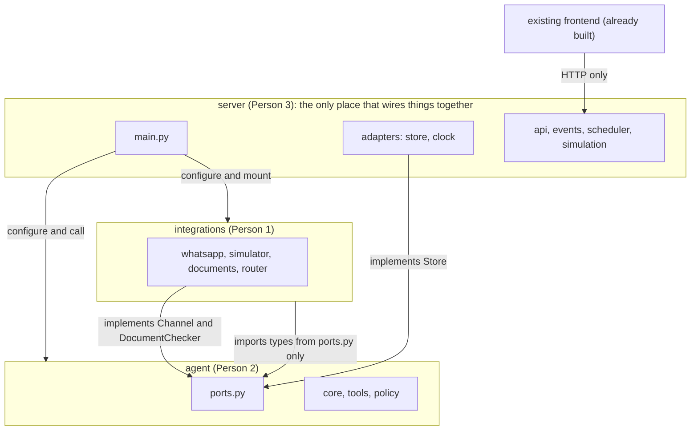
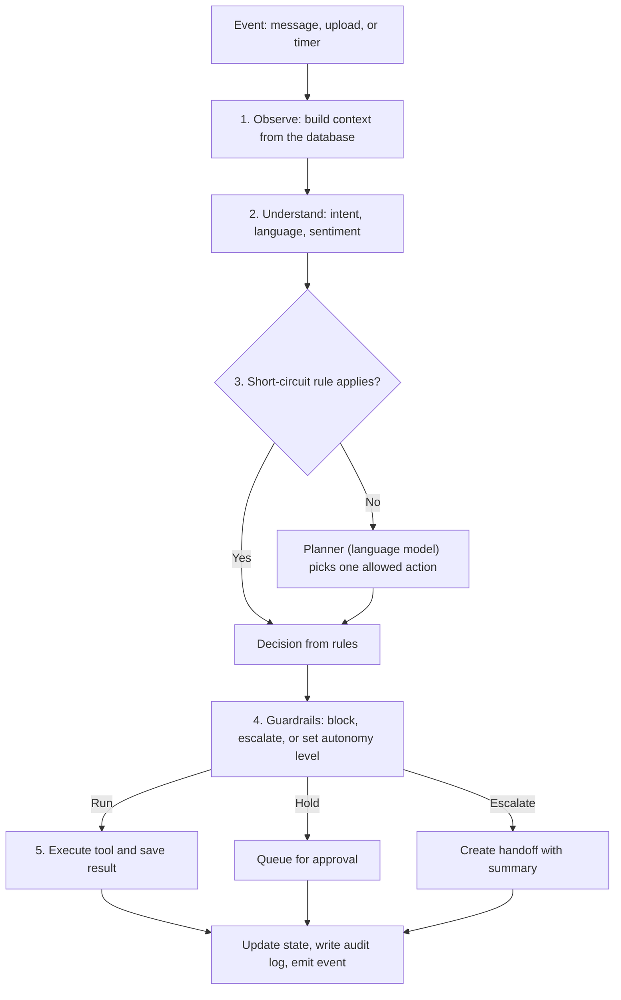
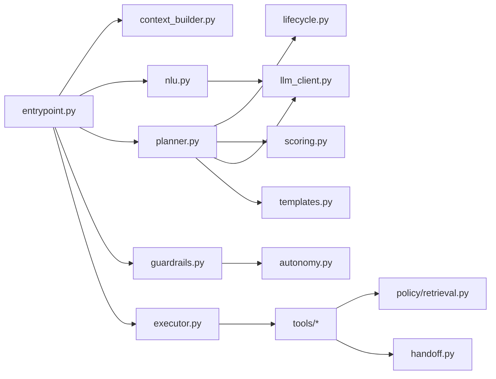
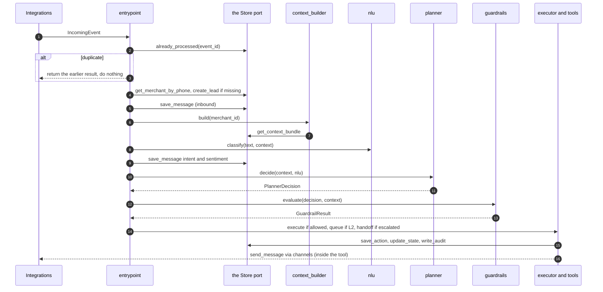
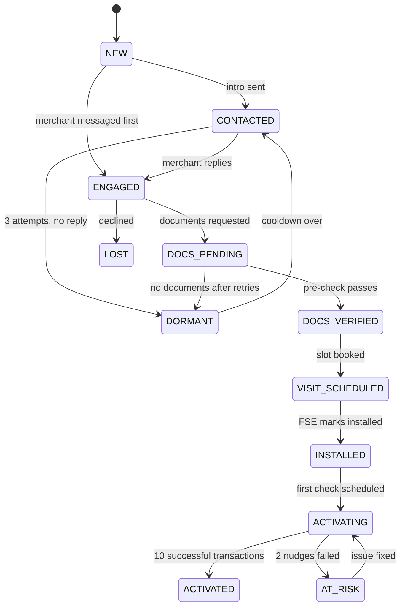

# Paytm Saathi: Agent Build Document (Person 2)

You own the part that decides what Saathi does: context, message understanding, planning, guardrails, tools, policy search, lead scoring, and handoff summaries. You do not touch WhatsApp, document images, the database, the API, or the frontend.

| | |
|---|---|
| Your folder | `agent/` (everything inside it, nothing outside it) |
| You never import | `integrations`, `server` |
| You provide | The entrypoints in section 2.3 and the ports file `agent/ports.py` |
| You consume (through ports) | Store, Channel, DocumentChecker, Clock, injected by `server/main.py` |
| Done when | AT-1 to AT-6 and AT-9 pass through the phone simulator, and your tests in section 14 are green |

### Your folder layout

```
agent/
├── __init__.py             exports configure and the six entrypoints
├── ports.py                boundary models and the Protocols the agent needs
├── settings.py             thresholds, limits, weights (read from environment)
├── .env.example            LLM key, model, cache switch, limits
├── fakes.py                FakeStore, FakeChannel, FakeDocs, FixedClock
├── cli.py                  python -m agent.cli scenario all
├── domain/
│   ├── enums.py            the enums in section 2.3
│   └── lifecycle.py        legal transitions and allowed actions per state
├── core/
│   ├── entrypoint.py       the six entrypoints
│   ├── context_builder.py
│   ├── nlu.py
│   ├── planner.py
│   ├── guardrails.py
│   ├── autonomy.py
│   ├── executor.py
│   ├── llm_client.py
│   ├── scoring.py
│   ├── handoff.py
│   └── templates.py
├── tools/                  base.py and the seven tools
├── policy/
│   ├── retrieval.py
│   └── docs/               fees.md, settlement.md, kyc_requirements.md, device_faq.md, escalation_policy.md
├── prompts/                planner.md, nlu.md, reply.md
└── tests/                  unit tests and scenario tests
```

## 1. Repository map and rules (same short section in all three documents)

The project is split into top-level folders. Each folder belongs to exactly one person. There is no shared code folder and no folder that two people edit.

### 1.1 Top-level layout

```
paytm-saathi/
├── agent/            Person 2   decides what Saathi does
├── integrations/     Person 1   talks to WhatsApp and handles documents
├── server/           Person 3   database, API, live events, scheduler, simulation, wiring
├── e2e/              Person 3   end-to-end acceptance tests
├── scripts/          Person 3
├── docs/             Person 3
└── README.md, Makefile, .env.example, CODEOWNERS, pyproject.toml   Person 3
```

The inner layout of each folder is in its owner's document. The frontend is already built and is not a folder in this repo. It only talks to the server's HTTP API.

### 1.2 Dependency rule



| Folder | May import | Never imports |
|---|---|---|
| `agent/` | Itself, standard library, third-party packages | `integrations`, `server` |
| `integrations/` | Itself, and `agent/ports.py` for the boundary types | `agent` internals, `server` |
| `server/` | Everything, because it wires the system | Nothing imports `server` |

### 1.3 How the folders connect without sharing code

- The agent declares what it needs from the outside as small Protocol interfaces in `agent/ports.py` (a store, a channel, a document checker, a clock). The rule: the side that consumes an interface defines it.
- `server/main.py` creates the real implementations and injects them at startup, for example `agent.configure(store=..., channel=..., documents=..., clock=...)` and `integrations.configure(store=..., on_incoming=agent.handle_incoming, clock=...)`.
- Types that cross a boundary live in `agent/ports.py` (they are the agent's inputs and outputs). Integrations imports them from there. Nobody else defines them again.
- Values such as lifecycle states and action types are defined once in `agent/domain/enums.py`. The server and frontend store and show them as plain strings, and a server test checks they match.
- Every folder reads its own settings from its own `settings.py` and ships its own `.env.example`. The root `.env.example` only lists the files to copy.
- If two copies of an interface description disagree, the owner's file wins: `agent/ports.py` for the boundary types and the agent's ports, `integrations/ports.py` for Integrations' own store port.

### 1.4 What you may and may not touch

You may read anything. You may edit only your own top-level folders. If you need a change somewhere else, ask the owner. `CODEOWNERS` and `make check` (which fails if a branch changes files outside the author's folders) enforce this. Branch names start with the area: `agent/…`, `integrations/…`, `server/…`.

### 1.5 Checkpoints (percent of total build time)

| When | Goal |
|---|---|
| Kickoff, first 60 to 90 minutes | Folders created, interface files written and committed, fakes in place, WhatsApp templates submitted |
| About 30% | Each area passes its own tests alone against fakes |
| About 60% | First integration through the phone simulator: AT-1 passes end to end |
| About 75% | AT-2 to AT-6 pass. Live WhatsApp (AT-7) works |
| About 85% | Feature freeze, failure drills (AT-9) |
| Last 15% | Rehearsals, backup recording, real simulation numbers into the deck |

---

## 2. What the agent is, in one page

Saathi is a loop, not a chat. On every event (merchant message, document upload, timer) it runs five steps. Only one needs a language model.



Design principle: rules first, model for the rest. Use plain code wherever a rule is enough, because it is faster, free, and predictable on demo day. Use the model for messy language and for choosing between several reasonable actions.

### 2.1 Component map



### 2.2 One `handle_incoming` call in order



### 2.3 Ports and interfaces (source of truth: `agent/ports.py`)

The agent imports nothing from other areas. Everything it needs from outside is declared here as a Protocol. The server injects the real implementations at startup with `agent.configure(store, channel, documents, clock)`. In tests you use the fakes in `agent/fakes.py`.

**Enums** (file `agent/domain/enums.py`). Never rename a value. Tell the group before adding one.

| Enum | Values |
|---|---|
| LifecycleState | NEW, CONTACTED, ENGAGED, DOCS_PENDING, DOCS_VERIFIED, VISIT_SCHEDULED, INSTALLED, ACTIVATING, ACTIVATED, AT_RISK, DORMANT, LOST |
| ActionType | SEND_INTRO, ANSWER_QUERY, REQUEST_DOCS, REREQUEST_DOC, SCHEDULE_VISIT, SEND_ACTIVATION_NUDGE, EXPLAIN_SETTLEMENT, WAIT, ESCALATE, CLOSE_LEAD, OFFER_DISCOUNT |
| AutonomyLevel | L1 (suggest), L2 (approve first), L3 (act alone) |
| ActionStatus | proposed, pending_approval, approved, executed, rejected, overridden, blocked, failed |
| Intent | greeting, interest, ask_fees, ask_documents, send_document, agree_visit, settlement_query, device_issue, complaint, ask_discount, ask_human, opt_out, not_interested, other |
| Language | hindi, hinglish, english |
| Channel | whatsapp, simulator |
| DocType | pan, address_proof |
| DocQuality | ok, blurry, unreadable |
| HandoffTarget | fse, support |

**Boundary models** (file `agent/ports.py`). These cross the border between areas.

```python
class IncomingEvent(BaseModel):          # Integrations builds it, the agent consumes it
    event_id: str                        # WhatsApp message id or uuid, used for idempotency
    channel: Channel
    kind: Literal["text", "media", "voice"]
    phone_e164: str                      # normalised, e.g. +919876543210
    text: str | None = None              # for voice: the transcript
    media_path: str | None = None        # local file path after download
    mime_type: str | None = None
    received_at: datetime

class OutgoingMessage(BaseModel):        # the agent builds it, Integrations sends it
    merchant_id: str
    phone_e164: str
    channel: Channel
    text: str                            # free-form version, used when the 24-hour window is open
    template_name: str | None = None     # approved template for when the window is closed
    template_params: list[str] = []
    language: Language

class SendResult(BaseModel):
    ok: bool
    provider_message_id: str | None = None
    used: Literal["text", "template", "none"]
    error_code: str | None = None
    error_message: str | None = None

class ProfileForKyc(BaseModel):
    owner_name: str
    shop_name: str

class DocValidationResult(BaseModel):
    quality: DocQuality
    sharpness_score: float
    extracted_pan: str | None
    pan_format_valid: bool
    name_match: bool | None              # None when no name could be read
    issues: list[str]                    # blurry, unreadable, pan_not_found, pan_format_invalid, name_mismatch
    precheck_passed: bool                # a pre-check, never "verified"

class KycResult(BaseModel):
    status: Literal["submitted", "approved", "rejected"]
    reference_id: str

class ActionSummary(BaseModel):
    id: str
    action_type: ActionType
    status: ActionStatus
    autonomy_level: AutonomyLevel
    reasoning: str

class AgentResult(BaseModel):
    merchant_id: str
    actions: list[ActionSummary]
    reply_sent: bool
    state_after: LifecycleState
```

The channel layer, not the agent, decides between free text and template. The agent never checks the 24-hour window.

**Ports the agent consumes** (Protocols in `agent/ports.py`):

| Port | Methods | Implemented by |
|---|---|---|
| `Channel` | `send_message(msg: OutgoingMessage) -> SendResult` | `integrations.router` |
| `DocumentChecker` | `validate_document(file_path, doc_type, profile) -> DocValidationResult` and `submit_to_mock_kyc(document_id) -> KycResult` | `integrations.documents` |
| `Clock` | `now() -> datetime` | `server/adapters/clock.py` |
| `Store` | see the table below | `server/adapters/agent_store.py` |

**Store port** (all reads and writes of saved data). The agent never sees SQL. It receives and returns the plain models defined in `agent/ports.py` (`MerchantView`, `DocumentView`, `MessageView`, `TicketView`, `SettlementView`, `ContextBundle`).

| Method | Notes |
|---|---|
| `get_merchant_by_phone(phone_e164)` | MerchantView or None |
| `get_merchant(merchant_id)` | |
| `create_lead(phone_e164, channel, language_guess)` | Creates a NEW lead, assigns an FSE, default score |
| `update_lead_score(merchant_id, score, explanation)` | |
| `already_processed(event_id)` | Idempotency check |
| `save_message(merchant_id, direction, channel, kind, text, event_id=None, provider_message_id=None, intent=None, sentiment=None)` | Idempotent on `event_id` |
| `save_document(merchant_id, doc_type, file_path)` and `update_document_validation(document_id, result)` | Increments `attempts` |
| `get_context_bundle(merchant_id)` | merchant, documents, txn_count, last_txn_at, device status, installed_at, open tickets, latest settlement, last 10 messages, visits, counters (nudges sent, document re-requests, contact attempts, messages today), consent |
| `save_action(...)` and `update_action_status(action_id, status, ...)` | Stores reasoning, confidence, source, autonomy level, guardrail notes, prompt version |
| `update_state(merchant_id, new_state, reason)` | |
| `create_visit(...)` and `find_nearby_leads(merchant_id, radius_km, states)` | Used by `schedule_visit` |
| `get_settlement(merchant_id)` | Latest row or None |
| `create_handoff(...)` | Also creates a ticket |
| `get_autonomy_level(action_type)` | |
| `set_consent(merchant_id, consent)` | For opt-outs |
| `write_audit(actor, event_type, merchant_id, payload)` | Append-only |
| `schedule_job(merchant_id, reason, run_at)` | Timer storage. The server runs due jobs |

**Entrypoints the agent provides** (exported from `agent/__init__.py`):

| Function | Called by | Purpose |
|---|---|---|
| `configure(store, channel, documents, clock, settings=None)` | `server/main.py` | Wire the ports once at startup |
| `handle_incoming(event: IncomingEvent) -> AgentResult` | Integrations (injected) | Full loop for one message or upload |
| `handle_timer(merchant_id: str, reason: str) -> AgentResult` | Server scheduler | Loop for a timer such as `activation_check` |
| `run_batch(limit: int = 120) -> list[AgentResult]` | Server API | The "overnight" run over ranked leads |
| `preview_next_action(merchant_id: str) -> ActionSummary` | Server API | Planner proposal with no side effects |
| `approve_action(action_id: str, by: str, edits: dict \| None = None) -> AgentResult` | Server API | Execute a pending L2 action |
| `reject_action(action_id: str, by: str, reason_code: str) -> AgentResult` | Server API | Reject and log an override |

## 3. Lifecycle and allowed actions

State changes only through `store.update_state`, and only the transitions below are legal.



Allowed actions per state (`lifecycle.allowed_actions(state)`; the planner may never return anything outside this set):

| State | Allowed actions |
|---|---|
| NEW | SEND_INTRO, WAIT, CLOSE_LEAD, ANSWER_QUERY (when the merchant messaged first) |
| CONTACTED | SEND_INTRO (retry), ANSWER_QUERY, WAIT, ESCALATE |
| ENGAGED | ANSWER_QUERY, REQUEST_DOCS, SCHEDULE_VISIT, ESCALATE, CLOSE_LEAD, OFFER_DISCOUNT |
| DOCS_PENDING | REQUEST_DOCS, REREQUEST_DOC, ANSWER_QUERY, WAIT, ESCALATE |
| DOCS_VERIFIED | SCHEDULE_VISIT, ESCALATE |
| VISIT_SCHEDULED | WAIT, ANSWER_QUERY, ESCALATE |
| INSTALLED, ACTIVATING | SEND_ACTIVATION_NUDGE, ANSWER_QUERY, EXPLAIN_SETTLEMENT, WAIT, ESCALATE |
| AT_RISK | ESCALATE, SEND_ACTIVATION_NUDGE |
| ACTIVATED | EXPLAIN_SETTLEMENT, ANSWER_QUERY, ESCALATE, WAIT |
| DORMANT, LOST | WAIT (and SEND_INTRO after the cooldown) |

Retry limits (constants in `agent/settings.py`): contact attempts 3, activation nudges 2, document re-requests 2, messages per day 3.

## 4. Action menu

| Action | Tools used | Default autonomy | Parameters |
|---|---|---|---|
| SEND_INTRO | send_whatsapp | L3 | template id |
| ANSWER_QUERY | search_policy, send_whatsapp | L3 | query |
| REQUEST_DOCS | send_whatsapp | L3 | doc types |
| REREQUEST_DOC | send_whatsapp | L3 | doc type, issues |
| SCHEDULE_VISIT | schedule_visit, send_whatsapp | L3 | preferred slot |
| SEND_ACTIVATION_NUDGE | send_whatsapp | L3 | nudge number |
| EXPLAIN_SETTLEMENT | check_settlement, send_whatsapp | L3 | none |
| WAIT | none (schedules a recheck) | L3 | days |
| ESCALATE | escalate_to_human, send_whatsapp (holding reply) | L3 | target, reason |
| CLOSE_LEAD | none | L1 | reason |
| OFFER_DISCOUNT | none | L2, never auto in MVP | amount |

## 5. Observe, understand, plan

### 5.1 Context (`context_builder.build(merchant_id) -> Context`)

Calls `store.get_context_bundle` and shapes it for the planner.

```python
class Context(BaseModel):
    merchant: MerchantView        # id, shop, owner, category, area, language, state, lead_score
    docs: DocsView                # status, attempts, last_issues
    activity: ActivityView        # txn_count, last_txn_at, device_status, installed_at
    open_tickets: list[TicketView]
    recent_messages: list[MessageView]   # last 10, with direction and intent
    counters: Counters            # contact_attempts, nudges_sent, doc_rerequests, messages_today
    settlement: SettlementView | None
    consent: bool
    now: datetime                 # from clock
```

### 5.2 Message understanding (`nlu.classify(text, context) -> NluResult`)

```python
class NluResult(BaseModel):
    intent: Intent
    language: Language
    sentiment: float              # -1 (angry) to +1 (happy)
    wants_human: bool
    mentions_money: bool
    confidence: float
```

Implementation: model call with JSON output, plus a keyword fallback that runs when the model fails or times out. Keep the fallback list in `nlu.py`:

| Intent | Example keywords (Hindi, Hinglish, English) |
|---|---|
| ask_human | baat karao, manager, human, insaan, call karo, kisi se baat |
| ask_fees | fees, charge, kitna, rental, kitne ka, price |
| settlement_query | settlement, paisa nahi aaya, payment nahi aaya, account mein nahi |
| ask_discount | discount, kam karo, free, waive, chhoot |
| complaint | bekar, fraud, dhokha, band karo, wapas, return |
| opt_out | stop, mat bhejo, band karo messages, unsubscribe |
| agree_visit | theek hai, haan, ok, aa jao, visit |

### 5.3 Planner (`planner.decide(context, nlu, event) -> PlannerDecision`)

```python
class PlannerDecision(BaseModel):
    action: ActionType
    params: dict = {}
    language: Language
    reasoning: str                # one or two sentences, shown in the UI
    confidence: float             # 0 to 1
    source: Literal["rule", "llm", "fallback"]
```

Document uploads: the entrypoint saves the file with `store.save_document`, runs the `validate_kyc_doc` tool, adds the result to the context, and then plans.

Order of evaluation:

1. Compute `allowed = lifecycle.allowed_actions(state)`.
2. Run short-circuit rules (table below). The first rule that matches wins, with `source="rule"`.
3. Otherwise call the model with the prompt in 5.4 and validate the JSON. If the action is not in `allowed`, retry once. If it still fails or times out, return ESCALATE with `source="fallback"`.

Short-circuit rules:

| Condition | Decision |
|---|---|
| intent is opt_out | Set consent false, no outbound message. Action WAIT with reasoning "opt-out" |
| nlu.wants_human, or sentiment below -0.5 | ESCALATE to fse |
| event is a document upload and validation passed | SCHEDULE_VISIT |
| event is a document upload and validation failed and re-requests under 2 | REREQUEST_DOC |
| event is a document upload and validation failed and re-requests at 2 | ESCALATE to fse |
| intent is settlement_query | EXPLAIN_SETTLEMENT (support if no settlement row) |
| intent is ask_discount | OFFER_DISCOUNT (will be held by guardrails) |
| timer `activation_check`, txn_count is 0, nudges under 2 | SEND_ACTIVATION_NUDGE |
| timer `activation_check`, txn_count is 0, nudges at 2 | ESCALATE to fse |
| timer `followup`, contact attempts at 3 | WAIT and move to DORMANT |
| intent is not_interested | CLOSE_LEAD |

Everything else (fee questions, objections, "I will think about it", unclear replies) goes to the model.

### 5.4 Planner prompt (file: `agent/prompts/planner.md`)

Sections, in order: role and goal ("get this merchant to 10 successful transactions"), the allowed actions with one-line meanings, hard rules ("never state a fee, date, or status that is not in tool output", "never offer discounts or loans", "prefer escalation when unsure"), the context as compact JSON, the NLU result, and the required output schema. Temperature 0 to 0.2. Keep the prompt under about 1,500 tokens. Version the file and log its version in every action.

### 5.5 Writing the merchant-facing text

| Situation | How the text is produced |
|---|---|
| Intro, document checklist, visit confirmation, nudge | Fixed template from `templates.py`, filled with merchant fields |
| Policy answer (fees, settlement terms) | Model writes a short reply using only the retrieved passages |
| Settlement explanation | Template filled from `check_settlement` output |
| Holding replies (discount, escalation) | Fixed template |

Grounded-claim check (in guardrails, section 6): every number, currency amount, and date in the outgoing text must also appear in the tool output or retrieved passages of the same step. If not, replace the text with the safe template or escalate.

## 6. Guardrails and autonomy

`guardrails.evaluate(decision, context, tool_outputs) -> GuardrailResult`

```python
class GuardrailResult(BaseModel):
    verdict: Literal["run", "hold", "escalate", "block"]
    autonomy_level: AutonomyLevel
    notes: list[str]              # shown in the UI
```

Evaluation order (stop at the first that triggers):

1. Hard blocks: no consent, quiet hours (21:00 to 08:00 by `clock`), more than 3 outbound messages today, unverifiable claim, forbidden action (loan offers, refunds, autonomous discounts). Verdict `block`, status `blocked`, reason logged.
2. Escalation triggers: negative sentiment, human requested, planner confidence under 0.6, retry limits exhausted, sensitive topics (fraud, chargeback, legal). Verdict `escalate`.
3. Autonomy lookup: `store.get_autonomy_level(action_type)`. L1 gives verdict `hold` with status `proposed` (show as suggestion). L2 gives `hold` with status `pending_approval`. L3 gives `run`.
4. OFFER_DISCOUNT always returns `hold` at L2 with the note "Discounts are never promised autonomously".

When a hard block applies to a message the merchant is waiting on (for example quiet hours on a reply), schedule the send for 08:00 instead of dropping it.

## 7. Tools (folder `agent/tools/`)

Every tool is a typed function with Pydantic input and output, wrapped by `agent/tools/base.py`, which validates input, catches errors, and returns a `ToolResult(ok, data, error)`. The LLM never calls a tool directly.

| Tool | Input | Output | Side effects |
|---|---|---|---|
| `get_lead_context` | merchant_id | Context | none |
| `send_whatsapp` | merchant_id, text, template_name, template_params, language | SendResult (from Integrations) | saves outbound message |
| `validate_kyc_doc` | document_id | DocValidationResult plus `KycResult` when the pre-check passes | updates the document row, sets attempts, calls `documents.mock_kyc.submit_to_mock_kyc` on a pass |
| `schedule_visit` | merchant_id, preferred_slot | visit_id, fse_id, slot, cluster_size | creates visit, state to VISIT_SCHEDULED |
| `check_settlement` | merchant_id | status, amount, expected_date, delay_reason or None | none |
| `search_policy` | query, language | passages (source, text, score) | none |
| `escalate_to_human` | merchant_id, reason, target | handoff_id, summary | creates handoff and ticket |

Details:

- `schedule_visit`: use `store.find_nearby_leads(merchant_id, radius_km=2, states=[DOCS_VERIFIED])`, order the cluster by nearest neighbour from the FSE start point, give each stop a 45-minute slot starting at 11:00 the next working day, and set the visit for the merchant. `cluster_size` includes the merchant.
- `search_policy`: see section 10. Returns an empty list when the best score is under the threshold.
- `escalate_to_human`: calls `handoff.build_summary(context, decision)`, then `store.create_handoff`.

## 8. Message templates (file: `agent/core/templates.py`)

Template ids must match the template names Person 1 submits to WhatsApp. Each template has a `text` (used inside the 24-hour window) and the approved WhatsApp body (used outside it).

| Template id | Used when | Parameters |
|---|---|---|
| `saathi_intro_hi` | First contact, Hindi or Hinglish | owner_name |
| `saathi_intro_en` | First contact, English | owner_name |
| `saathi_doc_request` | REQUEST_DOCS | owner_name |
| `saathi_doc_rerequest` | REREQUEST_DOC | owner_name, doc_type |
| `saathi_visit_confirm` | SCHEDULE_VISIT | owner_name, date, time, fse_name |
| `saathi_activation_nudge` | SEND_ACTIVATION_NUDGE | owner_name |
| `saathi_followup` | Re-engagement after silence | owner_name |

Language follows `merchant.language`, and is updated from NLU when the merchant writes in another language.

## 9. Lead scoring (file: `agent/core/scoring.py`)

Plain function, no model. Score from 0 to 100.

```
score = 100 * (0.30 * footfall + 0.25 * category_value + 0.20 * engagement
             + 0.15 * responsiveness + 0.10 * proximity)
```

| Factor | Definition |
|---|---|
| footfall | `merchant.footfall_score`, 0 to 1 from seed data |
| category_value | kirana 1.0, restaurant 0.9, pharmacy 0.9, sweet shop 0.8, salon 0.7, clothing 0.7, mobile repair 0.6, chai stall 0.6 |
| engagement | 0 for no reply, 0.5 for replied, 1.0 for asked questions or sent documents |
| responsiveness | 1.0 if median reply time under 10 minutes, 0.5 under 2 hours, else 0.2, 0.3 if unknown |
| proximity | number of other leads within 2 km divided by 5, capped at 1 |

Return `(score, explanation)` where explanation is a short string such as "high footfall, replied in 5 minutes, 4 nearby leads". Weights live in `agent/settings.py`. Call `store.update_lead_score` after each inbound event and from `run_batch`.

## 10. Policy documents and retrieval

Files in `agent/policy/docs/` (all marked "MOCK, not real Paytm pricing"): `fees.md`, `settlement.md`, `kyc_requirements.md`, `device_faq.md`, `escalation_policy.md`. Write short, factual, headed sections. Example facts you can invent and keep consistent: Soundbox rental per month, UPI charge, settlement within one working day, bank-holiday delay rule, documents required (PAN, address proof).

Retrieval (`agent/policy/retrieval.py`): split by heading, rank with BM25 (`rank_bm25`), return the top 3 as `source` (file and heading), `text`, `score`. Threshold in `agent/settings.py`. Below the threshold return an empty list, which makes the planner escalate or ask a clarifying question. Hindi queries: add a small synonym map (kitna, fees, charge to "fee") before ranking, or switch to embeddings later.

## 11. Handoff summary (file: `agent/core/handoff.py`)

`build_summary(context, decision) -> HandoffSummary`

| Field | Source |
|---|---|
| headline | Merchant, shop, area, language |
| state and score | Context |
| what_happened | Last 5 actions and messages, condensed by the model or a template |
| sentiment and objection | NLU of the last messages |
| documents | Context docs status |
| recommended_next_step | Rule table by reason: discount request gives "Call within 2 hours and discuss pricing in person", idle device gives "Call after 3 pm, check QR placement and network", settlement complexity gives "Check with the settlement team, then call back" |

A person must be able to act in under a minute without asking the merchant anything.

## 12. Timers (the agent side)

The agent decides when to look at a merchant again by calling `store.schedule_job(merchant_id, reason, run_at)`. Platform runs due jobs and calls `handle_timer`.

| Reason | Scheduled when | Run at |
|---|---|---|
| `activation_check` | State becomes INSTALLED or after each nudge | 24 hours later |
| `followup` | After SEND_INTRO with no reply, or WAIT | 2 days later |
| `settlement_recheck` | After EXPLAIN_SETTLEMENT with a delay | The expected date plus 2 hours |
| `docs_reminder` | After REQUEST_DOCS with no upload | 1 day later |

## 13. LLM client (file: `agent/core/llm_client.py`)

Interface: `generate_json(prompt: str, schema: type[BaseModel], timeout_s: float = 8) -> BaseModel` and `generate_text(prompt: str, timeout_s: float = 8) -> str`. Provider and model come from `.env`. Requirements: timeout, one retry, schema validation, and a cache keyed by a hash of prompt plus model that Platform can switch on for demo day (`LLM_CACHE=on`). On failure raise `LLMUnavailable`; callers use fallbacks (planner gives ESCALATE, NLU uses keywords). Log latency and token counts per call.

## 14. Build order, tests, and success criteria

### 14.1 Build order

1. Enums, `lifecycle.py`, `config` constants, fake `send_message` and in-memory repo for local runs (30 minutes).
2. `scoring.py`, `templates.py`, `agent/policy/retrieval.py` with the five policy files.
3. Tools one by one with unit tests. `send_whatsapp` and `validate_kyc_doc` call the mock versions until Integrations delivers.
4. `nlu.py` with keyword fallback first, then the model path.
5. `guardrails.py` and `autonomy.py`.
6. `planner.py` with rules first, then the model path.
7. `executor.py` and `entrypoint.py`. Add a CLI `python -m agent.cli scenario rahul` that prints a transcript.
8. `handoff.py`, timers, `run_batch`, `preview_next_action`, approve and reject.

### 14.2 Unit tests (folder `agent/tests/`)

| ID | Test | Expected |
|---|---|---|
| AG-01 | `allowed_actions` for every state | Matches the table in section 3 |
| AG-02 | Planner returns an action outside `allowed` (mock the model) | Retried once, then ESCALATE with `source="fallback"` |
| AG-03 | Short-circuit rules, one test per row | Correct action, `source="rule"`, no model call made |
| AG-04 | Guardrails, one test per hard block and per escalation trigger | Correct verdict, status, and note |
| AG-05 | Autonomy: L1, L2, L3 for the same action | `hold`/proposed, `hold`/pending_approval, `run` |
| AG-06 | Grounded-claim check: text with a fee not in tool output | Blocked and replaced with the safe template |
| AG-07 | `search_policy` with a fee question and with nonsense | Fee passage returned, then empty list |
| AG-08 | `schedule_visit` with 3 nearby leads in seed data | `cluster_size` of 4, slots 45 minutes apart |
| AG-09 | Lead scoring on three fixtures | Matches hand-computed scores, explanation non-empty |
| AG-10 | Same `event_id` delivered twice | One action, one reply |
| AG-11 | LLM timeout in NLU and planner | Keyword fallback and ESCALATE, no exception |
| AG-12 | Opt-out message | Consent false, no outbound message afterwards |
| AG-13 | Retry limits | Third document re-request becomes ESCALATE. Third nudge becomes ESCALATE |
| AG-14 | Quiet hours at 22:00 | Outbound message blocked, send rescheduled for 08:00 |

### 14.3 Scenario tests (run through the simulator channel)

| ID | Scenario | Final state and assertions |
|---|---|---|
| AG-S1 | Rahul (AT-1, then agree to visit) | ANSWER_QUERY then SCHEDULE_VISIT, both L3 executed. State VISIT_SCHEDULED. Audit names `fees.md` |
| AG-S2 | Meena (AT-2) | REREQUEST_DOC then SCHEDULE_VISIT. Document attempts 2. State VISIT_SCHEDULED |
| AG-S3 | Sunil (AT-3) | Two nudges, then handoff to fse, state AT_RISK |
| AG-S4 | Farida (AT-4) | EXPLAIN_SETTLEMENT with the expected date in the text. With no settlement row: ESCALATE to support |
| AG-S5 | Vikram (AT-5) | OFFER_DISCOUNT pending_approval with a holding reply, then ESCALATE with summary. Approve executes, reject logs an override |
| AG-S6 | Pooja | SEND_INTRO, state CONTACTED |

### 14.4 Success criteria for your area

- All AG tests green. No test needs the network (the model is mocked).
- `handle_incoming` takes under 1 second with mocks and under about 6 seconds with the real model.
- Every action row contains: reasoning, confidence, source (rule, llm, fallback), autonomy level, guardrail notes, prompt version.
- Zero direct database writes from agent code. Only `store`.
- `python -m agent.cli scenario all` runs all six scenarios and prints a pass or fail line for each.

## 15. Mocks you provide, and what you can use while waiting

| You provide | Used by |
|---|---|
| `agent/fakes.py` (FakeStore, FakeChannel, FakeDocs, FixedClock for everyone's tests) | Integrations, Platform |
| CLI scenario runner | Everyone, to see the agent work |

| You use while waiting | From |
|---|---|
| In-memory `store` stub in `tests/agent/conftest.py` | Yourself, until `the Store port` is ready |
| `FakeChannel` and `FakeDocs` in `agent/fakes.py` | Yourself, until Integrations delivers |

## 16. Risks and debugging

| Risk | Handling |
|---|---|
| Model returns invalid JSON | Schema validation, one retry, then fallback |
| Model invents a fee | Grounded-claim check blocks it. Test AG-06 |
| Slow responses at the finals | Rules first, LLM cache on, short prompts, 8-second timeout |
| Hindi or Hinglish misclassified | Keyword fallback list. Add keywords as you test |
| Scenario flakiness | Temperature 0, fixed seeds, cached responses for the demo |
| Merging with other areas | Only talk through the interfaces in section 1 |

## 17. Instructions for an AI coding assistant working in this area

1. You may edit only the `agent/` folder. Do not create or change files anywhere else.
2. Never import from `integrations` or `server`. Everything external comes through the ports in `agent/ports.py`. If a port needs to change, stop and write a proposal.
3. The model proposes. Only guardrails and tools change state. Never let model output reach the database or the channel without going through `executor`.
4. Every state change must go through `store.update_state`, and every action must be saved with `store.save_action` and `store.write_audit`.
5. Never state fees, dates, or statuses from model memory. They must come from `search_policy` or `check_settlement` in the same step.
6. Never describe the document pre-check as KYC verification.
7. Use `clock.now()` for time and the constants in `agent/settings.py` for limits.
8. Write the test first or alongside. A task is done only when its AG tests pass.
