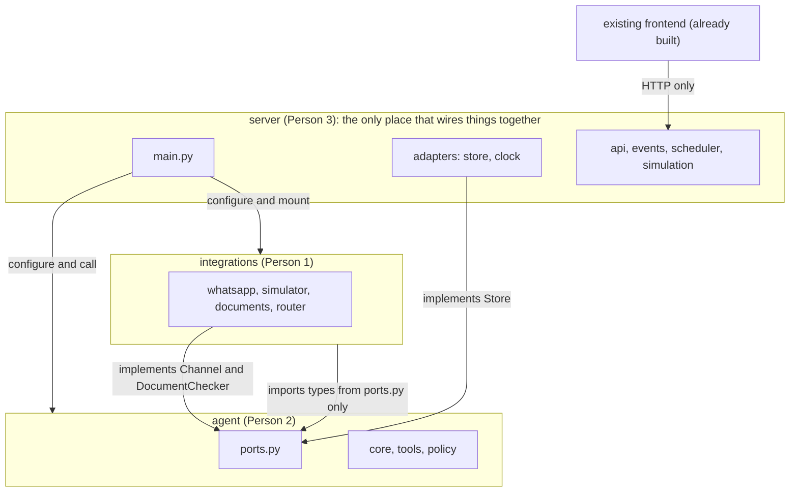
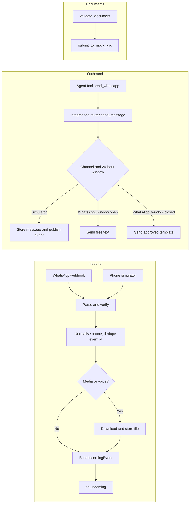
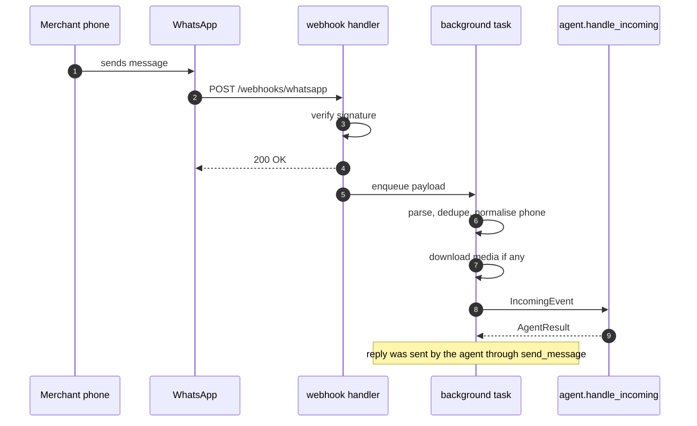
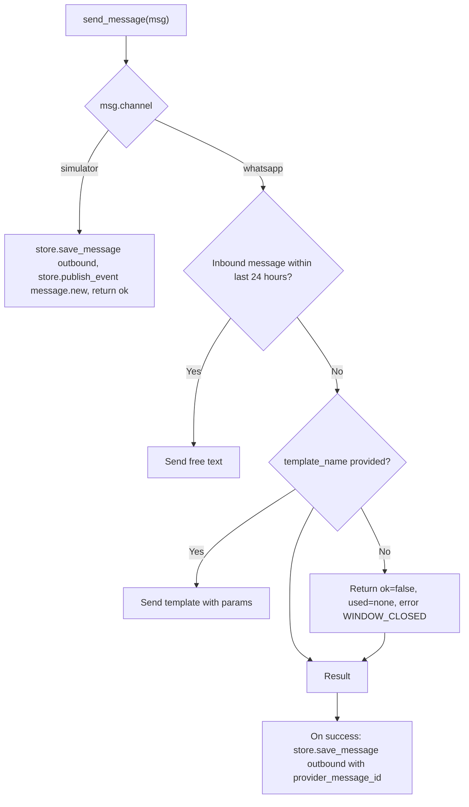
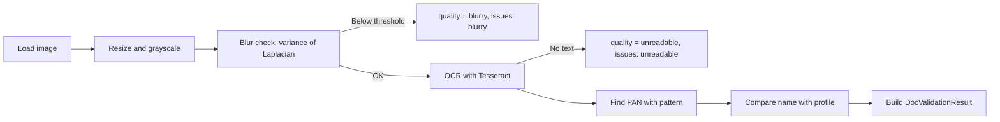

# Paytm Saathi: Integrations Build Document (Person 1)

You own everything that connects Saathi to the outside world: the WhatsApp channel, the phone simulator channel, media and voice handling, and the document pre-check with the mock KYC service. You do not decide what Saathi does, store data, or serve the frontend.

| | |
|---|---|
| Your folder | `integrations/` (everything inside it, nothing outside it) |
| You import | Only `agent/ports.py` and `agent/domain/enums.py` from the agent folder |
| You provide | The `Channel` and `DocumentChecker` implementations, the WhatsApp webhook router, the simulator |
| You consume (through ports) | Your own `Store` port, an injected `on_incoming` callable, and a `Clock`, all injected by `server/main.py` |
| Done when | AT-7 and AT-9 (channel parts) pass, AT-1 and AT-2 pass through your simulator, and your tests in section 12 are green |

### Your folder layout

```
integrations/
├── __init__.py             exports configure
├── ports.py                your Store port and MerchantRef
├── settings.py             WhatsApp keys, blur threshold, upload limits
├── .env.example
├── router.py               send_message: picks channel, text or template, retries
├── phone.py                normalize and mask
├── errors.py               maps provider error codes to SendResult errors
├── simulator.py            phone simulator channel
├── voice.py                stretch
├── whatsapp/
│   ├── __init__.py         status()
│   ├── webhook.py          the APIRouter: verify and receive
│   ├── security.py         signature check
│   ├── parser.py           payload to IncomingEvent
│   ├── client.py           Graph API calls (send text, send template)
│   └── media.py            media download
├── documents/
│   ├── __init__.py         exposes validate_document and submit_to_mock_kyc
│   ├── validate.py, quality.py, ocr.py, pan.py
│   ├── mock_kyc.py
│   ├── make_samples.py     builds the synthetic images
│   └── samples/            generated sample documents
└── tests/                  tests and fakes.py
```

## 1. Repository map and rules (same short section in all three documents)

The project is split into top-level folders. Each folder belongs to exactly one person. There is no shared code folder and no folder that two people edit.

### 1.1 Top-level layout

```
paytm-saathi/
├── agent/            Person 2   decides what Saathi does
├── integrations/     Person 1   talks to WhatsApp and handles documents
├── server/           Person 3   database, API, live events, scheduler, simulation, wiring
├── e2e/              Person 3   end-to-end acceptance tests
├── scripts/          Person 3
├── docs/             Person 3
└── README.md, Makefile, .env.example, CODEOWNERS, pyproject.toml   Person 3
```

The inner layout of each folder is in its owner's document. The frontend is already built and is not a folder in this repo. It only talks to the server's HTTP API.

### 1.2 Dependency rule



| Folder | May import | Never imports |
|---|---|---|
| `agent/` | Itself, standard library, third-party packages | `integrations`, `server` |
| `integrations/` | Itself, and `agent/ports.py` for the boundary types | `agent` internals, `server` |
| `server/` | Everything, because it wires the system | Nothing imports `server` |

### 1.3 How the folders connect without sharing code

- The agent declares what it needs from the outside as small Protocol interfaces in `agent/ports.py` (a store, a channel, a document checker, a clock). The rule: the side that consumes an interface defines it.
- `server/main.py` creates the real implementations and injects them at startup, for example `agent.configure(store=..., channel=..., documents=..., clock=...)` and `integrations.configure(store=..., on_incoming=agent.handle_incoming, clock=...)`.
- Types that cross a boundary live in `agent/ports.py` (they are the agent's inputs and outputs). Integrations imports them from there. Nobody else defines them again.
- Values such as lifecycle states and action types are defined once in `agent/domain/enums.py`. The server and frontend store and show them as plain strings, and a server test checks they match.
- Every folder reads its own settings from its own `settings.py` and ships its own `.env.example`. The root `.env.example` only lists the files to copy.
- If two copies of an interface description disagree, the owner's file wins: `agent/ports.py` for the boundary types and the agent's ports, `integrations/ports.py` for Integrations' own store port.

### 1.4 What you may and may not touch

You may read anything. You may edit only your own top-level folders. If you need a change somewhere else, ask the owner. `CODEOWNERS` and `make check` (which fails if a branch changes files outside the author's folders) enforce this. Branch names start with the area: `agent/…`, `integrations/…`, `server/…`.

### 1.5 Checkpoints (percent of total build time)

| When | Goal |
|---|---|
| Kickoff, first 60 to 90 minutes | Folders created, interface files written and committed, fakes in place, WhatsApp templates submitted |
| About 30% | Each area passes its own tests alone against fakes |
| About 60% | First integration through the phone simulator: AT-1 passes end to end |
| About 75% | AT-2 to AT-6 pass. Live WhatsApp (AT-7) works |
| About 85% | Feature freeze, failure drills (AT-9) |
| Last 15% | Rehearsals, backup recording, real simulation numbers into the deck |

---

## 2. What you are building



Three deliverables, in priority order:

1. The simulator channel and a router, so the other two areas are never blocked by Meta.
2. The document pre-check, because the blurry-PAN story is in the demo.
3. The live WhatsApp channel.

## 3. Interfaces you implement and use

### 3.1 Ports you implement (defined in `agent/ports.py`, which is the source of truth)

| Port | Method | Your module |
|---|---|---|
| `Channel` | `send_message(msg: OutgoingMessage) -> SendResult` | `integrations/router.py` |
| `DocumentChecker` | `validate_document(file_path, doc_type, profile) -> DocValidationResult` | `integrations/documents/validate.py` |
| `DocumentChecker` | `submit_to_mock_kyc(document_id) -> KycResult` | `integrations/documents/mock_kyc.py` |

You import `IncomingEvent`, `OutgoingMessage`, `SendResult`, `ProfileForKyc`, `DocValidationResult`, `KycResult`, `AgentResult`, `Language`, `Channel`, `DocType`, `DocQuality` from `agent/ports.py` and `agent/domain/enums.py`. These are the only things you import from the agent folder. The agent's `validate_kyc_doc` tool calls `submit_to_mock_kyc` when the pre-check passes (confirm with Person 2 at kickoff).

### 3.2 Things you expose

| Item | Where | Used by |
|---|---|---|
| `integrations.configure(store, on_incoming, clock)` | `integrations/__init__.py` | `server/main.py`, once at startup |
| Webhook router (GET and POST `/webhooks/whatsapp`) | `integrations.whatsapp.webhook.router` (a FastAPI `APIRouter`) | Mounted by `server/main.py` |
| Simulator: `receive_text(merchant_id, text)` and `receive_media(merchant_id, file_bytes, filename, mime)` | `integrations/simulator.py` | Server API routes `/chat` and `/documents` |
| `phone.normalize(raw) -> str` and `phone.mask(e164) -> str` | `integrations/phone.py` | Anyone who needs it (it is a pure function, copy the call, not the code) |
| `whatsapp.status()` | `integrations/whatsapp/__init__.py` | Server `/api/health` |

### 3.3 Ports you declare yourself (file `integrations/ports.py`, you own it)

```python
class MerchantRef(BaseModel):
    id: str
    phone_e164: str
    language: Language
    preferred_channel: Channel

class Store(Protocol):
    def already_processed(self, event_id: str) -> bool: ...
    def get_merchant_by_phone(self, phone_e164: str) -> MerchantRef | None: ...
    def get_merchant(self, merchant_id: str) -> MerchantRef | None: ...
    def last_inbound_at(self, merchant_id: str) -> datetime | None: ...
    def save_message(self, merchant_id: str, direction: str, channel: str, kind: str,
                     text: str | None, provider_message_id: str | None = None) -> None: ...
    def write_audit(self, actor: str, event_type: str, merchant_id: str | None, payload: dict) -> None: ...
    def publish_event(self, type: str, merchant_id: str | None, data: dict) -> None: ...
```

`on_incoming` is the agent's `handle_incoming`, injected by the server as a plain callable taking an `IncomingEvent` and returning an `AgentResult`. `clock` is the `Clock` protocol from `agent/ports.py`. In your tests, use your own small fakes in `integrations/tests/fakes.py` (an in-memory Store, a recording `on_incoming`, a fixed clock).

## 4. WhatsApp Cloud API setup (Meta)

This reflects public documentation and developer guides as of late 2026. Confirm details in your Meta dashboard, because versions and limits change.

### 4.1 One-time setup (do this first, today)

1. Create a Meta developer account and a Business app. Add the WhatsApp product. You receive a temporary test phone number, a Phone Number ID, and a WhatsApp Business Account ID.
2. Under API Setup, add recipient phone numbers. The free test number can only message up to 5 verified recipients, so add your teammates' phones and any phones you will use in the demo. Sending to any other number fails with an "allowed list" error.
3. Create a permanent token: Business Settings, Users, System users, create an admin system user, give it WhatsApp messaging and management permissions, and generate a token. User tokens expire in 24 hours, so do not use them.
4. Note the App Secret (for signature checks) and choose a Verify Token string for the webhook handshake.
5. Submit message templates (section 4.2). Approval commonly takes 24 to 48 hours, so submit on day one.
6. Start a public HTTPS tunnel (ngrok or Cloudflare Tunnel) and register `https://<tunnel>/webhooks/whatsapp` as the webhook URL. Subscribe to the `messages` field.

### 4.2 Message rules that shape the design

| Rule | Consequence for you |
|---|---|
| The first message to a person must be an approved template | Outbound-first messages (intros, nudges after silence) use `template_name`. The router falls back to text only when the window is open |
| When the person replies, you can send free text for 24 hours | The router tracks the last inbound time per merchant and checks it before every send |
| Webhooks must be on a public HTTPS URL with a trusted certificate and must reply quickly | Return 200 immediately, process in a background task |
| Test number: up to 5 recipients | Plan the demo phones in advance |
| Known errors seen in documentation | Outside the 24-hour window (code 131047), recipient not in allowed list (131030), template parameter count mismatch (132000). Verify codes in your dashboard and map them in `errors.py` |

For the live demo, open the window by messaging the Saathi number from the demo phone a few minutes before you start. Then free-text replies work even for outbound messages.

### 4.3 Templates to submit

Names must match the Agent document (section 8). Use `{{1}}`, `{{2}}` for parameters. Meta may categorise intros as marketing. That is fine for the test number.

| Name | Language code | Draft body |
|---|---|---|
| `saathi_intro_hi` | hi | नमस्ते {{1}} जी! आपकी दुकान के लिए Paytm Soundbox उपयोगी हो सकता है। क्या मैं जानकारी भेजूं? |
| `saathi_intro_en` | en | Hello {{1}}! A Paytm Soundbox could help your shop confirm payments instantly. Shall I share the details? |
| `saathi_doc_request` | en | Hi {{1}}, please send a clear photo of your PAN card and an address proof to continue. |
| `saathi_doc_rerequest` | en | Hi {{1}}, the photo of your {{2}} was not clear. Could you please send it again? |
| `saathi_visit_confirm` | en | Hi {{1}}, our executive {{4}} will visit your shop on {{2}} at {{3}}. |
| `saathi_activation_nudge` | en | Hi {{1}}, ask your first customer to scan the QR to complete your first payment. |
| `saathi_followup` | en | Hi {{1}}, just checking in about your Soundbox. Reply here whenever you are ready. |

## 5. Inbound: the webhook

### 5.1 Endpoints

| Method | Path | Behaviour |
|---|---|---|
| GET | `/webhooks/whatsapp` | If `hub.mode` is subscribe and `hub.verify_token` matches, return `hub.challenge` as plain text. Otherwise 403 |
| POST | `/webhooks/whatsapp` | Verify signature, enqueue processing, return 200 within about 1 second |

### 5.2 Signature check

Compute HMAC-SHA256 of the raw request body using the App Secret and compare, in constant time, with the `X-Hub-Signature-256` header (format `sha256=<hex>`). Reject on mismatch. Parse JSON only after verifying.

### 5.3 What arrives

The body nests as `entry`, then `changes`, then `value`. `value` contains `metadata` (with the Phone Number ID), and either `messages` or `statuses`.

| Field | Meaning |
|---|---|
| `messages[].from` | Sender number without the plus sign |
| `messages[].id` | Message id. Use as `event_id` |
| `messages[].timestamp` | Unix seconds as text |
| `messages[].type` | text, image, audio, interactive, button, or others |
| `messages[].text.body` | The text for type text |
| `messages[].image.id` and `.mime_type` | For photos. Needs a media download |
| `messages[].audio.id` | For voice notes |
| `statuses[]` | Delivery updates: sent, delivered, read, failed, with the message id and errors |

Rules:

- Handle text, image, audio. For other types reply once with a short "please send text or a photo" message, using the Agent's templates through the router, and do not call the agent.
- Statuses are logged with `store.write_audit(event_type="delivery_status")`. They never trigger the agent.
- Dedupe with `store.already_processed(event_id)`. Meta retries webhooks, so duplicates will happen.
- Convert the sender with `phone.normalize("+" + from)`. Unknown numbers are fine: the Agent creates the lead.

### 5.4 Media download

1. Call the Graph API `GET /<media_id>` with the bearer token. It returns a short-lived `url`.
2. Download that `url` with the same bearer token and save to `data/uploads/<merchant_or_phone>/<event_id>.<ext>`.
3. Pass the saved path as `media_path`. Cap size (for example 10 MB) and allow only image and audio MIME types.

### 5.5 Processing flow



## 6. Outbound: the router (`integrations/router.py`)

`send_message(msg)` logic:



How to know the window: call `store.last_inbound_at(merchant_id)` and compare it with `clock.now()`.

Graph API call shapes (use the version shown in your Meta dashboard):

| Message | Endpoint and body |
|---|---|
| Text | `POST /<PHONE_NUMBER_ID>/messages` with `messaging_product: whatsapp`, `to`, `type: text`, `text.body` |
| Template | Same endpoint with `type: template`, `template.name`, `template.language.code`, and `components` holding a `body` component with the parameters in order |

Reliability: timeout 8 seconds, retry up to 3 times with exponential backoff on 5xx or network errors, no retry on 4xx (map to `SendResult.error_code`). Never raise to the caller. Always return a `SendResult`.

## 7. The phone simulator channel (`integrations/simulator.py`)

This is the fallback and the main development channel. It must behave like WhatsApp from the Agent's point of view.

- `receive_text(merchant_id, text)` looks up the merchant's phone, builds an `IncomingEvent(channel="simulator", kind="text")` with a generated `event_id`, and calls `handle_incoming`.
- `receive_media(...)` saves the file under `data/uploads/` and builds `kind="media"`.
- Outbound for the simulator stores the message and publishes `message.new`. The frontend phone shows it through polling or live updates.
- Rule: a reply goes out on the same channel the message came in on. Merchants with `preferred_channel = whatsapp` get WhatsApp on outbound-first messages.

## 8. Document pipeline (`integrations/documents/`)

### 8.1 Steps in `validate_document`



| Step | Detail |
|---|---|
| Load and resize | OpenCV, width capped at 1600 px |
| Blur check | Variance of the Laplacian on the grayscale image. Start with threshold 100 (`BLUR_THRESHOLD` in `.env`) and tune with your sample set (clear images should score well above, blurry well below) |
| OCR | Tesseract through `pytesseract`, English, page segmentation mode 6. Install the Tesseract binary on every machine that runs the demo |
| PAN pattern | Five capital letters, four digits, one capital letter. Fix common OCR confusions in position (O and 0, I and 1, S and 5) before matching |
| Name match | `rapidfuzz` token sort ratio of each OCR line against `owner_name`. Match if 80 or more. `name_match = None` if no name-like line was read |
| Result | `issues` list uses only: `blurry`, `unreadable`, `pan_not_found`, `pan_format_invalid`, `name_mismatch`. `precheck_passed` is true when quality is ok, PAN format is valid, and `name_match` is not False |

Wording rule: results and logs say "pre-check passed". The words "verified" and "KYC approved" are reserved for the mock KYC service output.

Option: a vision-capable model can read messy photos better than Tesseract. If you use one, keep the blur check deterministic and send only synthetic images.

### 8.2 Mock KYC (`mock_kyc.py`)

`submit_to_mock_kyc(document_id)` returns `approved` with `reference_id = "MOCKKYC-" + document_id` for any document that passed the pre-check. To demo a rejection, a document whose owner name contains "REJECT" returns `rejected`. Keep it deterministic. It is clearly labelled as a mock.

### 8.3 Synthetic sample documents (folder `integrations/documents/samples/`)

Generate with a script (`integrations/documents/make_samples.py`, Pillow) so nobody uses real documents. Each image shows a made-up name, a made-up PAN such as `ABCDE1234F`, and a watermark "SAMPLE, NOT A REAL DOCUMENT".

| File | What it is | Expected result |
|---|---|---|
| `pan_clear.jpg` | Sharp image, correct name | quality ok, PAN found, name match, pre-check passed |
| `pan_blurry.jpg` | Gaussian blur applied | quality blurry |
| `pan_cropped.jpg` | Number cut off | `pan_not_found` |
| `pan_dark.jpg` | Very low brightness | blurry or unreadable |
| `pan_wrong_name.jpg` | Sharp, different name | `name_mismatch` |
| `meena_pan_blurry.jpg`, `meena_pan_clear.jpg` | Hero set for Meena, name "Meena Devi" | blurry, then passed |

## 9. Voice notes (stretch)

Only after everything else works. Download the audio, convert if needed, transcribe with a speech-to-text API or Whisper, and send an `IncomingEvent(kind="voice", text=<transcript>)`. If transcription fails, reply with a short "please type your message" and do not call the agent.

## 10. Running it: tunnel, config, and health

| Item | Detail |
|---|---|
| Config keys (`.env`) | `WHATSAPP_TOKEN`, `WHATSAPP_PHONE_NUMBER_ID`, `WHATSAPP_VERIFY_TOKEN`, `WHATSAPP_APP_SECRET`, `WHATSAPP_API_VERSION`, `BLUR_THRESHOLD`, `UPLOAD_DIR`, `MAX_UPLOAD_MB` |
| Tunnel | ngrok or Cloudflare Tunnel to port 8000. Register the HTTPS URL in Meta. It changes on restart on free tiers, so keep a note to re-register |
| Health | `GET /api/health` (Platform) should include `whatsapp: configured or not` from a helper you expose, `integrations.whatsapp.status()` |
| Logging | Log every inbound and outbound message id, masked phone, and result. Never log tokens or full phone numbers |
| Secrets | Never commit `.env`. Put the template names in `integrations/settings.py` |

## 11. Build order

1. `phone.py` (normalise, mask) with tests.
2. `simulator.py` and `router.py` with the simulator path. Fake `send_message` for the other two areas. Hand it over.
3. `integrations/documents/quality.py`, `pan.py`, `ocr.py`, `validate.py`, and `make_samples.py`. Tune the blur threshold on the sample set.
4. `mock_kyc.py`.
5. WhatsApp: verify endpoint, signature check, payload parser, background processing, dedupe.
6. WhatsApp send: text and template, window logic, retries, error mapping.
7. Media download and the end-to-end path with the real agent.
8. Voice (stretch). Resilience drills.

## 12. Tests and success criteria

### 12.1 Automated tests (folder `integrations/tests/`)

| ID | Test | Expected |
|---|---|---|
| IN-01 | `phone.normalize` with "98765 43210", "+91 98765-43210", "919876543210", "09876543210" | All return `+919876543210`. Garbage input raises a clear error |
| IN-02 | `phone.mask("+919876543210")` | `+91 98xxx xx210` style, never the full number |
| IN-03 | Signature check with a valid and a tampered body | Valid accepted, tampered rejected |
| IN-04 | GET verify with right and wrong token | Challenge returned, then 403 |
| IN-05 | Parser fixtures: text, image, audio, button reply, status, unsupported type | Correct `IncomingEvent` or correct skip |
| IN-06 | Same payload posted twice | Agent called once |
| IN-07 | Router window logic: inbound 1 hour ago, inbound 30 hours ago, never | Text, template, and template (or `WINDOW_CLOSED` if no template) |
| IN-08 | Router with 500 then 200 from the API (mock HTTP) | Retries and succeeds. With 400: no retry, `ok=false` with a code |
| IN-09 | Simulator send and receive | Message saved, event published, agent called |
| IN-10 | Document checks over the sample set | clear passes, blurry is blurry, cropped is `pan_not_found`, wrong name is `name_mismatch`, 5 of 5 correct |
| IN-11 | Oversized or wrong-MIME upload | Rejected, no agent call |
| IN-12 | Mock KYC for pre-check passed and for a "REJECT" name | `approved` and `rejected` |

### 12.2 Live checklist (with a real phone)

| ID | Step | Pass |
|---|---|---|
| L-1 | Meta verifies the webhook URL | Verified |
| L-2 | Send "hi" from an added phone | Webhook receives it, merchant lookup or lead creation happens |
| L-3 | Agent reply arrives on the phone | Within 10 seconds |
| L-4 | Send a photo | File saved, document row created, validation runs |
| L-5 | Send an outbound-first intro to a phone that has not messaged in 24 hours | Template is used |
| L-6 | Break the tunnel then restore it | Messages resume. No duplicates |
| L-7 | Turn off the agent mock to force an error | Webhook still returns 200, error logged, no crash |
| L-8 | Send an unsupported type (sticker) | One polite reply, no agent call |

### 12.3 Success criteria for your area

- Webhook answers in under 1 second. Reply on the phone in under 10 seconds with the real agent.
- Zero duplicate agent runs from duplicate webhooks.
- 5 of 5 sample documents classified correctly.
- Nothing in your code can crash the server: every external call is wrapped and returns a result.
- The simulator path passes AT-1 and AT-2 on its own.

## 13. Fallbacks for demo day

| Failure | Plan |
|---|---|
| No internet or tunnel down | Switch the demo to the phone simulator. It uses the same code path |
| Meta outage or template not approved | Simulator, plus show a recorded WhatsApp clip |
| Window closed | Message the Saathi number from the demo phone to reopen it |
| Recipient not on the allowed list | Add the number in API Setup beforehand and test it the night before |
| Venue Wi-Fi blocks tunnels | Use a phone hotspot, and test it in advance |

## 14. Risks

| Risk | Handling |
|---|---|
| Template approval takes days | Submit immediately. Demo on free-text replies inside the window |
| Tesseract not installed on the demo laptop | Document the install. Keep the blur check as the main demo signal |
| OCR misreads names | Treat `name_match = None` as a pass. Only a clear mismatch fails |
| Tokens leak | `.env` only, rotate if shared |
| Scope creep into voice | Voice is stretch. Do it last |

## 15. Instructions for an AI coding assistant working in this area

1. You may edit only the `integrations/` folder. Do not create or change files anywhere else.
2. Never import anything from `agent/` except `agent/ports.py` and `agent/domain/enums.py`, and never import from `server/`. If a port needs to change, stop and write a proposal.
3. Never call the language model or decide actions. You pass events to `on_incoming` (the agent's `handle_incoming`, injected) and send what you are asked to send.
4. Never write SQL or touch the database directly. Use the injected `store`.
5. Never log tokens, secrets, or full phone numbers. Use `phone.mask`.
6. Never use real documents, real PAN numbers, or real personal data. Synthetic samples only.
7. Never call the document pre-check "KYC verification".
8. Wrap every external call with a timeout and error handling, and return result objects instead of raising.
9. Use `clock.now()` for time.
10. A task is done only when its IN tests pass.
