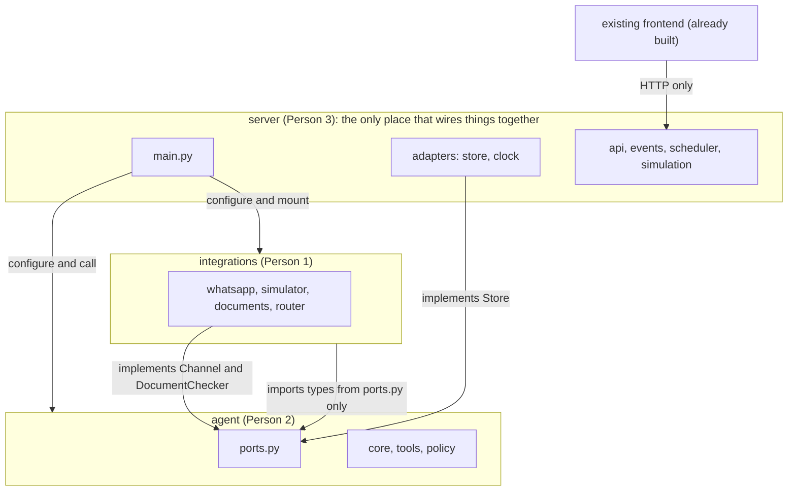
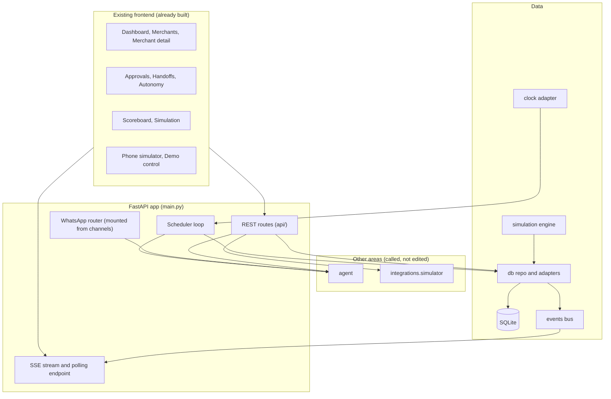
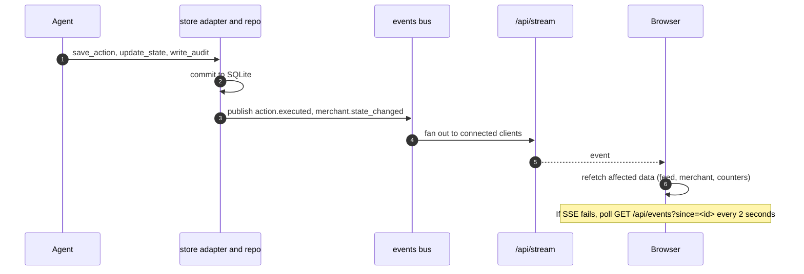
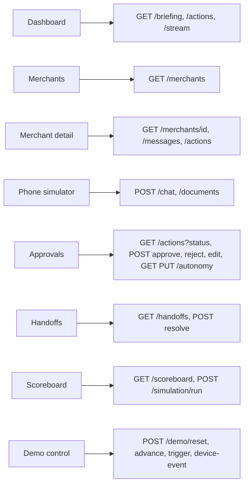
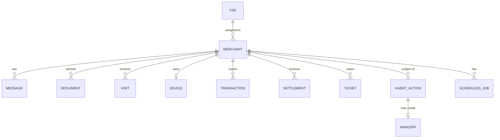

# Paytm Saathi: Platform Build Document (Person 3)

You own everything that stores or serves data and everything that connects the areas: the database, the store adapters, the API, live events, the clock and scheduler, seed data, the simulation, the demo controls, and the end-to-end tests. The frontend is already built, so you do not build it. You make sure the API gives it everything it needs. You also own the repository root.

| | |
|---|---|
| Your folders | `server/`, `e2e/`, `scripts/`, `docs/`, and the root files (`README.md`, `Makefile`, `.env.example`, `CODEOWNERS`, `pyproject.toml`) |
| You must not edit | `agent/`, `integrations/` |
| You import | `agent` and `integrations`, only in `server/main.py`, `server/adapters/`, and tests |
| You provide | Implementations of the agent's `Store` and `Clock`, the Integrations `Store`, the REST API and live stream, seed data, simulation |
| You consume | The agent entrypoints (`agent/__init__.py`), the Integrations simulator functions and webhook router |
| Done when | AT-1 to AT-9 pass end to end through the real frontend, and your tests in section 14 are green |

You are the first dependency for the other two. Ship the database, seed data, and store adapters within the first hours, even if rough.

### Your folder layout

```
server/
├── main.py                  composition root: wires agent and integrations, mounts routers
├── settings.py              server settings
├── .env.example
├── api/
│   ├── router.py
│   └── routes/              briefing, merchants, chat, documents, actions, handoffs, autonomy, scoreboard, simulation, audit, batch, demo, stream, health
├── adapters/
│   ├── agent_store.py       implements agent.ports.Store
│   ├── integrations_store.py  implements integrations.ports.Store
│   └── clock.py             clock with demo offset
├── db/
│   ├── models.py, session.py, repo.py, seed.py
├── events/                  bus, SSE
├── scheduler/               background loop for due jobs
├── simulation/              engine.py, params.py, report.py
├── seed_data/               heroes.json, fses.json
└── tests/                   server tests
e2e/                         acceptance tests AT-1 to AT-9
scripts/                     check_ownership.py, export_openapi.py, make helpers
docs/                        these documents, exported OpenAPI
```

## 1. Repository map and rules (same short section in all three documents)

The project is split into top-level folders. Each folder belongs to exactly one person. There is no shared code folder and no folder that two people edit.

### 1.1 Top-level layout

```
paytm-saathi/
├── agent/            Person 2   decides what Saathi does
├── integrations/     Person 1   talks to WhatsApp and handles documents
├── server/           Person 3   database, API, live events, scheduler, simulation, wiring
├── e2e/              Person 3   end-to-end acceptance tests
├── scripts/          Person 3
├── docs/             Person 3
└── README.md, Makefile, .env.example, CODEOWNERS, pyproject.toml   Person 3
```

The inner layout of each folder is in its owner's document. The frontend is already built and is not a folder in this repo. It only talks to the server's HTTP API.

### 1.2 Dependency rule



| Folder | May import | Never imports |
|---|---|---|
| `agent/` | Itself, standard library, third-party packages | `integrations`, `server` |
| `integrations/` | Itself, and `agent/ports.py` for the boundary types | `agent` internals, `server` |
| `server/` | Everything, because it wires the system | Nothing imports `server` |

### 1.3 How the folders connect without sharing code

- The agent declares what it needs from the outside as small Protocol interfaces in `agent/ports.py` (a store, a channel, a document checker, a clock). The rule: the side that consumes an interface defines it.
- `server/main.py` creates the real implementations and injects them at startup, for example `agent.configure(store=..., channel=..., documents=..., clock=...)` and `integrations.configure(store=..., on_incoming=agent.handle_incoming, clock=...)`.
- Types that cross a boundary live in `agent/ports.py` (they are the agent's inputs and outputs). Integrations imports them from there. Nobody else defines them again.
- Values such as lifecycle states and action types are defined once in `agent/domain/enums.py`. The server and frontend store and show them as plain strings, and a server test checks they match.
- Every folder reads its own settings from its own `settings.py` and ships its own `.env.example`. The root `.env.example` only lists the files to copy.
- If two copies of an interface description disagree, the owner's file wins: `agent/ports.py` for the boundary types and the agent's ports, `integrations/ports.py` for Integrations' own store port.

### 1.4 What you may and may not touch

You may read anything. You may edit only your own top-level folders. If you need a change somewhere else, ask the owner. `CODEOWNERS` and `make check` (which fails if a branch changes files outside the author's folders) enforce this. Branch names start with the area: `agent/…`, `integrations/…`, `server/…`.

### 1.5 Checkpoints (percent of total build time)

| When | Goal |
|---|---|
| Kickoff, first 60 to 90 minutes | Folders created, interface files written and committed, fakes in place, WhatsApp templates submitted |
| About 30% | Each area passes its own tests alone against fakes |
| About 60% | First integration through the phone simulator: AT-1 passes end to end |
| About 75% | AT-2 to AT-6 pass. Live WhatsApp (AT-7) works |
| About 85% | Feature freeze, failure drills (AT-9) |
| Last 15% | Rehearsals, backup recording, real simulation numbers into the deck |

---

## 2. Architecture

### 2.1 What runs where



### 2.2 Live update path



### 2.3 Page to data map



### 2.4 Wiring (`server/main.py`, the only place that connects the areas)

```python
store = AgentStoreAdapter(db)          # server/adapters/agent_store.py, implements agent.ports.Store
istore = IntegrationsStoreAdapter(db)  # server/adapters/integrations_store.py, implements integrations.ports.Store
clock = Clock()                        # server/adapters/clock.py

agent.configure(store=store, channel=integrations.router, documents=integrations.documents, clock=clock)
integrations.configure(store=istore, on_incoming=agent.handle_incoming, clock=clock)

app.include_router(integrations.whatsapp.webhook.router)   # the WhatsApp webhook
app.include_router(api_router, prefix="/api")               # your routes
```

Nothing else imports the agent or integrations packages. If an area needs a new capability from the outside, it adds a method to its own port and you implement it in the matching adapter.

## 3. Config, clock, events, scheduler

### 3.1 Settings (`server/settings.py`) and environment files

Your settings cover only the server: `DATABASE_URL`, `CORS_ORIGINS`, `UPLOAD_DIR`, scheduler tick, simulation defaults, and the hero phone numbers `HERO_PHONE_RAHUL`, `HERO_PHONE_MEENA`, `HERO_PHONE_SUNIL`, `HERO_PHONE_FARIDA`, `HERO_PHONE_VIKRAM`, `HERO_PHONE_POOJA`. The agent keeps its own settings (LLM key and model, thresholds, limits, score weights) in `agent/settings.py` and `agent/.env.example`. Integrations keeps its own (WhatsApp keys, blur threshold) in `integrations/settings.py` and `integrations/.env.example`. The root `.env.example` only tells people to copy the three files. `make setup` does the copying.

### 3.2 Clock (`server/adapters/clock.py`)

| Function | Behaviour |
|---|---|
| `now()` | Real time plus the stored offset |
| `advance(hours)` | Increases the offset. Persists it in `demo_state` |
| `reset()` | Sets the offset to zero |

The clock is injected into the agent and Integrations at startup, so "24 hours later" is demoable without anyone importing from `server`.

### 3.3 Events (`events/`)

`publish(type, merchant_id, data)` stores the event in an `events` table (id, type, merchant_id, data, created_at) and pushes it to connected SSE clients. Types: `message.new`, `action.created`, `action.executed`, `action.blocked`, `approval.pending`, `handoff.created`, `merchant.state_changed`, `document.validated`, `metrics.updated`. Payload carries only ids and small summaries. The frontend refetches details.

### 3.4 Scheduler (`scheduler/`)

A background loop every 5 seconds: `jobs = repo.due_jobs(clock.now())`, mark each running, call `agent.handle_timer(merchant_id, reason)`, mark done or failed. `/demo/advance` moves the clock, then runs the loop once immediately and returns what ran.

## 4. Database

SQLite through SQLAlchemy 2.x, created by `db/models.py`. IDs are short strings (`m_rahul`, or `m_` plus 8 random characters). Timestamps are stored in UTC.

| Table | Columns |
|---|---|
| `fses` | id, name, zone, start_lat, start_lng |
| `merchants` | id, shop_name, owner_name, category, city, area, pincode, lat, lng, language, phone_e164 (unique), preferred_channel, consent (bool), footfall_score, lead_score, score_explanation, state, state_updated_at, fse_id, created_at |
| `messages` | id, merchant_id, direction (in or out), channel, kind (text, media, voice, template), text, event_id (unique, nullable), provider_message_id, intent, sentiment, created_at |
| `documents` | id, merchant_id, doc_type, file_path, quality, sharpness_score, extracted_pan, name_match, issues (json), precheck_passed, kyc_status, kyc_reference, attempts, created_at |
| `visits` | id, merchant_id, fse_id, slot_start, status (scheduled, done, cancelled), cluster_size, created_at |
| `devices` | id, merchant_id, status (none, installed, active), installed_at, first_txn_at |
| `transactions` | id, merchant_id, amount, status (success, failed), created_at |
| `settlements` | id, merchant_id, amount, expected_date, status (paid, delayed, processing), delay_reason |
| `tickets` | id, merchant_id, type, status, assigned_to, resolved_by, created_at, resolved_at |
| `agent_actions` | id, merchant_id, action_type, params (json), reasoning, confidence, source (rule, llm, fallback), autonomy_level, status, guardrail_notes (json), prompt_version, approved_by, rejection_reason, created_at, executed_at |
| `handoffs` | id, merchant_id, action_id, target, reason, summary (json), status (open, resolved), resolution_note, created_at |
| `autonomy_config` | action_type (pk), level, updated_by, updated_at |
| `audit_log` | id, actor, event_type, merchant_id, payload (json), created_at (append-only: no update or delete functions exist) |
| `scheduled_jobs` | id, merchant_id, reason, run_at, status (pending, running, done, failed) |
| `events` | id, type, merchant_id, data (json), created_at |
| `demo_state` | key, value (clock offset and flags) |
| `sim_runs` | id, params (json), seeds, created_at |
| `sim_results` | run_id, metric, arm (manual or saathi), mean, ci_low, ci_high |



## 5. Repository and adapters

`server/db/repo.py` is your own internal data layer. Nothing outside `server/` imports it. The two areas reach the data only through adapters that implement their ports.

| Adapter | Implements | Methods |
|---|---|---|
| `adapters/agent_store.py` | `agent.ports.Store` | `get_merchant_by_phone`, `get_merchant`, `create_lead`, `update_lead_score`, `already_processed`, `save_message`, `save_document`, `update_document_validation`, `get_context_bundle`, `save_action`, `update_action_status`, `update_state`, `create_visit`, `find_nearby_leads`, `get_settlement`, `create_handoff`, `get_autonomy_level`, `set_consent`, `write_audit`, `schedule_job` (signatures in the Agent document, section 2.3) |
| `adapters/integrations_store.py` | `integrations.ports.Store` | `already_processed`, `get_merchant_by_phone`, `get_merchant`, `last_inbound_at`, `save_message`, `write_audit`, `publish_event` (signatures in the Integrations document, section 3.3) |

Rules:

- Adapters convert your database rows into the plain models defined in `agent/ports.py` and `integrations/ports.py`. Never return ORM objects.
- Every write runs in a transaction and publishes the matching event after commit.
- `save_message` with an existing `event_id` returns the existing row and creates nothing. `already_processed` reads the same unique key.
- `get_context_bundle` is one function running a few queries. Counters: contact attempts (outbound intro and followup actions), nudges sent, document re-requests, messages sent today by `clock.now()` date.
- `update_state` rejects transitions that are not legal. Use `agent.domain.lifecycle.is_legal_transition` (you may import it because `server` may import everything).
- `create_handoff` also creates a ticket row and publishes `handoff.created`.
- `write_audit` is the only way to write to `audit_log`.

## 6. Seed data (`db/seed.py`, `server/seed_data/`)

Deterministic: a fixed random seed. `make seed` builds the database. `/demo/reset` restores a pristine copy of it (copy `saathi.seed.db` over `saathi.db`) in under 3 seconds.

### 6.1 Volume

| Item | Spec |
|---|---|
| Merchants | 300 generated plus the 6 heroes. Delhi-NCR: Delhi, Gurugram, Noida, Ghaziabad, with realistic lat and lng clusters (about 10 clusters of 20 to 40 shops) so route grouping works |
| Categories | kirana, chai stall, salon, pharmacy, mobile repair, sweet shop, restaurant, clothing, weighted toward kirana |
| Languages | hindi 55 percent, hinglish 30 percent, english 15 percent |
| States | About 60 percent NEW, 15 percent CONTACTED or ENGAGED, 10 percent DOCS_PENDING or DOCS_VERIFIED, 8 percent ACTIVATING, 7 percent ACTIVATED |
| FSEs | 4, one per zone |
| Transactions | Generated for ACTIVATING and ACTIVATED merchants by category daily volume |
| Settlements | One recent row per ACTIVATED merchant, mostly paid, 10 percent delayed with a reason (bank holiday, bank error, pending verification) |
| Phone numbers | Fake but valid-format numbers such as +919000000001 upward. Hero numbers come from `.env` so real test phones can be used |

### 6.2 Hero merchants (fixed IDs and states at reset)

| ID | Shop, owner | Category, area | Language | State at reset | Extra seed |
|---|---|---|---|---|---|
| m_rahul | Rahul Kirana Store, Rahul Sharma | Kirana, Rohini, Delhi | hindi | CONTACTED | Three other leads in DOCS_VERIFIED within 2 km, so `cluster_size` is at least 4 |
| m_meena | Meena Beauty Salon, Meena Devi | Salon, Sector 18, Noida | hinglish | DOCS_PENDING | Documents requested, zero attempts. Sample files `meena_pan_blurry.jpg` and `meena_pan_clear.jpg` available to the simulator upload |
| m_sunil | Sunil Chai Point, Sunil Yadav | Chai stall, Sector 14, Gurugram | hindi | INSTALLED | Device installed at reset time, zero transactions, a pending `activation_check` job at +24 hours |
| m_farida | Farida Sweets, Farida Khan | Sweet shop, Indirapuram, Ghaziabad | hinglish | ACTIVATED | 42 transactions, settlement of 4,820 rupees, status delayed, reason "bank holiday", expected the next working day |
| m_vikram | Vikram Mobile Repair, Vikram Singh | Mobile repair, Lajpat Nagar, Delhi | hinglish | ENGAGED | Open objection about rental fee |
| m_pooja | Pooja Medical, Pooja Verma | Pharmacy, Sector 62, Noida | english | NEW | None |

For AT-1 (new lead), the test uses an unknown phone such as +919000000099, which makes the Agent create the lead. The "no settlement row" case in AT-4 uses a test-created ACTIVATED merchant without a settlement row.

## 7. API (`server/api/`)

Base path `/api`. JSON. Errors use `{ "error": { "code", "message", "details" } }` with codes `NOT_FOUND`, `VALIDATION_ERROR`, `GUARDRAIL_BLOCKED`, `LLM_UNAVAILABLE`, `TOOL_FAILED`. Routes contain no business logic. They call `repo` for reads and the Agent or Integrations for actions. Generate the OpenAPI JSON with `scripts/export_openapi.py` and keep it in `docs/`.

| Method | Path | Purpose | Calls |
|---|---|---|---|
| GET | `/health` | Status, database ok, LLM configured, WhatsApp configured, clock offset | repo |
| GET | `/briefing` | Overnight counts, today's route, top leads, pending approvals, open handoffs | repo |
| GET | `/merchants` | Filters `state`, `category`, `fse_id`, sort by score, paging | repo |
| GET | `/merchants/{id}` | Profile, state, docs, visits, tickets, score explanation | repo |
| GET | `/merchants/{id}/messages` | Conversation | repo |
| GET | `/merchants/{id}/actions` | Action history with reasoning | repo |
| GET | `/merchants/{id}/next-action` | Preview of the planner proposal | `agent.preview_next_action` |
| POST | `/chat/{merchant_id}/message` | Body `{text}`. Phone simulator sends text | `integrations.simulator.receive_text` |
| POST | `/documents/{merchant_id}` | Multipart image upload | `integrations.simulator.receive_media` |
| GET | `/actions` | Filter by `status`, `merchant_id` | repo |
| POST | `/actions/{id}/approve` | Body `{by, edits?}` | `agent.approve_action` |
| POST | `/actions/{id}/reject` | Body `{by, reason_code}` | `agent.reject_action` |
| GET | `/handoffs` | Filter `target`, `status` | repo |
| POST | `/handoffs/{id}/resolve` | Body `{note}` | repo |
| GET | `/autonomy` | Level per action type | repo |
| PUT | `/autonomy/{action_type}` | Body `{level, by}`. Writes an audit row | repo |
| GET | `/scoreboard` | Live KPIs and funnel counts | repo |
| POST | `/simulation/run` | Body optional parameter overrides. Returns `run_id` | simulation |
| GET | `/simulation/{run_id}` | Metrics, intervals, assumptions | repo |
| GET | `/audit` | Filter by merchant, actor, event type | repo |
| POST | `/agent/run-batch` | Overnight run over ranked leads | `agent.run_batch` |
| POST | `/demo/reset` | Restore seed state, reset clock | db |
| POST | `/demo/advance` | Body `{hours}`. Moves the clock and runs due jobs | clock, scheduler |
| POST | `/demo/trigger/{scenario}` | Scenarios `rahul`, `meena`, `sunil`, `farida`, `vikram`, `pooja`. Resets that merchant to its start state | db |
| POST | `/demo/device-event` | Body `{merchant_id, event: installed or transaction, count?}`. See 7.1 | repo |
| GET | `/stream` | Server-sent events | events |
| GET | `/events` | Polling fallback, parameter `since` | events |

### 7.1 Device events (Platform rules, not the Agent's)

`installed`: device row to installed, `repo.update_state(INSTALLED)` then `ACTIVATING`, and `repo.schedule_job(merchant_id, "activation_check", now + 24h)`. `transaction` with a count: insert that many successful transactions, set `first_txn_at` if empty, and when the total reaches 10 call `repo.update_state(ACTIVATED)`.

### 7.2 Key response shapes

```ts
interface Briefing {
  overnight: { contacted: number; replied: number; docs_uploaded: number;
               precheck_passed: number; visits_booked: number };
  route: { fse_id: string; stops: { merchant_id: string; shop_name: string; slot: string }[] };
  top_leads: MerchantSummary[];
  pending_approvals: number;
  open_handoffs: number;
}
interface AgentActionView {
  id: string; merchant_id: string; shop_name: string; action_type: string;
  autonomy_level: "L1" | "L2" | "L3"; status: string; reasoning: string;
  confidence: number; source: "rule" | "llm" | "fallback"; guardrail_notes: string[];
  text_preview?: string; created_at: string; executed_at?: string;
}
interface HandoffView {
  id: string; merchant_id: string; shop_name: string; target: "fse" | "support";
  reason: string; summary: { headline: string; what_happened: string; sentiment: string;
  objection: string; documents: string; recommended_next_step: string };
  status: "open" | "resolved"; created_at: string;
}
interface Scoreboard {
  counters: { actions_executed: number; pending_approvals: number; blocked: number; handoffs_open: number };
  funnel: { state: string; count: number }[];
  override_rate_by_action: Record<string, number>;
  conversion_rate: number; activation_within_7d: number;
}
interface SimulationResult {
  run_id: string; seeds: number; assumptions: Record<string, number | string>;
  metrics: { name: string; manual: number; saathi: number; relative_lift_pct: number;
             ci_low: number; ci_high: number }[];
}
```

## 8. Live stream

`GET /api/stream` returns `text/event-stream`. Each event: `id`, `event: <type>`, `data: {merchant_id, summary}`. Send a comment heartbeat every 15 seconds. Support `Last-Event-ID` by replaying from the `events` table. The polling endpoint returns events with id greater than `since`, so the frontend can fall back with no code changes elsewhere.

## 9. Demo controls

| Control | Effect | Used for |
|---|---|---|
| Reset | Pristine database, clock offset zero, uploads cleared, cache of demo replies kept | Start of every rehearsal |
| Advance | Add hours to the clock, run due jobs | AT-3 (24 and 48 hours later) |
| Trigger scenario | Put one hero back in its start state without a full reset | Replaying a single scenario |
| Device event | Mark a device installed, add transactions | Showing activation and reaching 10 transactions |
| Run batch | The overnight run | The morning briefing story |

Keep a "slow mode" flag in `demo_state` that adds a short delay before outbound messages so the audience can follow the live feed.

## 10. Supporting the existing frontend

The frontend is already built and lives outside this repo's folders. Your job is to make the API give it everything it needs and to keep the contract stable.

| You provide | Detail |
|---|---|
| The API in section 7 | Stable paths and response shapes (section 7.2). Changes are announced to whoever maintains the frontend |
| CORS | Allowed origins from `CORS_ORIGINS` |
| Live updates | `/api/stream` with `/api/events` as the polling fallback |
| Sample responses | An exported OpenAPI file and a set of example JSON responses for every route in `docs/` so the frontend can be switched from demo data to the real API without guessing |
| Optional static hosting | If the team wants one URL, the built frontend files can be copied into `server/static/` and served by FastAPI. This is a copy step, not new code |

Page to endpoint map, for whoever connects the existing pages:

| Page | On load | Interactions | Live refresh |
|---|---|---|---|
| Dashboard | `/briefing`, `/actions?limit=5`, `/scoreboard` | Scenario list links | Refetch on any action event |
| Merchants | `/merchants?sort=score` | Row opens detail | On `merchant.state_changed` |
| Merchant detail | `/merchants/{id}`, `/messages`, `/actions` | Phone sends call `/chat` and `/documents` | On `message.new`, `action.*` for that merchant |
| Approvals | `/actions?status=pending_approval`, `/autonomy` | Approve, Reject, Edit, level selector (`PUT /autonomy`) | On `approval.pending` |
| Handoffs | `/handoffs` | Resolve | On `handoff.created` |
| Scoreboard | `/scoreboard`, latest `/simulation/{id}` | Run simulation | On `metrics.updated` |
| Demo control | none | Reset, advance, trigger, device events | n/a |

Rules the frontend should follow, which you can check in the end-to-end runs: no business logic in the page, every number labelled "live (demo data)" or "simulated", and loading, empty and error states on every page.

## 11. Simulation (`server/simulation/`)

### 11.1 Purpose

Produce Saathi versus manual numbers on synthetic data for the deck and the Scoreboard. It is a projection from stated assumptions, not Paytm data, and it never touches live tables (it uses its own in-memory population).

### 11.2 Design

- Population: N leads (default 300). Each lead has hidden traits drawn from the seed: category, a conversion propensity (fixed per lead and identical in both arms), a reply tendency, and a doc-completion tendency.
- Time: 30 daily steps. Each lead moves through lead, contacted, documents complete, installed, active (10 transactions). Transition probabilities depend on the lead's traits and on the arm's behaviour parameters.
- Two arms run on the same lead pool and the same random draws per lead, so only workflow behaviour differs.
- Repeat over many random seeds (default 30). Report the mean and a 95 percent interval per metric.

### 11.3 Parameters (`simulation/params.py`, every number is an assumption and is commented as one)

| Parameter | Manual | Saathi |
|---|---|---|
| Probability of first contact within 1 hour | 0.25 | 0.95 |
| Median days to first contact | 2.0 | 0.1 |
| Maximum follow-up attempts | 2 | 4 |
| Document completion after a re-request | 0.40 | 0.60 |
| Median days to complete documents | 4 | 2 |
| Probability an activation nudge is sent | 0.15 | 0.90 |
| Tier-1 tickets resolved without a human | 0.00 | 0.50 |
| FSE share of time on admin | 0.50 | 0.25 |

### 11.4 Metrics

| Metric | Definition |
|---|---|
| Contacted within 1 hour | Leads contacted in the first hour divided by all leads |
| Lead-to-onboarded conversion | Leads reaching INSTALLED divided by all leads |
| Activated within 7 days | Installed devices reaching 10 successful transactions within 7 days |
| Tier-1 tickets resolved without a human | Tickets closed by the agent divided by all tier-1 tickets |
| FSE admin time | Share of FSE time on non-visit work |
| Cost per activated merchant | (FSE cost plus agent cost) divided by activated merchants, using cost inputs in `params.py` |

Relative lift is (Saathi minus manual) divided by manual. The default parameters give roughly the numbers on the pitch slide (contact 25 to 95 percent, onboarding 20 to 26, activation 38 to 47, tickets 0 to 50, admin 50 to 25). If your real run differs, update the deck with your run's numbers. Never edit results by hand.

## 12. Tooling: Makefile, ownership check, CODEOWNERS

| Target | Does |
|---|---|
| `make setup` | Install dependencies and copy each area's `.env.example` |
| `make seed` | Build the seeded database and the pristine copy |
| `make dev` | Run the API (port 8000) |
| `make tunnel` | Print the command to start the tunnel (Integrations) |
| `make test` | Run all test folders |
| `make e2e` | Run `tests/e2e/` scenarios AT-1 to AT-9 |
| `make sim` | Run the simulation and print the metrics table |
| `make check` | Run `scripts/check_ownership.py` |

`scripts/check_ownership.py`: reads `OWNER` (`integrations`, `agent`, or `platform`), lists files changed versus `origin/main`, and fails if any file is outside that owner's top-level folders (`integrations/`, `agent/`, or `server/`, `e2e/`, `scripts/`, `docs/` and the root files for Platform). It also fails if `agent/` imports `integrations` or `server`, or if `integrations/` imports anything from `agent/` other than `ports.py` and `domain/enums.py` (a simple import scan).

`CODEOWNERS` maps `agent/` to Person 2, `integrations/` to Person 1, and everything else to Person 3.

## 13. Build order

1. Repo skeleton with the top-level folders, Makefile, root `.env.example`, CODEOWNERS, and the ownership script. Commit section 1 of this document. Ask Person 2 and Person 1 to commit their `ports.py` files so you can write the adapters.
2. Models, session, seed script with the six heroes, `repo.py` basics, and the two store adapters. Tell the others the data layer is ready.
3. API skeleton and `/health`, `/merchants`, `/chat`, `/actions`. Export the OpenAPI file early so the frontend owner can start connecting.
4. Events bus, SSE, polling endpoint.
5. Clock, scheduler, demo routes (reset, advance, trigger, device event).
6. Approvals, handoffs, autonomy, briefing, scoreboard endpoints.
7. Support the frontend connection: example responses, CORS, and a contract check against each page's calls (Merchant detail first, then Approvals, Handoffs, Dashboard).
8. Simulation engine, endpoints, Scoreboard hookup.
9. E2E tests, failure drills, rehearsal support, ownership script.

## 14. Tests and success criteria

### 14.1 Automated tests (folder `server/tests/`)

| ID | Test | Expected |
|---|---|---|
| PL-01 | Create schema and run the seed twice | Same counts and same hero data. 306 merchants. Phone numbers unique. Every seeded state and action value exists in `agent/domain/enums.py` |
| PL-02 | Repo: `save_message` with the same `event_id` twice | One row |
| PL-03 | Repo: illegal state transition | Rejected with a clear error |
| PL-04 | Repo: `get_context_bundle` for each hero | All fields present. Counters correct |
| PL-05 | Repo: audit log | No update or delete function exists. Every write path appends a row |
| PL-06 | Clock: advance 24 hours | `now()` moves 24 hours. Reset returns to zero |
| PL-07 | Scheduler: job due after advance | `handle_timer` called once and the job marked done |
| PL-08 | API contract: every route in section 7 | Status codes and response shapes match the TypeScript shapes. OpenAPI exported |
| PL-09 | SSE: publish an event | A connected client receives it. Reconnect with `Last-Event-ID` replays missed events |
| PL-10 | Polling endpoint with `since` | Returns only newer events |
| PL-11 | Demo reset | Restores the seed in under 3 seconds and clears uploads |
| PL-12 | Device event: installed then 10 transactions | State goes INSTALLED, ACTIVATING, ACTIVATED. Job scheduled |
| PL-13 | Autonomy PUT | Level stored, audit row written, next guardrail read sees it |
| PL-14 | Simulation determinism | Same parameters and seeds give identical output |
| PL-15 | Simulation sanity | With default parameters Saathi is at least manual on contact, onboarding, activation, and tickets. Intervals are present |
| PL-16 | Ownership script | Fails on an out-of-area change, passes on an in-area change |

### 14.2 End-to-end tests (folder `e2e/`)

One test per acceptance test AT-1 to AT-9, run against the real app with the real agent when the key is available, and with the agent's cached or mocked model otherwise. Each test resets the demo state first, drives the flow through the API (`/chat`, `/documents`, `/demo/*`), and asserts on the database and the API responses, not on screenshots. `make e2e` prints one pass or fail line per AT.

### 14.3 Acceptance tests (the demo is only done when these pass)

| ID | Scenario | Pass criteria |
|---|---|---|
| AT-1 | New lead (unknown phone) asks "Soundbox lena hai, fees kya hain?" through the simulator | Merchant created in NEW then ENGAGED. Reply contains the fee from `fees.md` and the audit row names that source. Action ANSWER_QUERY, L3, executed. Messages in and out stored. Dashboard feed shows it |
| AT-2 | Meena sends a blurry then a clear PAN photo | First: re-request sent, attempts 1, state DOCS_PENDING. Second: pre-check passes, mock KYC submitted, state DOCS_VERIFIED, then a visit is booked with `cluster_size` of at least 2 and state VISIT_SCHEDULED |
| AT-3 | Sunil installed, no transactions, clock advanced 24 and 48 hours | Nudge 1 sent (L3). Nudge 2 sent. The next check escalates: handoff for the FSE, state AT_RISK, summary non-empty |
| AT-4 | Farida: "Mera settlement nahi aaya" | `check_settlement` called. Reply has the expected date and delay reason from the tool. With no settlement row the case is escalated to support |
| AT-5 | Vikram demands a discount, then asks for a manager | OFFER_DISCOUNT held as `pending_approval` (L2) with a holding reply. Then ESCALATE creates a handoff with summary. Approve executes and logs. Reject logs an override |
| AT-6 | Manager sets SEND_ACTIVATION_NUDGE to L2 | The next nudge is `pending_approval` and nothing is sent until approved |
| AT-7 | Live WhatsApp: a real phone sends the AT-1 message | Reply on the phone in under 10 seconds. Duplicate webhook deliveries create no duplicate replies |
| AT-8 | Reset and replay | `/api/demo/reset` in under 3 seconds. All six heroes replay without manual database edits. Scoreboard and simulation load with assumptions visible |
| AT-9 | Failure drills | LLM timeout: fallback used, no crash. WhatsApp unreachable: simulator works. Quiet hours block outbound sending. Unknown number creates a lead. Opt-out stops all outbound messages |

### 14.4 Success criteria for your area

- `make seed && make dev` gives a working app with all pages populated.
- `/demo/reset` in under 3 seconds. The whole six-hero replay in under 60 seconds.
- Every API route matches the contract. The frontend runs without console errors against the real API.
- Live feed updates within 2 seconds of an agent action.
- Scoreboard shows live counters and a simulation run with visible assumptions.
- AT-1 to AT-9 pass in `make e2e`.

## 15. Mocks you provide, and risks

| You provide | Used by |
|---|---|
| The store adapters and a seeded database (first priority) | Agent, Integrations |
| `/demo/*` endpoints | Everyone, for rehearsals |

| Risk | Handling |
|---|---|
| Others blocked on the database | Ship a rough schema and repo within the first hours. Refine later |
| Frontend and API drift | Types copied from section 7.2. Contract test PL-08 |
| SSE flaky on venue Wi-Fi | Polling fallback built in |
| Reset too slow | Copy-a-file reset, not re-seeding |
| Simulation numbers questioned | Show the assumptions table on the same screen. Deterministic seeds |
| Merge conflicts in `main.py` | You alone edit it. Others ask you to mount routers or wire something |

## 16. Instructions for an AI coding assistant working in this area

1. You may edit only the Platform folders: `server/`, `e2e/`, `scripts/`, `docs/`, and the root files. Do not create or change files in `agent/` or `integrations/`.
2. `server/main.py` and `server/adapters/` are the only places that import from `agent/` and `integrations/`. Everything else in `server/` stays independent of them, except tests.
3. Other areas never import from `server/`. They receive implementations through `configure(...)`. Never expose ORM objects, and never add shared code folders.
4. Routes contain no business logic. Call `repo`, the Agent, or Integrations.
5. The audit log is append-only.
6. Always use `server/adapters/clock.py` for time, never the system time.
7. Every number shown must be labelled live or simulated. Never present simulated results as Paytm data.
8. Keep data synthetic. No real personal data.
9. A task is done only when its PL tests pass and the contract test PL-08 still passes.
